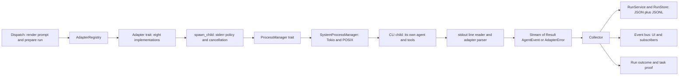
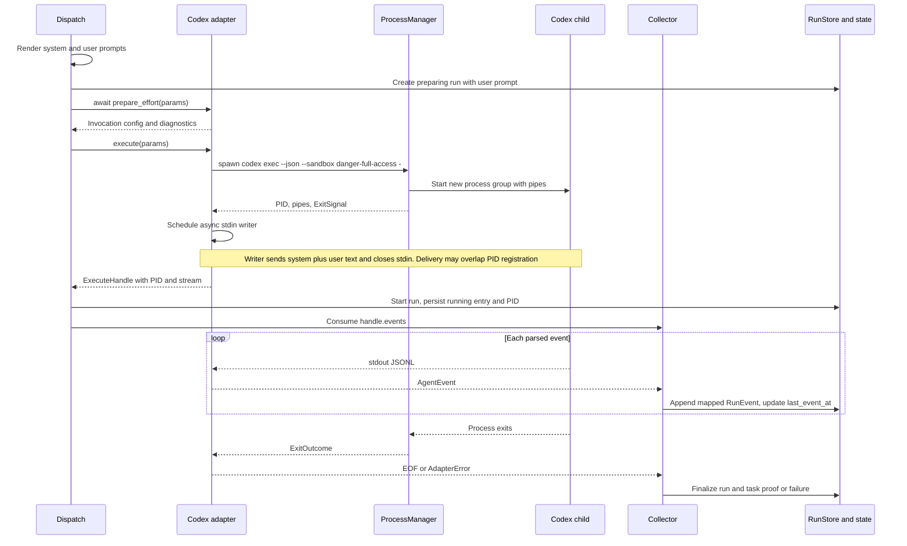
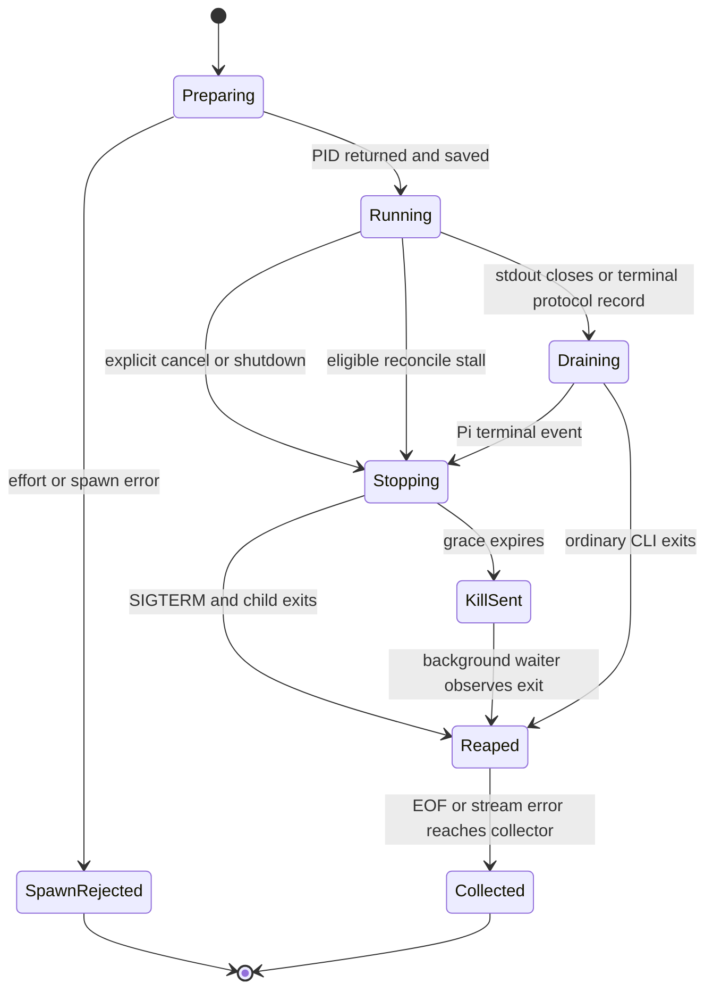

# Driving agent CLIs

Version 1. Code baseline: **`40a6dc7` (v0.10.0)**. Every source citation below is pinned to
`40a6dc78a8bd305ac00163282629c50855616788`; it describes this checkout, not a promise about the latest
provider CLI. Examples are existing repository fixtures, not fresh provider sessions. Scheduling, task
handoffs, goals and pause/resume of orchestration belong in `docs/internal/orchestration.md`.

## Q6. How does an agent drive the agent CLI?

**The orchestrator drives a child process through an adapter.** It renders the task's prompt, chooses the
adapter registered for the agent, and calls `execute`. That call returns the real child PID and an async
stream immediately. The orchestrator records the PID before consuming the stream. It does not embed the
provider's agent loop: the CLI owns that loop inside the child process.
[adapter.rs:201 @40a6dc7][src1] [dispatch.rs:741 @40a6dc7][src2]
[dispatch.rs:850 @40a6dc7][src3]

### Components and boundaries



The diagram's boundaries follow the port traits, the common spawn helper and the collector. The adapter
registry preserves insertion order and replaces a duplicate kind. Registration order is Claude, OpenCode,
Codex, Cursor, Pi, Grok, Antigravity, Shell. `AgentEventKind` lives in **orch-core**, not orch-domain;
orch-domain owns the persisted `RunEventType` and `Run`.
[adapter.rs:51 @40a6dc7][src4] [adapter.rs:292 @40a6dc7][src5]
[registry.rs:18 @40a6dc7][src6] [spawn.rs:110 @40a6dc7][src7]
[run.rs:57 @40a6dc7][src8] [collect.rs:159 @40a6dc7][src9]

| Boundary | Owner and contract | Failure behavior |
|---|---|---|
| Dispatch → adapter | `ExecuteParams`: user prompt, optional system prompt, workspace, environment overlay/inheritance policy, invocation-local `AgentConfig`, cancellation token | Preparation/spawn rejection goes through `fail_before_spawn`; it is not left as a successfully launched run. |
| Adapter → process manager | Executable plus separate argv strings and `SpawnOptions`; manager returns pipes, PID and cloneable `ExitSignal` | Spawn is fallible; exit notification is separate from stdout EOF. |
| Adapter → collector | `BoxStream<Result<AgentEvent, AdapterError>>`; each event has kind, timestamp, arbitrary JSON data, optional tokens and error classification | An `Ok(Error event)` is observable output; an `Err(AdapterError)` ends collection as failure. |
| Collector → storage/UI | Map kind to `RunEventType`, serialize/cap data, append event, update activity time, emit selected bus events | Append failure propagates; dispatch logs collector failure. This is not a transactional write across log, state and bus. |

Sources for the table: [adapter.rs:176 @40a6dc7][src10] [process.rs:153 @40a6dc7][src11]
[process.rs:176 @40a6dc7][src12] [dispatch.rs:782 @40a6dc7][src13]
[collect.rs:91 @40a6dc7][src14] [collect.rs:235 @40a6dc7][src15]
[dispatch.rs:895 @40a6dc7][src16]

### Every Adapter method

| Method | Who calls it, and when | What it guarantees |
|---|---|---|
| `kind(&self) -> &'static str` | Registry on registration; doctor when naming checks; dispatch when selecting effort diagnostics | Stable adapter key; no process I/O. |
| `test(&self) -> AdapterTestResult` (async) | `DoctorService::run_all`, sequentially in registry order | Usually runs `<binary> --version`. This checks executable/version response, not authentication or a model invocation. Cursor tries two names; Shell reads the first Bash version line. |
| `prepare_effort(&self, &ExecuteParams) -> Result<EffortPreparation, AdapterError>` (async) | Local dispatch before `execute` | Default is an identity config copy with no I/O. Only OpenCode overrides it. The dispatcher checks allowed changes; preparation is invocation-local, not an edit to the stored agent. |
| `execute(&self, ExecuteParams) -> Result<ExecuteHandle, AdapterError>` (**synchronous**) | Local dispatch after preparation | Spawns and returns `{pid, events}` before collection. Stderr draining, cancellation watcher and child reaper are installed without waiting for the collector. Shell's missing-command path is a documented exception: PID 0 and one error event, no child. |
| `stop(&self, pid) -> Result<()>` (async) | Available to adapter callers; the local orchestrator's cancel/stop paths instead call `ProcessManager::kill_with_grace` directly | Each adapter implementation delegates to a 10-second graceful kill and returns `Ok(())`; it is not a confirmed-death receipt. |

Sources: [adapter.rs:265 @40a6dc7][src17] [adapter.rs:310 @40a6dc7][src18]
[doctor_service.rs:92 @40a6dc7][src19] [dispatch.rs:795 @40a6dc7][src20]
[dispatch.rs:1131 @40a6dc7][src21] [cursor.rs:97 @40a6dc7][src22]
[shell.rs:197 @40a6dc7][src23] [shell.rs:219 @40a6dc7][src24]
[claude.rs:405 @40a6dc7][src25] [orchestrator.rs:946 @40a6dc7][src26]
[recovery.rs:621 @40a6dc7][src27] [manager.rs:108 @40a6dc7][src28]

### One run, from prepared task to outcome

This sequence uses Codex as the concrete transport. Other adapters change the prompt delivery and parser,
not the dispatch/collection boundary. A `Done` record is not the same as process exit; the shared stream
continues reading and waits for exit before the collector finishes.
[codex.rs:356 @40a6dc7][src29] [util.rs:144 @40a6dc7][src30]



Sequence evidence: prompt assembly and run creation [dispatch.rs:550 @40a6dc7][src31];
stdin [codex.rs:73 @40a6dc7][src32]; PID publication
[dispatch.rs:866 @40a6dc7][src33]; reaper
[manager.rs:168 @40a6dc7][src34]; collection
[collect.rs:81 @40a6dc7][src35].

## Q7. How does the agent send request, response, tool call?

**The request crosses into the child as argv, stdin, a temporary prompt file, or an environment value.
Responses and tool observations come back on stdout; stderr is a separate diagnostic stream. r-orch does
not execute the tool calls described by those events.** The adapter parses them and the collector logs
and displays them, sometimes extracting changed-file paths. The CLI's own tool implementation performs
the operation. Shell is the explicit command-running adapter: it runs the configured Bash command,
not commands decoded from output events.
[codex.rs:52 @40a6dc7][src36] [pi.rs:133 @40a6dc7][src37]
[claude.rs:363 @40a6dc7][src38] [shell.rs:234 @40a6dc7][src39]
[collect.rs:176 @40a6dc7][src40]

### Directions and formats

| Direction | Data | Format and handling |
|---|---|---|
| r-orch → CLI | Startup configuration | Separate argv elements, environment overlay, cwd. This is not a shell-joined command, except for Shell's explicit `bash -lc <command>`. |
| r-orch → Claude/Codex | Task prompt | Plain text stdin, then EOF. Claude's system prompt is a file path in argv; Codex prepends system text to user text with two newlines. |
| r-orch → Pi | One prompt request | JSONL `{id, type: "prompt", message}`; ID is `orch-<clock milliseconds>`. Flush stdin and keep it open for this run. System governance is argv `--append-system-prompt`. |
| CLI → r-orch | Assistant/tool/lifecycle output | JSON per stdout line for Claude, Codex, Pi, OpenCode, Cursor, Grok; plain lines for Antigravity and Shell. |
| CLI → r-orch | Diagnostics | Tail, discard or stream policy described under Q9; stderr is never parsed as tool instructions. |
| r-orch → CLI | Cancellation | OS signals to the process group, not a tool-result reply or conversational message. |

Sources: [manager.rs:129 @40a6dc7][src41] [claude.rs:78 @40a6dc7][src42]
[codex.rs:373 @40a6dc7][src43] [util.rs:40 @40a6dc7][src44]
[pi.rs:105 @40a6dc7][src45] [pi.rs:133 @40a6dc7][src37]
[antigravity.rs:81 @40a6dc7][src46] [shell.rs:97 @40a6dc7][src47]
[spawn.rs:169 @40a6dc7][src48] [spawn.rs:145 @40a6dc7][src49].
The Q10 matrix gives the remaining exact transports and argv.

### Normalized kinds, deliberately imperfect payload normalization

`AgentEventKind` has six variants. The canonical payload is a guide for consumers, not a schema enforced
on every adapter: Claude/Cursor preserve message objects or strings, and OpenCode can emit a bare text
string. Consumers must not assume every output has `data.text`.
[adapter.rs:51 @40a6dc7][src4] [adapter.rs:121 @40a6dc7][src50]
[util.rs:294 @40a6dc7][src51] [opencode.rs:234 @40a6dc7][src52]

| Adapter kind | Persisted RunEventType | Canonical useful fields |
|---|---|---|
| `Output` | `agent_output` | `text`, optional `raw` |
| `FileChange` | `file_changed` | `paths: string[]`, optional `raw` |
| `Command` | `command_run` | `command`, optional `result`, `raw` |
| `ToolCall` | `tool_call` | `name`, optional `input`, `raw` |
| `Error` | `error` | `message`, optional `raw`; classification is separate on `AgentEvent` |
| `Done` | `done` | optional `result`, `raw`; usage is separate on `AgentEvent` |

Mapping and envelope: [adapter.rs:86 @40a6dc7][src53] [adapter.rs:121 @40a6dc7][src50].

### Annotated real event samples

The following JSONL lines are copied verbatim from the pinned fixtures. They are repository test inputs
with documented upstream-test provenance, not a claim that a current live provider emitted them today.
The fixture suite replays them through the actual adapters over scripted child pipes and compares whole
events, omitting timestamps. [README.md:1 @40a6dc7][src54]
[adapter_fixtures.rs:54 @40a6dc7][src55]

**Claude: tool observation, then completion.** Source lines 2–4:
[session.jsonl:2 @40a6dc7][src56]

```jsonl
{"type": "tool_use", "name": "read", "input": {"path": "src/index.ts"}}
{"type": "tool_result", "content": "export const a = 1;"}
{"type": "result", "subtype": "success", "usage": {"input_tokens": 100, "output_tokens": 50, "cache_read_input_tokens": 10}}
```

These map to `ToolCall`, `Output`, `Done`. The final event carries normalized usage, but **no `result`
string exists in this sample**. The adapter does not manufacture one from `subtype: success`.
[util.rs:293 @40a6dc7][src57]

**Codex: a command already executed by Codex.** Source line 6:
[session.jsonl:6 @40a6dc7][src58]

```jsonl
{"type": "item.completed", "item": {"type": "command_execution", "command": "ls", "aggregated_output": "file.txt\n", "exit_code": 0}}
```

This becomes `Command` with `command: "ls"`, `result: "file.txt\n"` and the item under `raw`.
The embedded command exit code is not the Codex process exit code. r-orch records the observation;
it does not run `ls` a second time. [codex.rs:192 @40a6dc7][src59]
[collect.rs:235 @40a6dc7][src15]

**Pi: tool start and terminal transcript.** Source lines 5 and 9, noncontiguous excerpts:
[session.jsonl:5 @40a6dc7][src60] [session.jsonl:9 @40a6dc7][src61]

```jsonl
{"type": "tool_execution_start", "toolName": "read", "args": {"path": "src/foo.ts"}}
{"type": "agent_end", "messages": [{"role": "assistant", "content": [{"type": "text", "text": "Implementation complete."}], "usage": {"input": 42, "output": 17, "reasoning": 3, "cache_read": 5, "cache_write": 0}}]}
```

The first becomes `ToolCall` with `name`, `input`, `raw`. The terminal frame selects the last assistant
message, joins text content and emits `Done.result = "Implementation complete."`. This old-style frame
has no `willRetry` key, so it can complete immediately; a frame with that key waits for `agent_settled`.
[pi.rs:244 @40a6dc7][src62] [pi.rs:444 @40a6dc7][src63]
[pi.rs:705 @40a6dc7][src64]

**OpenCode: an intermediate step is not completion.** Source lines 4–5:
[session.jsonl:4 @40a6dc7][src65]

```jsonl
{"type": "step_finish", "part": {"type": "step-finish", "reason": "tool-calls", "tokens": {"total": 500, "input": 400, "output": 100}}}
{"type": "step_finish", "part": {"type": "step-finish", "reason": "stop", "tokens": {"total": 14502, "input": 12416, "output": 2, "reasoning": 0}, "cost": 0}}
```

The first is dropped. The second becomes `Done` with the part as data. Usage is recomputed from
input/output/reasoning, not the provider's `total`; `cost` remains payload data and is not a normalized
price measurement. [opencode.rs:196 @40a6dc7][src66]
[opencode.rs:266 @40a6dc7][src67] [run.rs:101 @40a6dc7][src68]

### What counts as “the result”?

The collector prefers the latest string `Done.data.result`; otherwise it uses the latest nonblank
`Output.data.text` or `Output.data.message` string. It does **not** unpack arbitrary content arrays or
bare strings. Consequently Shell's plain-string output, OpenCode's bare text and some Claude/Cursor
message shapes do not populate that fallback. This is a narrower contract than “last thing printed”.
[collect.rs:141 @40a6dc7][src69] [collect.rs:176 @40a6dc7][src40]
[shell.rs:119 @40a6dc7][src70] [opencode.rs:234 @40a6dc7][src52]

The result becomes `task.proof.agent_summary`, capped at 2,000 characters; file changes come from explicit
`FileChange` events, recognized write tool calls, or a worktree diff when no paths were reported. The
run record itself stores status, prompt, PID, error and usage, not a separate result field. A normal EOF
without a stream error enters the success handler even without `Done`; task review/approval happens
outside the CLI run and is explained in `docs/internal/orchestration.md`.
[orchestrator.rs:92 @40a6dc7][src71] [collect.rs:213 @40a6dc7][src72]
[collect.rs:354 @40a6dc7][src73] [run.rs:59 @40a6dc7][src74]
[collect.rs:108 @40a6dc7][src75]

### What gets persisted?

The `RunService` creates a `preparing` record, later marks it `running` with PID, then finishes it.
`RunStore` writes `.orchestry/runs/<run-id>.json` and sibling `<run-id>.jsonl`. Dispatch persists
`RenderedPrompt.prompt` (the user half in split mode); it does **not** persist the separate system half
in the run record. Thus a run JSON alone cannot reconstruct the exact complete model input.
[run_service.rs:72 @40a6dc7][src76] [run_service.rs:99 @40a6dc7][src77]
[run_service.rs:141 @40a6dc7][src78] [paths.rs:144 @40a6dc7][src79]
[run.rs:81 @40a6dc7][src80] [dispatch.rs:622 @40a6dc7][src81]

For collected events, `RunEvent.data` is a **string containing serialized/truncated event data**, not
necessarily a JSON object. Append precedes the activity-clock update and bus emission. Output/tool calls
become `AgentOutput` on the bus; file changes and errors get dedicated events; commands and done records
are stored without a corresponding branch-specific bus event here. The original `AgentEvent` can also
reach an optional event tap before truncation.
[collect.rs:167 @40a6dc7][src82] [collect.rs:235 @40a6dc7][src15]

## Q8. How does the agent maintain the conversation with the CLI tool?

**r-orch does not resume a provider conversation between runs. All eight adapters spawn anew and pass no
`--resume`, `--continue`, session or thread selector.** Pi keeps stdin open within one run, but terminates
that RPC process at completion rather than retaining it for the next task. A Codex `thread.started` ID
or OpenCode `sessionID` in stdout is not saved as a resume handle. This describes r-orch's behavior;
it does not assert that an external CLI never reads its own local config or project files.
[claude.rs:78 @40a6dc7][src42] [codex.rs:52 @40a6dc7][src36]
[pi.rs:105 @40a6dc7][src45] [pi.rs:713 @40a6dc7][src83]
[opencode.rs:178 @40a6dc7][src84] [cursor.rs:64 @40a6dc7][src85]
[grok.rs:60 @40a6dc7][src86] [antigravity.rs:59 @40a6dc7][src87]
[shell.rs:234 @40a6dc7][src39] [codex.rs:130 @40a6dc7][src88]

### Memory is rebuilt as input

Each dispatch prepares a workspace and builds context from the task, the agent's role, team roster,
project, current attempt, relevant shared context, drained mailbox, reviewer feedback and linked goal.
Library skills are loaded and rendered into the prompt. These are fresh reads/projections, not an
incremental chat transcript sent to an existing child.
[dispatch.rs:413 @40a6dc7][src89] [dispatch.rs:452 @40a6dc7][src90]
[dispatch.rs:550 @40a6dc7][src31] [context.rs:162 @40a6dc7][src91]

| Carries forward | How | What does not automatically carry forward |
|---|---|---|
| Task and goal state, feedback, role and skills | Re-rendered at dispatch | Provider conversation objects, internal reasoning, or a live previous process |
| Messages | Mailbox drained for this agent/task before rendering | Automatic delivery of later messages into the already-running stdin conversation |
| Shared context | Relevance-ranked selection, at most 15 entries; selected keys/values kept whole | Every context entry when there are more than 15 |
| Retry evidence | Latest failed run by `finished_at`; last 50 stored events filtered to output/error and joined | Full previous transcript, successful-run history, or tool events excluded by that filter |
| Files | The workspace path prepared for the task | A guarantee that a new task gets the same workspace or that external CLI caches are portable |

Sources: [dispatch.rs:425 @40a6dc7][src92]
[dispatch.rs:452 @40a6dc7][src90] [context.rs:75 @40a6dc7][src93]
[template.rs:214 @40a6dc7][src94] [run_service.rs:23 @40a6dc7][src95]
[run_service.rs:193 @40a6dc7][src96] [dispatch.rs:413 @40a6dc7][src89].

Normal mode usually renders separate system/user templates and appends loaded skills to the system
half. A legacy custom `prompt.template` produces one combined prompt with skills appended. Native system
handling differs by adapter: Claude uses a file; Pi appends to its harness prompt; Grok overrides its
system prompt; Codex/OpenCode/Cursor prepend text; Antigravity prepends with a per-agent fallback;
Shell receives the combined text in its environment. See Q10 for exact fallbacks.
[render.rs:105 @40a6dc7][src97] [util.rs:40 @40a6dc7][src44]
[claude.rs:125 @40a6dc7][src98] [pi.rs:115 @40a6dc7][src99]
[grok.rs:87 @40a6dc7][src100] [codex.rs:373 @40a6dc7][src43]
[opencode.rs:188 @40a6dc7][src101] [cursor.rs:83 @40a6dc7][src102]
[antigravity.rs:59 @40a6dc7][src87] [shell.rs:240 @40a6dc7][src103]

### Token eco mode changes presentation, not sessions

Dispatch captures the agent override or the refreshed project `prompt_mode` before rendering. Remote
execution/mirrors bypass this selection. Eco uses separate templates, rejects custom prompt templates,
keeps the own role/skills in full, and replaces other agents' full roles with bounded roster hints.
Shared context is in the **user** half; stable governance/roster/own-role blocks are in the system half.
The compact prompt instructs the agent to fetch full records before specified routing/retry/goal decisions.
[dispatch.rs:520 @40a6dc7][src104] [dispatch.rs:914 @40a6dc7][src105]
[render.rs:66 @40a6dc7][src106] [eco.rs:75 @40a6dc7][src107]
[eco_system.liquid:30 @40a6dc7][src108] [eco_user.liquid:1 @40a6dc7][src109]

Eco bounds role hints to 192 UTF-8 bytes, goal previews to 40 rows/12,288 bytes, and retry output to
8,192 bytes with a 2,048-byte head only when a stable source run ID is available. Otherwise retry output
stays whole. Selected context, goal progress, inbox, own role/skills and task text stay whole. These are
presentation bounds, not deletion of persisted evidence, and neither lower the configured model/effort
nor introduce a session-resume flag.
[eco.rs:8 @40a6dc7][src110] [eco.rs:30 @40a6dc7][src111]
[eco.rs:118 @40a6dc7][src112] [dispatch.rs:432 @40a6dc7][src113]
[dispatch.rs:766 @40a6dc7][src114] [effort.rs:11 @40a6dc7][src115]

Related design intent: [ADR 0010](../decisions/0010-prompt-mode-and-effort-contract.md), whose status at
this baseline is still `proposed`, plus the [eco spec](../specs/2026-10-22-token-eco-mode.md) and
[plan](../plans/2026-10-22-token-eco-mode.md). Runtime statements above are based on code; these documents
contain verification history and pending items, not additional runtime guarantees.

## Q9. Any other important factors when driving the CLI?

**Treat startup, output and completion as separate failure boundaries.** A process can start but never
finish; it can report a tool error and still finish; its output can be truncated before parsing; and its
configured permissions are not the same as r-orch's task-review policy.
[util.rs:144 @40a6dc7][src30] [line_reader.rs:18 @40a6dc7][src116]
[collect.rs:380 @40a6dc7][src117]

### Environment, working directory and permissions

The manager applies `params.workspace` as cwd and starts a new POSIX **process group** using
`process_group(0)` (not a new `setsid` session). stdout/stderr are always pipes; stdin is a pipe only
where requested. Local runs inherit the parent environment, then apply agent `config.env`, with
`ORCH_AGENT_ID`, `ORCH_AGENT_NAME`, `ORCH_TASK_ID` overwritten by dispatch. There is no general clean-env
or provider-variable stripping pass for local runs.
[manager.rs:129 @40a6dc7][src41] [dispatch.rs:744 @40a6dc7][src118]

Remote mirrors use `WithoutSecrets`: a name-based credential denylist on inherited variables, with exact
allowlisted names from `ORCH_REMOTE_ENV_PASSTHROUGH`. The explicit config overlay still wins. It is not
complete secret isolation: the code explicitly notes innocently named secret values such as database
URLs are not caught. The cwd is an execution location, not a sandbox.
[process.rs:55 @40a6dc7][src119] [process.rs:109 @40a6dc7][src120]
[manager.rs:142 @40a6dc7][src121]

The adapters' permission flags are fixed by their argv builders; they do not translate
`approval_policy` into a live approval conversation. For example, Claude always skips permissions,
Codex requests `danger-full-access`, Cursor uses `--yolo --trust`, and Grok bypasses/always-approves.
Pi and OpenCode add no approval flag here. r-orch reads `approval_policy == Auto` when deciding task
auto-approval after the run. Do not interpret `manual` task review as a provider tool sandbox.
[claude.rs:83 @40a6dc7][src122] [codex.rs:54 @40a6dc7][src123]
[cursor.rs:66 @40a6dc7][src124] [grok.rs:62 @40a6dc7][src125]
[pi.rs:105 @40a6dc7][src45] [opencode.rs:178 @40a6dc7][src84]
[collect.rs:380 @40a6dc7][src117]

### Model and effort selection

The tables below describe the **checked-in mapping**, not an independent claim about provider model
availability. A stored model generally passes through unchanged. Tier names are resolved for new
selections, not re-resolved during each run. An unset model is different from a literal empty string;
argv builders commonly test `Option::Some`, so they can forward an explicitly empty configured value.
[model_tiers.rs:111 @40a6dc7][src126] [effort.rs:11 @40a6dc7][src115]
[codex.rs:62 @40a6dc7][src127]

| Adapter | `capable` / `balanced` / `fast` static choices | Effort emitted by adapter |
|---|---|---|
| Claude | `claude-opus-5-5` / `claude-sonnet-5-5` / `claude-haiku-5-5` | `--effort <level>` |
| Codex | `gpt-6-astra` / `gpt-6.1-sol` / `gpt-6-luna` | `-c 'model_reasoning_effort="<level>"'` (quotes around the level are literal inside one argv element) |
| Pi | `openai-codex/gpt-6-astra` / `openai-codex/gpt-6.1-sol` / `openai-codex/gpt-6-luna` | `--thinking <level>` |
| OpenCode | `openrouter/anthropic/claude-opus-5.5` / no tier model / `openrouter/google/gemini-3.8-flash` | `--model <base>#<level>`; suffix once, after wire check |
| Cursor | `auto` / `auto` / `auto` | No generic effort selector |
| Grok | `grok-build` / no tier model / no tier model | `--effort <level>`; never `--reasoning-effort` |
| Antigravity | `gemini-4-argon` / no tier model / `gemini-3.8-flash` | `--effort <level>` |
| Shell | No tier model in any tier | No model or effort argument |

Sources: [model_tiers.rs:121 @40a6dc7][src128] [effort.rs:159 @40a6dc7][src129]
[effort.rs:11 @40a6dc7][src115]. “No tier model” denotes an empty static-table entry,
not a requirement to send `--model ""`.

| Adapter | Authorable effort in the pinned policy | Qualification |
|---|---|---|
| Claude | `low medium high xhigh max` | Known 4.6 rows omit `xhigh`; unknown models get syntax-only validation. |
| Codex | `low medium high xhigh max ultra` | `ultra` requires an explicit known supporting model; Luna rows omit it. With no model, other accepted levels warn that effort can affect the CLI's managed default. |
| Pi | `off minimal low medium high xhigh max` | Syntax-only; diagnostics disclose provider clamping and flag precedence. |
| OpenCode | Union: `none low medium high xhigh max` | Requires an explicit known model and its narrower level list; an existing conflicting suffix is refused. |
| Cursor | None | New authoring refused; stored legacy `low medium high` ignored with warning. |
| Grok | `low medium high` | Other levels are rejected as **unverified**, not asserted provider-invalid. |
| Antigravity | `low medium high` | `gpt-oss-120b` row permits medium only; known effort-suffixed model slugs are legacy-only combinations. |
| Shell | None | New authoring refused; stored legacy `low medium high` ignored with warning. |

Sources: table [effort.rs:141 @40a6dc7][src130]; model/flag refinements
[effort.rs:783 @40a6dc7][src131] [effort.rs:870 @40a6dc7][src132]; authoring vs dispatch
[effort.rs:997 @40a6dc7][src133]. `default` clears effort rather than naming a level.
An unset effort emits no selector or effort probe. Stored legacy `low|medium|high` is forwarded where
possible, otherwise ignored with warning; nonlegacy invalid combinations reject before model spawn.
Forwarded effort is a request, never a verified effective reasoning level.
[effort.rs:379 @40a6dc7][src134] [effort.rs:1019 @40a6dc7][src135]
[effort.rs:39 @40a6dc7][src136]

OpenCode's preparation, only for a forwardable stored effort, checks `--version` for numeric major 2 and
`run --help` for the `--model` / `provider/model#variant` signature. Each probe has a two-second deadline
and shared stdout+stderr budget of 64 KiB; two probes mean up to four seconds of probe deadlines, plus
failure cleanup (a separate bounded reap wait). They use the actual run cwd/environment policy. Failed
checks ignore legacy levels or reject newer ones; they do not silently append an unverified suffix.
Ordinary `test()` version probes use a different helper with no such timeout/output bounds and do not
verify auth. [opencode.rs:48 @40a6dc7][src137]
[opencode.rs:94 @40a6dc7][src138] [opencode.rs:308 @40a6dc7][src139]
[util.rs:208 @40a6dc7][src140]

### Cancellation, idle detection and child cleanup



This is the child lifecycle, not the task-status state machine. The background waiter publishes the
exit code/signal; the adapter determines whether that becomes a stream error. `kill_with_grace` checks
PID liveness, sends group-first SIGTERM, polls every 200 ms, then group-first SIGKILL. It does **not**
confirm death after SIGKILL. The process manager has no kill-on-drop behavior, so a crashed orchestrator
does not automatically dispose of children. Process groups reach descendants that remain in the group;
they are not containment for children that detach into another group.
[manager.rs:92 @40a6dc7][src141] [manager.rs:108 @40a6dc7][src28]
[manager.rs:152 @40a6dc7][src142] [process.rs:330 @40a6dc7][src143]

| Trigger | Actual action at this baseline |
|---|---|
| Cancellation token | Shared `spawn_child` watcher sends SIGTERM. The token itself is not an OS kill. |
| Explicit task cancel / forced agent stop | Orchestrator also invokes graceful kill with 3-second grace. |
| Eligible stall | Graceful kill with 5-second grace, then failure `Agent stalled (no events)`. |
| Orchestrator shutdown / adapter `stop` | Default grace 10 seconds. Shutdown records cancelled runs and applies task failure/retry policy. |
| Pi terminal record | Adapter emits the terminal event, graceful-kills Pi with 1-second grace, then returns or throws terminal failure. |
| Shell abort | In addition to the shared watcher, its stream installs a 5-second graceful-kill watcher. |
| Startup finds orphaned running run | Recovery may kill a live local PID and finish that orphan run cancelled. |

Sources: [spawn.rs:145 @40a6dc7][src49] [orchestrator.rs:87 @40a6dc7][src144]
[orchestrator.rs:946 @40a6dc7][src26] [orchestrator.rs:1025 @40a6dc7][src145]
[tick.rs:244 @40a6dc7][src146] [recovery.rs:621 @40a6dc7][src27]
[pi.rs:45 @40a6dc7][src147] [pi.rs:713 @40a6dc7][src83]
[shell.rs:141 @40a6dc7][src148] [recovery.rs:430 @40a6dc7][src149].

**Idle detection has an important limit.** The default `stall_timeout_ms` is 600,000 ms, with an agent
override, and the clock advances on emitted `AgentEvent`s, not raw stdout bytes. But reconcile first
skips entries with an active collector, before both PID and stall checks. A current local collector
blocked on a silent child therefore does not receive a guaranteed stall deadline from this path.
Similarly, `timeout_ms` defaults to 3,600,000 ms in config, but the local dispatch/adapter execution path
does not install a wall-clock timer using it. Do not promise that a hung local run stops in ten minutes
or one hour. These are code-reading findings at this snapshot, not measurements of a live AI process.
[config.rs:228 @40a6dc7][src150] [tick.rs:201 @40a6dc7][src151]
[tick.rs:244 @40a6dc7][src146] [collect.rs:250 @40a6dc7][src152]
[dispatch.rs:850 @40a6dc7][src3] [util.rs:144 @40a6dc7][src30]

Cleanup is also limited by parent-PID liveness: `kill_with_grace` returns if that PID is already gone,
even if a descendant remains in the group. A descendant holding stdout/stderr open can postpone EOF;
`StderrTail::tail` waits for stderr EOF without its own deadline. These details matter when diagnosing
“the CLI exited but the run still hangs.” [manager.rs:108 @40a6dc7][src28]
[spawn.rs:64 @40a6dc7][src153] [util.rs:147 @40a6dc7][src154]

### Buffering and large output

| Layer | Limit/behavior | Consequence |
|---|---|---|
| Shared stdout line reader | Split on LF; empty lines dropped; trailing fragment emitted; CR retained; cap decoded lines at 16,384 UTF-16 units | Truncated JSON normally becomes raw output, losing structured event semantics. |
| Pending bytes before newline | `Vec<u8>` grows until a delimiter/EOF; cap is applied only on decode | The line cap is **not** a bound on peak memory for an unterminated line. |
| Pi line reader | No 16,384-unit cap; strips trailing CR | Terminal transcript frames remain parseable, but may be large. |
| Stderr tail | Drain concurrently, retain last 4,096 bytes for Claude/Codex/Pi/OpenCode/Cursor | Appended to exit errors before classification; not a complete stderr archive. |
| Grok/Antigravity stderr | Drain and discard | Their error message cannot include lost stderr detail. |
| Shell `EventBuffer` | FIFO capacity 1,024 events; producer waits for space; close wakes both sides | Backpressure instead of queue growth; closed buffer drops later pushes and drains queued events. |
| Collector JSONL data | 8,192 characters, then `…` when truncated | Outer JSONL remains serializable, but inner data string may no longer parse as complete JSON. |
| Collector bus data | 4,096 characters, then `…` | UI preview can be shorter than the stored event. |

Sources: [line_reader.rs:18 @40a6dc7][src116]
[line_reader.rs:77 @40a6dc7][src155] [spawn.rs:29 @40a6dc7][src156]
[spawn.rs:169 @40a6dc7][src48] [buffer.rs:22 @40a6dc7][src157]
[buffer.rs:81 @40a6dc7][src158] [orchestrator.rs:71 @40a6dc7][src159]
[collect.rs:44 @40a6dc7][src160].

The shared streaming adapters read stdout as the consumer polls; Shell alone merges two pumping tasks
through `EventBuffer`. Grok and Antigravity accumulate complete final text; Pi retains transcript-related
state. Neither per-event caps nor Shell's queue bound impose a total-output or total-memory budget on
all adapters. [util.rs:147 @40a6dc7][src154]
[shell.rs:153 @40a6dc7][src161] [grok.rs:98 @40a6dc7][src162]
[antigravity.rs:89 @40a6dc7][src163] [pi.rs:648 @40a6dc7][src164]

### Exit code and outcome are not interchangeable

| Adapter/path | Completion and failure rule |
|---|---|
| Claude, Codex, Cursor, OpenCode shared stream | Numeric nonzero exit throws only if not cancelled and no `Done` was seen. Any `Done` suppresses that exit error. Signal-only exit (`code = None`) does not throw here. Zero exit with no `Done` ends normally. |
| Grok | Same nonzero/Done suppression; clean zero exit without `end` synthesizes `Done` from accumulated text. |
| Antigravity | Numeric nonzero exit throws unless cancelled; otherwise emits `Done` with accumulated lines. Signal-only exit is not rejected by this check. |
| Pi | Failed RPC response or terminal assistant `stopReason: error/aborted` yields an error event **and** a stream error. Terminal success kills the RPC process deliberately. Without a terminal event, numeric nonzero exit fails unless cancelled; zero/signal-only EOF is not a strict “missing terminal” rejection. |
| Shell | Nonzero or signal-only exit throws unless cancelled; zero exit emits no synthetic `Done`. stderr `Error` events alone do not fail it. Missing command returns PID 0 plus an `Ok(Error)` event rather than `Err`. |
| Collector | `Err` enters failure handling; normal EOF enters success handling. `Error` events only remember classification and emit/log diagnostics. Removed running entries are not completed again by the success handler. |

Sources: [util.rs:181 @40a6dc7][src165] [grok.rs:240 @40a6dc7][src166]
[antigravity.rs:124 @40a6dc7][src167] [pi.rs:219 @40a6dc7][src168]
[pi.rs:461 @40a6dc7][src169] [pi.rs:713 @40a6dc7][src83]
[shell.rs:81 @40a6dc7][src170] [shell.rs:187 @40a6dc7][src171]
[collect.rs:91 @40a6dc7][src14] [collect.rs:286 @40a6dc7][src172]
[collect.rs:343 @40a6dc7][src173].

Thus an error-looking payload, `Done`, a zero OS exit, a succeeded run, and a task approved as done are
five different observations. For example, Claude's `result` parser does not inspect `is_error` or
`subtype` before constructing `Done`; it is not a semantic success validator.
[util.rs:306 @40a6dc7][src174] [collect.rs:380 @40a6dc7][src117]

### Usage and pricing

Claude/Codex/Cursor read snake_case or camelCase usage; Claude additionally supports `stats.usage`.
OpenCode reads `part.tokens` input/output/reasoning without cache counters. Pi reads its alias sets and
uses the final assistant usage or latest observed usage. Grok, Antigravity and Shell do not produce
normalized usage in these implementations. Collector usage comes from `Done` events and is replaced,
not summed across every output event; missing usage stays `None`. The domain total is saturating
`input + output + reasoning`; cache counters are separate informational fields.
[util.rs:85 @40a6dc7][src175] [opencode.rs:196 @40a6dc7][src66]
[pi.rs:444 @40a6dc7][src63] [pi.rs:584 @40a6dc7][src176]
[grok.rs:171 @40a6dc7][src177] [antigravity.rs:139 @40a6dc7][src178]
[shell.rs:119 @40a6dc7][src70] [collect.rs:177 @40a6dc7][src179]
[run.rs:80 @40a6dc7][src180]

There is no normalized price/currency/cost field in `Run` or `TokenUsage`, and the finish path does not
convert usage to money. A provider `cost` field may survive in event payload data, as in the OpenCode
fixture, but that is not an r-orch billing ledger. Failed-run handling finishes with no token total,
even if an earlier event carried usage. [run.rs:59 @40a6dc7][src74]
[run_service.rs:141 @40a6dc7][src78] [collect.rs:579 @40a6dc7][src181]
[session.jsonl:5 @40a6dc7][src182]

### What breaks and why

| Symptom | Mechanism at this snapshot | What to inspect |
|---|---|---|
| CLI not installed or not executable | Spawn returns an adapter error; doctor normally probes `--version`. Cursor's fallback is chosen only by a successful `test()` on that instance. | Executable/PATH, doctor result and spawn error; no model invocation is needed to test existence. |
| Missing auth | Version probe is not an auth check. Failure arrives through provider events or exit/stderr; discarded stderr adapters expose less. | Run events and retained stderr tail, classification, explicit environment policy. |
| Schema drift | Unknown types may be raw output or dropped; malformed JSON falls back to text. Expected completion/usage fields can disappear without a parser exception. | Actual JSONL against the fixture and adapter parser; do not infer success from logs alone. |
| Hung child or inherited pipe | EOF/exit waits may not finish; active collectors bypass reconcile stall checks; cleanup follows parent PID. | Collector ownership, process group, open pipes and explicit cancellation result. |
| Output flood | Post-decode line caps and event caps are not a global memory budget; Pi frames and final-text accumulation can grow. | Newline frequency, frame sizes, Shell backpressure and parser-specific accumulation. |
| Prompt too large | Claude/Codex task input avoids argv; other adapters still use argv for some/all prompt text; Shell uses env | Invocation size and transport choice; no universal `ARG_MAX` avoidance. |
| Truncated input despite a launched run | Claude/Codex/Pi async stdin write failures log warnings rather than failing the event stream directly | Process logs plus downstream response; launch alone does not prove full prompt receipt. |
| Log persistence fails | `record_event` propagates the append error; the collector task emits an orchestrator error | Storage error and subsequent reconciliation; this is distinct from an adapter stream error. |

Evidence: spawn/probe [spawn.rs:118 @40a6dc7][src183]
[util.rs:208 @40a6dc7][src140] [cursor.rs:27 @40a6dc7][src184];
schema [util.rs:282 @40a6dc7][src185] [pi.rs:292 @40a6dc7][src186];
hangs [tick.rs:201 @40a6dc7][src151]; flood
[line_reader.rs:85 @40a6dc7][src187]; input delivery
[claude.rs:310 @40a6dc7][src188] [codex.rs:75 @40a6dc7][src189]
[pi.rs:133 @40a6dc7][src37]; persistence
[collect.rs:235 @40a6dc7][src15] [dispatch.rs:895 @40a6dc7][src16].
Transport-size observations follow the exact argv/env builders in Q10; no live provider stress test was run.

## Q10. How do different adapters work?

**They share process ownership and event collection, but implement different wire protocols.** Use the
matrix to choose the transport/result expectations, and the adapter sections for exact argv and parser
exceptions. Every row starts a fresh process: none resumes a prior CLI conversation.
[registry.rs:44 @40a6dc7][src190] [adapter.rs:265 @40a6dc7][src17]

### Comparison matrix

`S` means rendered system prompt, `U` rendered user prompt, and `S + U` means the shared helper's
system text, two newlines, then user text (or only user text when system is absent/empty).
[util.rs:40 @40a6dc7][src44]

| Adapter / binary | Request transport | stdout / terminal event | stderr | Normalized usage | Session continuity |
|---|---|---|---|---|---|
| Claude / `claude` | U on stdin then EOF; S in private file | stream-json / `result` | Tail | Yes | Fresh |
| Codex / `codex` | S + U on stdin then EOF | JSONL / `turn.completed` | Tail | Yes | Fresh; thread IDs ignored |
| Pi / `pi` | U in one JSONL RPC prompt; S in argv | RPC JSONL / `agent_end`, optionally `agent_settled` | Tail | Yes | One run per RPC process, stdin held open |
| OpenCode / `opencode` | S + U as positional argv | JSONL / terminal `step_finish` | Tail | Yes, no cache counters | Fresh |
| Cursor / `cursor-agent` or probed `agent` | S + U as positional argv | stream-json / `result` | Tail | Yes | Fresh |
| Grok / `grok` | U via `-p`, S via override argv | streaming-json / `end` or synthetic done on zero exit | Discard | No | Fresh |
| Antigravity / `agy` | S + U via `-p` | Plain lines / synthesized done | Discard | No | Fresh |
| Shell / `bash` | Command in `-lc`; S + U in `ORCHESTRY_TASK_PROMPT` | Plain lines / EOF, no done | Stream as Error | No | Fresh Bash invocation |

Matrix sources, one per implementation: [claude.rs:363 @40a6dc7][src38]
[codex.rs:356 @40a6dc7][src29] [pi.rs:781 @40a6dc7][src191]
[opencode.rs:360 @40a6dc7][src192] [cursor.rs:115 @40a6dc7][src193]
[grok.rs:285 @40a6dc7][src194] [antigravity.rs:162 @40a6dc7][src195]
[shell.rs:234 @40a6dc7][src39]. Terminal/usage details are sourced in the sections below.

The following command lines are **argv schematics**, not captured shell commands. Bracketed items are
conditional, placeholders stand for separate argument values, and the effort policy in Q9 determines
whether an effort selector is forwarded, ignored or rejected.

### Claude

```text
claude --print --output-format stream-json --input-format text
       --max-turns <configured-or-50> --verbose --dangerously-skip-permissions
       [--model <model>] [--effort <level>] [--system-prompt-file <private-file>]
```

Claude uses the rendered nonblank system prompt first, then nonblank `config.system_prompt`; if neither
exists it omits the file flag. The file is created exclusively with mode 0600 inside a private 0700
directory under absolute `XDG_RUNTIME_DIR` or the OS temp directory. Its guard is owned by the stream
and deletes it when dropped; an age-based sweep handles stale prompt files. The task prompt is stdin,
not argv. On a multithread Tokio runtime, the first write attempts up to 32 KiB with a one-second wait;
the remainder is asynchronous, then stdin closes.
[claude.rs:62 @40a6dc7][src196] [claude.rs:78 @40a6dc7][src42]
[claude.rs:125 @40a6dc7][src98] [claude.rs:175 @40a6dc7][src197]
[claude.rs:259 @40a6dc7][src198] [claude.rs:292 @40a6dc7][src199]
[claude.rs:390 @40a6dc7][src200]

`assistant` becomes Output carrying `message`; top-level `tool_use` becomes ToolCall; `tool_result`
becomes Output; `error` becomes classified Error; `result` becomes Done with usage. Other JSON types
become Output, so this parser does not universally discard lifecycle noise or extract nested tool-use
content blocks. It does not inspect result subtype before declaring Done.
[util.rs:273 @40a6dc7][src201]

### Codex

```text
codex exec --json --sandbox danger-full-access [--model <model>]
      [-c model_reasoning_effort="<level>"] -
```

The final `-` selects stdin. The adapter writes S + U without a trailing newline, then EOF. It does not
use `config.system_prompt` as a fallback. `thread.started`, `turn.started`, `item.started` and reasoning
items are dropped. Completed assistant items become Output; commands become Command; changed paths
become FileChange; `tool_use`/`mcp_tool_call`/`web_search` become ToolCall. No such event is executed by
r-orch. Adjacent duplicate provider errors are suppressed by unwrapped message, with dedup reset by a
non-error parsed event; model-metadata warnings can be downgraded to Output. `turn.completed` is Done
with optional result and usage.
[codex.rs:52 @40a6dc7][src36] [codex.rs:91 @40a6dc7][src202]
[codex.rs:114 @40a6dc7][src203] [codex.rs:170 @40a6dc7][src204]
[codex.rs:311 @40a6dc7][src205] [codex.rs:373 @40a6dc7][src43]

### Pi

```text
pi --mode rpc [--model <model>] [--thinking <level>]
   [--append-system-prompt <system>]
```

The rendered system prompt wins over `config.system_prompt` when present. It appends governance to Pi's
own coding-agent harness prompt. One JSONL prompt frame goes to stdin, which remains open. There is no
interactive tool-result exchange implemented in r-orch: tool-start events are observations, progress
updates are dropped, successful Bash results become Command, Write/Edit results with paths become
FileChange, other tool results become Output, and failed tool results become Error.
[pi.rs:105 @40a6dc7][src45] [pi.rs:133 @40a6dc7][src37]
[pi.rs:244 @40a6dc7][src62] [pi.rs:372 @40a6dc7][src206]

Text deltas accumulate silently until `text_end`. Completion uses the last assistant in `agent_end`;
if `willRetry` is present, even false, the adapter waits for `agent_settled` and uses the pending
completion. This avoids treating an automatically retried intermediate end as final. Terminal failure
is emitted and thrown; success emits Done. Either terminal outcome gracefully stops the long-lived RPC
child with a one-second grace. This is a one-shot use of an RPC transport, not session pooling.
[pi.rs:310 @40a6dc7][src207] [pi.rs:444 @40a6dc7][src63]
[pi.rs:489 @40a6dc7][src208] [pi.rs:687 @40a6dc7][src209]
[pi.rs:45 @40a6dc7][src147]

### OpenCode

```text
opencode run --format json [--model <model-or-model#effort>] <combined-prompt>
```

No native system flag or permission-bypass flag is added. The adapter prepends the rendered system text,
ignoring `config.system_prompt` as a fallback. Effort may require the separate pre-spawn wire check
under Q9. Parsing drops `step_start`; text returns `part.text` directly; successful `tool_use` maps
`part.tool`/`state.input` to name/input, while `state.status: error` yields Error. `step_finish` with
`tool-calls` is intermediate, `error` yields Error, and every other reason (including absent or
`max_tokens`) yields Done. That Done commonly has no result string; see the collector fallback limit.
[opencode.rs:178 @40a6dc7][src84] [opencode.rs:211 @40a6dc7][src210]
[opencode.rs:308 @40a6dc7][src139] [collect.rs:189 @40a6dc7][src211]

### Cursor

```text
cursor-agent -p --output-format stream-json --workspace <workspace> --yolo --trust
             [--model <model>] <combined-prompt>
```

A successful `test()` may select `agent` instead of `cursor-agent` for that adapter instance; execution
before probing uses `cursor-agent`. The prompt is positional argv, with rendered system prepended and
no per-agent system fallback. Cursor shares Claude's stream-json parser, except it does not read the
Claude `stats.usage` fallback. Generic effort is unsupported by the checked-in policy; legacy effort
may be ignored with warning.
[cursor.rs:21 @40a6dc7][src212] [cursor.rs:62 @40a6dc7][src213]
[cursor.rs:97 @40a6dc7][src22] [cursor.rs:133 @40a6dc7][src214]
[effort.rs:270 @40a6dc7][src215] [effort.rs:1019 @40a6dc7][src135]

### Grok

```text
grok -p <user-prompt> --output-format streaming-json
     --permission-mode bypassPermissions --always-approve --cwd <workspace>
     [--model <model>] [--effort <level>] [--max-turns <nonzero-configured>]
     [--system-prompt-override <system>]
```

The rendered system prompt wins over `config.system_prompt` when present. `thought` records are dropped;
`text.data` accumulates into complete final text and is flushed to Output in chunks at 240 UTF-16 units,
or at completion/clean drain. `tool_call`/`tool_use` becomes ToolCall, `tool_result` becomes Output,
`error` is classified, and `end` becomes Done with accumulated text. A clean exit without `end` also
synthesizes Done. Stderr is discarded and no normalized token usage is extracted.
[grok.rs:33 @40a6dc7][src216] [grok.rs:60 @40a6dc7][src86]
[grok.rs:98 @40a6dc7][src162] [grok.rs:133 @40a6dc7][src217]
[grok.rs:212 @40a6dc7][src218] [grok.rs:285 @40a6dc7][src194]

### Antigravity

```text
agy -p <combined-prompt> --dangerously-skip-permissions
    [--model <model>] [--effort <level>]
```

It combines rendered system text (or `config.system_prompt` fallback) with U. It requests no JSON output:
each stdout line becomes `Output {text}` and is appended to final text with newlines. After the exit
check it emits `Done {result}` unless cancelled. There are no structured tool or usage events in this
adapter, even if the underlying CLI performs tools. Stderr is drained/discarded.
[antigravity.rs:59 @40a6dc7][src87]
[antigravity.rs:81 @40a6dc7][src46] [antigravity.rs:162 @40a6dc7][src195]

### Shell

```text
bash -lc <config.command>
# Environment overlay: ORCHESTRY_TASK_PROMPT=<combined-prompt>
```

The shell runs the configured command as a login-shell command string. Prompt text is an environment
value, not interpolated into that command by the adapter. The command decides whether to read/use it.
The adapter ignores model, max-turns and per-agent system fallback; stdin is null. stdout and stderr
are pumped concurrently into a bounded FIFO as bare-string Output and classified Error events.
A successful exit ends the stream without Done; a nonzero/signal exit throws unless cancelled.
[shell.rs:97 @40a6dc7][src47] [shell.rs:127 @40a6dc7][src219]
[shell.rs:234 @40a6dc7][src39]

If the command is absent, the adapter does not spawn at all: it returns PID 0 and one error event.
Because that stream ends normally, the collector can take its success path. Do not use this exceptional path as evidence that error
events fail a run.
[shell.rs:197 @40a6dc7][src23] [collect.rs:91 @40a6dc7][src14]
[manager.rs:78 @40a6dc7][src220] [tick.rs:201 @40a6dc7][src151]

### Verification vectors and maintenance

These are focused checks for changes to this boundary, rather than a request to invoke live AI CLIs:

| Input/vector | Expected observation at the baseline | Existing evidence |
|---|---|---|
| Claude/Cursor top-level tool use plus result | ToolCall then Done; result payload preserved | Fixtures and shared parser |
| Codex duplicated error plus `turn.failed` | One matching adjacent error observation | `codex/duplicate-error` fixture |
| Pi `agent_end` with `willRetry`, then retry and settle | Do not finalize the first end; settle final pending completion | `pi/auto-retry` fixture |
| OpenCode `step_finish: tool-calls`, then stop | No Done for intermediate step; Done for stop | `opencode/session` fixture |
| Invalid JSON or overlong completed line | Text fallback, not an invented structured tool event | Shared line reader and malformed-output fixture |
| Shell exit zero / nonzero / signal | Normal EOF / stream error / stream error, unless cancelled | `exit_failure` tests |
| Producer fills Shell queue then consumer drains | Producer blocks for space; order retained | `EventBuffer` tests |
| Effort unset vs valid vs invalid combination | No selector/probe vs one native selector vs pre-spawn rejection or legacy ignore | Effort dispatch matrix tests |

Evidence: [adapter_fixtures.rs:139 @40a6dc7][src221]
[duplicate-error.jsonl:1 @40a6dc7][src222] [auto-retry.jsonl:1 @40a6dc7][src223]
[session.jsonl:4 @40a6dc7][src65] [errors.jsonl:1 @40a6dc7][src224]
[line_reader.rs:39 @40a6dc7][src225] [shell.rs:340 @40a6dc7][src226]
[buffer.rs:246 @40a6dc7][src227] [effort.rs:140 @40a6dc7][src228].

Adapter argv snapshots and fixture replay tests pin r-orch's side of the boundary; they cannot prove an
arbitrary installed CLI still supports the same protocol. When updating an adapter, compare both its
argv and event fixtures, then recheck this matrix, result handling and cancellation behavior.
[adapter_argv.rs:80 @40a6dc7][src229] [adapter_fixtures.rs:90 @40a6dc7][src230]

This document changes no runtime contract. The scope deliberately excludes provider installation/auth
instructions, live provider compatibility certification, and changes to timeout/result semantics. Those
need their own evidence and review; this chapter records the implementation engineers must understand.

<!-- Pinned source references; labels retain file and line for offline lookup. -->
[src1]: https://github.com/yuxhuang/r-orch/blob/40a6dc78a8bd305ac00163282629c50855616788/crates/orch-core/src/adapter.rs#L201
[src2]: https://github.com/yuxhuang/r-orch/blob/40a6dc78a8bd305ac00163282629c50855616788/crates/orch-engine/src/orchestrator/dispatch.rs#L741
[src3]: https://github.com/yuxhuang/r-orch/blob/40a6dc78a8bd305ac00163282629c50855616788/crates/orch-engine/src/orchestrator/dispatch.rs#L850
[src4]: https://github.com/yuxhuang/r-orch/blob/40a6dc78a8bd305ac00163282629c50855616788/crates/orch-core/src/adapter.rs#L51
[src5]: https://github.com/yuxhuang/r-orch/blob/40a6dc78a8bd305ac00163282629c50855616788/crates/orch-core/src/adapter.rs#L292
[src6]: https://github.com/yuxhuang/r-orch/blob/40a6dc78a8bd305ac00163282629c50855616788/crates/orch-infra/src/adapters/registry.rs#L18
[src7]: https://github.com/yuxhuang/r-orch/blob/40a6dc78a8bd305ac00163282629c50855616788/crates/orch-infra/src/process/spawn.rs#L110
[src8]: https://github.com/yuxhuang/r-orch/blob/40a6dc78a8bd305ac00163282629c50855616788/crates/orch-domain/src/run.rs#L57
[src9]: https://github.com/yuxhuang/r-orch/blob/40a6dc78a8bd305ac00163282629c50855616788/crates/orch-engine/src/orchestrator/collect.rs#L159
[src10]: https://github.com/yuxhuang/r-orch/blob/40a6dc78a8bd305ac00163282629c50855616788/crates/orch-core/src/adapter.rs#L176
[src11]: https://github.com/yuxhuang/r-orch/blob/40a6dc78a8bd305ac00163282629c50855616788/crates/orch-core/src/process.rs#L153
[src12]: https://github.com/yuxhuang/r-orch/blob/40a6dc78a8bd305ac00163282629c50855616788/crates/orch-core/src/process.rs#L176
[src13]: https://github.com/yuxhuang/r-orch/blob/40a6dc78a8bd305ac00163282629c50855616788/crates/orch-engine/src/orchestrator/dispatch.rs#L782
[src14]: https://github.com/yuxhuang/r-orch/blob/40a6dc78a8bd305ac00163282629c50855616788/crates/orch-engine/src/orchestrator/collect.rs#L91
[src15]: https://github.com/yuxhuang/r-orch/blob/40a6dc78a8bd305ac00163282629c50855616788/crates/orch-engine/src/orchestrator/collect.rs#L235
[src16]: https://github.com/yuxhuang/r-orch/blob/40a6dc78a8bd305ac00163282629c50855616788/crates/orch-engine/src/orchestrator/dispatch.rs#L895
[src17]: https://github.com/yuxhuang/r-orch/blob/40a6dc78a8bd305ac00163282629c50855616788/crates/orch-core/src/adapter.rs#L265
[src18]: https://github.com/yuxhuang/r-orch/blob/40a6dc78a8bd305ac00163282629c50855616788/crates/orch-core/src/adapter.rs#L310
[src19]: https://github.com/yuxhuang/r-orch/blob/40a6dc78a8bd305ac00163282629c50855616788/crates/orch-engine/src/doctor_service.rs#L92
[src20]: https://github.com/yuxhuang/r-orch/blob/40a6dc78a8bd305ac00163282629c50855616788/crates/orch-engine/src/orchestrator/dispatch.rs#L795
[src21]: https://github.com/yuxhuang/r-orch/blob/40a6dc78a8bd305ac00163282629c50855616788/crates/orch-engine/src/orchestrator/dispatch.rs#L1131
[src22]: https://github.com/yuxhuang/r-orch/blob/40a6dc78a8bd305ac00163282629c50855616788/crates/orch-infra/src/adapters/cursor.rs#L97
[src23]: https://github.com/yuxhuang/r-orch/blob/40a6dc78a8bd305ac00163282629c50855616788/crates/orch-infra/src/adapters/shell.rs#L197
[src24]: https://github.com/yuxhuang/r-orch/blob/40a6dc78a8bd305ac00163282629c50855616788/crates/orch-infra/src/adapters/shell.rs#L219
[src25]: https://github.com/yuxhuang/r-orch/blob/40a6dc78a8bd305ac00163282629c50855616788/crates/orch-infra/src/adapters/claude.rs#L405
[src26]: https://github.com/yuxhuang/r-orch/blob/40a6dc78a8bd305ac00163282629c50855616788/crates/orch-engine/src/orchestrator.rs#L946
[src27]: https://github.com/yuxhuang/r-orch/blob/40a6dc78a8bd305ac00163282629c50855616788/crates/orch-engine/src/orchestrator/recovery.rs#L621
[src28]: https://github.com/yuxhuang/r-orch/blob/40a6dc78a8bd305ac00163282629c50855616788/crates/orch-infra/src/process/manager.rs#L108
[src29]: https://github.com/yuxhuang/r-orch/blob/40a6dc78a8bd305ac00163282629c50855616788/crates/orch-infra/src/adapters/codex.rs#L356
[src30]: https://github.com/yuxhuang/r-orch/blob/40a6dc78a8bd305ac00163282629c50855616788/crates/orch-infra/src/adapters/util.rs#L144
[src31]: https://github.com/yuxhuang/r-orch/blob/40a6dc78a8bd305ac00163282629c50855616788/crates/orch-engine/src/orchestrator/dispatch.rs#L550
[src32]: https://github.com/yuxhuang/r-orch/blob/40a6dc78a8bd305ac00163282629c50855616788/crates/orch-infra/src/adapters/codex.rs#L73
[src33]: https://github.com/yuxhuang/r-orch/blob/40a6dc78a8bd305ac00163282629c50855616788/crates/orch-engine/src/orchestrator/dispatch.rs#L866
[src34]: https://github.com/yuxhuang/r-orch/blob/40a6dc78a8bd305ac00163282629c50855616788/crates/orch-infra/src/process/manager.rs#L168
[src35]: https://github.com/yuxhuang/r-orch/blob/40a6dc78a8bd305ac00163282629c50855616788/crates/orch-engine/src/orchestrator/collect.rs#L81
[src36]: https://github.com/yuxhuang/r-orch/blob/40a6dc78a8bd305ac00163282629c50855616788/crates/orch-infra/src/adapters/codex.rs#L52
[src37]: https://github.com/yuxhuang/r-orch/blob/40a6dc78a8bd305ac00163282629c50855616788/crates/orch-infra/src/adapters/pi.rs#L133
[src38]: https://github.com/yuxhuang/r-orch/blob/40a6dc78a8bd305ac00163282629c50855616788/crates/orch-infra/src/adapters/claude.rs#L363
[src39]: https://github.com/yuxhuang/r-orch/blob/40a6dc78a8bd305ac00163282629c50855616788/crates/orch-infra/src/adapters/shell.rs#L234
[src40]: https://github.com/yuxhuang/r-orch/blob/40a6dc78a8bd305ac00163282629c50855616788/crates/orch-engine/src/orchestrator/collect.rs#L176
[src41]: https://github.com/yuxhuang/r-orch/blob/40a6dc78a8bd305ac00163282629c50855616788/crates/orch-infra/src/process/manager.rs#L129
[src42]: https://github.com/yuxhuang/r-orch/blob/40a6dc78a8bd305ac00163282629c50855616788/crates/orch-infra/src/adapters/claude.rs#L78
[src43]: https://github.com/yuxhuang/r-orch/blob/40a6dc78a8bd305ac00163282629c50855616788/crates/orch-infra/src/adapters/codex.rs#L373
[src44]: https://github.com/yuxhuang/r-orch/blob/40a6dc78a8bd305ac00163282629c50855616788/crates/orch-infra/src/adapters/util.rs#L40
[src45]: https://github.com/yuxhuang/r-orch/blob/40a6dc78a8bd305ac00163282629c50855616788/crates/orch-infra/src/adapters/pi.rs#L105
[src46]: https://github.com/yuxhuang/r-orch/blob/40a6dc78a8bd305ac00163282629c50855616788/crates/orch-infra/src/adapters/antigravity.rs#L81
[src47]: https://github.com/yuxhuang/r-orch/blob/40a6dc78a8bd305ac00163282629c50855616788/crates/orch-infra/src/adapters/shell.rs#L97
[src48]: https://github.com/yuxhuang/r-orch/blob/40a6dc78a8bd305ac00163282629c50855616788/crates/orch-infra/src/process/spawn.rs#L169
[src49]: https://github.com/yuxhuang/r-orch/blob/40a6dc78a8bd305ac00163282629c50855616788/crates/orch-infra/src/process/spawn.rs#L145
[src50]: https://github.com/yuxhuang/r-orch/blob/40a6dc78a8bd305ac00163282629c50855616788/crates/orch-core/src/adapter.rs#L121
[src51]: https://github.com/yuxhuang/r-orch/blob/40a6dc78a8bd305ac00163282629c50855616788/crates/orch-infra/src/adapters/util.rs#L294
[src52]: https://github.com/yuxhuang/r-orch/blob/40a6dc78a8bd305ac00163282629c50855616788/crates/orch-infra/src/adapters/opencode.rs#L234
[src53]: https://github.com/yuxhuang/r-orch/blob/40a6dc78a8bd305ac00163282629c50855616788/crates/orch-core/src/adapter.rs#L86
[src54]: https://github.com/yuxhuang/r-orch/blob/40a6dc78a8bd305ac00163282629c50855616788/fixtures/adapters/README.md#L1
[src55]: https://github.com/yuxhuang/r-orch/blob/40a6dc78a8bd305ac00163282629c50855616788/crates/orch-infra/tests/adapter_fixtures.rs#L54
[src56]: https://github.com/yuxhuang/r-orch/blob/40a6dc78a8bd305ac00163282629c50855616788/fixtures/adapters/claude/session.jsonl#L2
[src57]: https://github.com/yuxhuang/r-orch/blob/40a6dc78a8bd305ac00163282629c50855616788/crates/orch-infra/src/adapters/util.rs#L293
[src58]: https://github.com/yuxhuang/r-orch/blob/40a6dc78a8bd305ac00163282629c50855616788/fixtures/adapters/codex/session.jsonl#L6
[src59]: https://github.com/yuxhuang/r-orch/blob/40a6dc78a8bd305ac00163282629c50855616788/crates/orch-infra/src/adapters/codex.rs#L192
[src60]: https://github.com/yuxhuang/r-orch/blob/40a6dc78a8bd305ac00163282629c50855616788/fixtures/adapters/pi/session.jsonl#L5
[src61]: https://github.com/yuxhuang/r-orch/blob/40a6dc78a8bd305ac00163282629c50855616788/fixtures/adapters/pi/session.jsonl#L9
[src62]: https://github.com/yuxhuang/r-orch/blob/40a6dc78a8bd305ac00163282629c50855616788/crates/orch-infra/src/adapters/pi.rs#L244
[src63]: https://github.com/yuxhuang/r-orch/blob/40a6dc78a8bd305ac00163282629c50855616788/crates/orch-infra/src/adapters/pi.rs#L444
[src64]: https://github.com/yuxhuang/r-orch/blob/40a6dc78a8bd305ac00163282629c50855616788/crates/orch-infra/src/adapters/pi.rs#L705
[src65]: https://github.com/yuxhuang/r-orch/blob/40a6dc78a8bd305ac00163282629c50855616788/fixtures/adapters/opencode/session.jsonl#L4
[src66]: https://github.com/yuxhuang/r-orch/blob/40a6dc78a8bd305ac00163282629c50855616788/crates/orch-infra/src/adapters/opencode.rs#L196
[src67]: https://github.com/yuxhuang/r-orch/blob/40a6dc78a8bd305ac00163282629c50855616788/crates/orch-infra/src/adapters/opencode.rs#L266
[src68]: https://github.com/yuxhuang/r-orch/blob/40a6dc78a8bd305ac00163282629c50855616788/crates/orch-domain/src/run.rs#L101
[src69]: https://github.com/yuxhuang/r-orch/blob/40a6dc78a8bd305ac00163282629c50855616788/crates/orch-engine/src/orchestrator/collect.rs#L141
[src70]: https://github.com/yuxhuang/r-orch/blob/40a6dc78a8bd305ac00163282629c50855616788/crates/orch-infra/src/adapters/shell.rs#L119
[src71]: https://github.com/yuxhuang/r-orch/blob/40a6dc78a8bd305ac00163282629c50855616788/crates/orch-engine/src/orchestrator.rs#L92
[src72]: https://github.com/yuxhuang/r-orch/blob/40a6dc78a8bd305ac00163282629c50855616788/crates/orch-engine/src/orchestrator/collect.rs#L213
[src73]: https://github.com/yuxhuang/r-orch/blob/40a6dc78a8bd305ac00163282629c50855616788/crates/orch-engine/src/orchestrator/collect.rs#L354
[src74]: https://github.com/yuxhuang/r-orch/blob/40a6dc78a8bd305ac00163282629c50855616788/crates/orch-domain/src/run.rs#L59
[src75]: https://github.com/yuxhuang/r-orch/blob/40a6dc78a8bd305ac00163282629c50855616788/crates/orch-engine/src/orchestrator/collect.rs#L108
[src76]: https://github.com/yuxhuang/r-orch/blob/40a6dc78a8bd305ac00163282629c50855616788/crates/orch-engine/src/run_service.rs#L72
[src77]: https://github.com/yuxhuang/r-orch/blob/40a6dc78a8bd305ac00163282629c50855616788/crates/orch-engine/src/run_service.rs#L99
[src78]: https://github.com/yuxhuang/r-orch/blob/40a6dc78a8bd305ac00163282629c50855616788/crates/orch-engine/src/run_service.rs#L141
[src79]: https://github.com/yuxhuang/r-orch/blob/40a6dc78a8bd305ac00163282629c50855616788/crates/orch-infra/src/storage/paths.rs#L144
[src80]: https://github.com/yuxhuang/r-orch/blob/40a6dc78a8bd305ac00163282629c50855616788/crates/orch-infra/src/storage/run.rs#L81
[src81]: https://github.com/yuxhuang/r-orch/blob/40a6dc78a8bd305ac00163282629c50855616788/crates/orch-engine/src/orchestrator/dispatch.rs#L622
[src82]: https://github.com/yuxhuang/r-orch/blob/40a6dc78a8bd305ac00163282629c50855616788/crates/orch-engine/src/orchestrator/collect.rs#L167
[src83]: https://github.com/yuxhuang/r-orch/blob/40a6dc78a8bd305ac00163282629c50855616788/crates/orch-infra/src/adapters/pi.rs#L713
[src84]: https://github.com/yuxhuang/r-orch/blob/40a6dc78a8bd305ac00163282629c50855616788/crates/orch-infra/src/adapters/opencode.rs#L178
[src85]: https://github.com/yuxhuang/r-orch/blob/40a6dc78a8bd305ac00163282629c50855616788/crates/orch-infra/src/adapters/cursor.rs#L64
[src86]: https://github.com/yuxhuang/r-orch/blob/40a6dc78a8bd305ac00163282629c50855616788/crates/orch-infra/src/adapters/grok.rs#L60
[src87]: https://github.com/yuxhuang/r-orch/blob/40a6dc78a8bd305ac00163282629c50855616788/crates/orch-infra/src/adapters/antigravity.rs#L59
[src88]: https://github.com/yuxhuang/r-orch/blob/40a6dc78a8bd305ac00163282629c50855616788/crates/orch-infra/src/adapters/codex.rs#L130
[src89]: https://github.com/yuxhuang/r-orch/blob/40a6dc78a8bd305ac00163282629c50855616788/crates/orch-engine/src/orchestrator/dispatch.rs#L413
[src90]: https://github.com/yuxhuang/r-orch/blob/40a6dc78a8bd305ac00163282629c50855616788/crates/orch-engine/src/orchestrator/dispatch.rs#L452
[src91]: https://github.com/yuxhuang/r-orch/blob/40a6dc78a8bd305ac00163282629c50855616788/crates/orch-infra/src/template/context.rs#L162
[src92]: https://github.com/yuxhuang/r-orch/blob/40a6dc78a8bd305ac00163282629c50855616788/crates/orch-engine/src/orchestrator/dispatch.rs#L425
[src93]: https://github.com/yuxhuang/r-orch/blob/40a6dc78a8bd305ac00163282629c50855616788/crates/orch-infra/src/template/context.rs#L75
[src94]: https://github.com/yuxhuang/r-orch/blob/40a6dc78a8bd305ac00163282629c50855616788/crates/orch-core/src/template.rs#L214
[src95]: https://github.com/yuxhuang/r-orch/blob/40a6dc78a8bd305ac00163282629c50855616788/crates/orch-engine/src/run_service.rs#L23
[src96]: https://github.com/yuxhuang/r-orch/blob/40a6dc78a8bd305ac00163282629c50855616788/crates/orch-engine/src/run_service.rs#L193
[src97]: https://github.com/yuxhuang/r-orch/blob/40a6dc78a8bd305ac00163282629c50855616788/crates/orch-infra/src/template/render.rs#L105
[src98]: https://github.com/yuxhuang/r-orch/blob/40a6dc78a8bd305ac00163282629c50855616788/crates/orch-infra/src/adapters/claude.rs#L125
[src99]: https://github.com/yuxhuang/r-orch/blob/40a6dc78a8bd305ac00163282629c50855616788/crates/orch-infra/src/adapters/pi.rs#L115
[src100]: https://github.com/yuxhuang/r-orch/blob/40a6dc78a8bd305ac00163282629c50855616788/crates/orch-infra/src/adapters/grok.rs#L87
[src101]: https://github.com/yuxhuang/r-orch/blob/40a6dc78a8bd305ac00163282629c50855616788/crates/orch-infra/src/adapters/opencode.rs#L188
[src102]: https://github.com/yuxhuang/r-orch/blob/40a6dc78a8bd305ac00163282629c50855616788/crates/orch-infra/src/adapters/cursor.rs#L83
[src103]: https://github.com/yuxhuang/r-orch/blob/40a6dc78a8bd305ac00163282629c50855616788/crates/orch-infra/src/adapters/shell.rs#L240
[src104]: https://github.com/yuxhuang/r-orch/blob/40a6dc78a8bd305ac00163282629c50855616788/crates/orch-engine/src/orchestrator/dispatch.rs#L520
[src105]: https://github.com/yuxhuang/r-orch/blob/40a6dc78a8bd305ac00163282629c50855616788/crates/orch-engine/src/orchestrator/dispatch.rs#L914
[src106]: https://github.com/yuxhuang/r-orch/blob/40a6dc78a8bd305ac00163282629c50855616788/crates/orch-infra/src/template/render.rs#L66
[src107]: https://github.com/yuxhuang/r-orch/blob/40a6dc78a8bd305ac00163282629c50855616788/crates/orch-infra/src/template/eco.rs#L75
[src108]: https://github.com/yuxhuang/r-orch/blob/40a6dc78a8bd305ac00163282629c50855616788/crates/orch-infra/src/template/eco_system.liquid#L30
[src109]: https://github.com/yuxhuang/r-orch/blob/40a6dc78a8bd305ac00163282629c50855616788/crates/orch-infra/src/template/eco_user.liquid#L1
[src110]: https://github.com/yuxhuang/r-orch/blob/40a6dc78a8bd305ac00163282629c50855616788/crates/orch-infra/src/template/eco.rs#L8
[src111]: https://github.com/yuxhuang/r-orch/blob/40a6dc78a8bd305ac00163282629c50855616788/crates/orch-infra/src/template/eco.rs#L30
[src112]: https://github.com/yuxhuang/r-orch/blob/40a6dc78a8bd305ac00163282629c50855616788/crates/orch-infra/src/template/eco.rs#L118
[src113]: https://github.com/yuxhuang/r-orch/blob/40a6dc78a8bd305ac00163282629c50855616788/crates/orch-engine/src/orchestrator/dispatch.rs#L432
[src114]: https://github.com/yuxhuang/r-orch/blob/40a6dc78a8bd305ac00163282629c50855616788/crates/orch-engine/src/orchestrator/dispatch.rs#L766
[src115]: https://github.com/yuxhuang/r-orch/blob/40a6dc78a8bd305ac00163282629c50855616788/crates/orch-infra/src/adapters/effort.rs#L11
[src116]: https://github.com/yuxhuang/r-orch/blob/40a6dc78a8bd305ac00163282629c50855616788/crates/orch-infra/src/process/line_reader.rs#L18
[src117]: https://github.com/yuxhuang/r-orch/blob/40a6dc78a8bd305ac00163282629c50855616788/crates/orch-engine/src/orchestrator/collect.rs#L380
[src118]: https://github.com/yuxhuang/r-orch/blob/40a6dc78a8bd305ac00163282629c50855616788/crates/orch-engine/src/orchestrator/dispatch.rs#L744
[src119]: https://github.com/yuxhuang/r-orch/blob/40a6dc78a8bd305ac00163282629c50855616788/crates/orch-core/src/process.rs#L55
[src120]: https://github.com/yuxhuang/r-orch/blob/40a6dc78a8bd305ac00163282629c50855616788/crates/orch-core/src/process.rs#L109
[src121]: https://github.com/yuxhuang/r-orch/blob/40a6dc78a8bd305ac00163282629c50855616788/crates/orch-infra/src/process/manager.rs#L142
[src122]: https://github.com/yuxhuang/r-orch/blob/40a6dc78a8bd305ac00163282629c50855616788/crates/orch-infra/src/adapters/claude.rs#L83
[src123]: https://github.com/yuxhuang/r-orch/blob/40a6dc78a8bd305ac00163282629c50855616788/crates/orch-infra/src/adapters/codex.rs#L54
[src124]: https://github.com/yuxhuang/r-orch/blob/40a6dc78a8bd305ac00163282629c50855616788/crates/orch-infra/src/adapters/cursor.rs#L66
[src125]: https://github.com/yuxhuang/r-orch/blob/40a6dc78a8bd305ac00163282629c50855616788/crates/orch-infra/src/adapters/grok.rs#L62
[src126]: https://github.com/yuxhuang/r-orch/blob/40a6dc78a8bd305ac00163282629c50855616788/crates/orch-domain/src/model_tiers.rs#L111
[src127]: https://github.com/yuxhuang/r-orch/blob/40a6dc78a8bd305ac00163282629c50855616788/crates/orch-infra/src/adapters/codex.rs#L62
[src128]: https://github.com/yuxhuang/r-orch/blob/40a6dc78a8bd305ac00163282629c50855616788/crates/orch-domain/src/model_tiers.rs#L121
[src129]: https://github.com/yuxhuang/r-orch/blob/40a6dc78a8bd305ac00163282629c50855616788/crates/orch-domain/src/effort.rs#L159
[src130]: https://github.com/yuxhuang/r-orch/blob/40a6dc78a8bd305ac00163282629c50855616788/crates/orch-domain/src/effort.rs#L141
[src131]: https://github.com/yuxhuang/r-orch/blob/40a6dc78a8bd305ac00163282629c50855616788/crates/orch-domain/src/effort.rs#L783
[src132]: https://github.com/yuxhuang/r-orch/blob/40a6dc78a8bd305ac00163282629c50855616788/crates/orch-domain/src/effort.rs#L870
[src133]: https://github.com/yuxhuang/r-orch/blob/40a6dc78a8bd305ac00163282629c50855616788/crates/orch-domain/src/effort.rs#L997
[src134]: https://github.com/yuxhuang/r-orch/blob/40a6dc78a8bd305ac00163282629c50855616788/crates/orch-domain/src/effort.rs#L379
[src135]: https://github.com/yuxhuang/r-orch/blob/40a6dc78a8bd305ac00163282629c50855616788/crates/orch-domain/src/effort.rs#L1019
[src136]: https://github.com/yuxhuang/r-orch/blob/40a6dc78a8bd305ac00163282629c50855616788/crates/orch-domain/src/effort.rs#L39
[src137]: https://github.com/yuxhuang/r-orch/blob/40a6dc78a8bd305ac00163282629c50855616788/crates/orch-infra/src/adapters/opencode.rs#L48
[src138]: https://github.com/yuxhuang/r-orch/blob/40a6dc78a8bd305ac00163282629c50855616788/crates/orch-infra/src/adapters/opencode.rs#L94
[src139]: https://github.com/yuxhuang/r-orch/blob/40a6dc78a8bd305ac00163282629c50855616788/crates/orch-infra/src/adapters/opencode.rs#L308
[src140]: https://github.com/yuxhuang/r-orch/blob/40a6dc78a8bd305ac00163282629c50855616788/crates/orch-infra/src/adapters/util.rs#L208
[src141]: https://github.com/yuxhuang/r-orch/blob/40a6dc78a8bd305ac00163282629c50855616788/crates/orch-infra/src/process/manager.rs#L92
[src142]: https://github.com/yuxhuang/r-orch/blob/40a6dc78a8bd305ac00163282629c50855616788/crates/orch-infra/src/process/manager.rs#L152
[src143]: https://github.com/yuxhuang/r-orch/blob/40a6dc78a8bd305ac00163282629c50855616788/crates/orch-core/src/process.rs#L330
[src144]: https://github.com/yuxhuang/r-orch/blob/40a6dc78a8bd305ac00163282629c50855616788/crates/orch-engine/src/orchestrator.rs#L87
[src145]: https://github.com/yuxhuang/r-orch/blob/40a6dc78a8bd305ac00163282629c50855616788/crates/orch-engine/src/orchestrator.rs#L1025
[src146]: https://github.com/yuxhuang/r-orch/blob/40a6dc78a8bd305ac00163282629c50855616788/crates/orch-engine/src/orchestrator/tick.rs#L244
[src147]: https://github.com/yuxhuang/r-orch/blob/40a6dc78a8bd305ac00163282629c50855616788/crates/orch-infra/src/adapters/pi.rs#L45
[src148]: https://github.com/yuxhuang/r-orch/blob/40a6dc78a8bd305ac00163282629c50855616788/crates/orch-infra/src/adapters/shell.rs#L141
[src149]: https://github.com/yuxhuang/r-orch/blob/40a6dc78a8bd305ac00163282629c50855616788/crates/orch-engine/src/orchestrator/recovery.rs#L430
[src150]: https://github.com/yuxhuang/r-orch/blob/40a6dc78a8bd305ac00163282629c50855616788/crates/orch-domain/src/config.rs#L228
[src151]: https://github.com/yuxhuang/r-orch/blob/40a6dc78a8bd305ac00163282629c50855616788/crates/orch-engine/src/orchestrator/tick.rs#L201
[src152]: https://github.com/yuxhuang/r-orch/blob/40a6dc78a8bd305ac00163282629c50855616788/crates/orch-engine/src/orchestrator/collect.rs#L250
[src153]: https://github.com/yuxhuang/r-orch/blob/40a6dc78a8bd305ac00163282629c50855616788/crates/orch-infra/src/process/spawn.rs#L64
[src154]: https://github.com/yuxhuang/r-orch/blob/40a6dc78a8bd305ac00163282629c50855616788/crates/orch-infra/src/adapters/util.rs#L147
[src155]: https://github.com/yuxhuang/r-orch/blob/40a6dc78a8bd305ac00163282629c50855616788/crates/orch-infra/src/process/line_reader.rs#L77
[src156]: https://github.com/yuxhuang/r-orch/blob/40a6dc78a8bd305ac00163282629c50855616788/crates/orch-infra/src/process/spawn.rs#L29
[src157]: https://github.com/yuxhuang/r-orch/blob/40a6dc78a8bd305ac00163282629c50855616788/crates/orch-infra/src/adapters/buffer.rs#L22
[src158]: https://github.com/yuxhuang/r-orch/blob/40a6dc78a8bd305ac00163282629c50855616788/crates/orch-infra/src/adapters/buffer.rs#L81
[src159]: https://github.com/yuxhuang/r-orch/blob/40a6dc78a8bd305ac00163282629c50855616788/crates/orch-engine/src/orchestrator.rs#L71
[src160]: https://github.com/yuxhuang/r-orch/blob/40a6dc78a8bd305ac00163282629c50855616788/crates/orch-engine/src/orchestrator/collect.rs#L44
[src161]: https://github.com/yuxhuang/r-orch/blob/40a6dc78a8bd305ac00163282629c50855616788/crates/orch-infra/src/adapters/shell.rs#L153
[src162]: https://github.com/yuxhuang/r-orch/blob/40a6dc78a8bd305ac00163282629c50855616788/crates/orch-infra/src/adapters/grok.rs#L98
[src163]: https://github.com/yuxhuang/r-orch/blob/40a6dc78a8bd305ac00163282629c50855616788/crates/orch-infra/src/adapters/antigravity.rs#L89
[src164]: https://github.com/yuxhuang/r-orch/blob/40a6dc78a8bd305ac00163282629c50855616788/crates/orch-infra/src/adapters/pi.rs#L648
[src165]: https://github.com/yuxhuang/r-orch/blob/40a6dc78a8bd305ac00163282629c50855616788/crates/orch-infra/src/adapters/util.rs#L181
[src166]: https://github.com/yuxhuang/r-orch/blob/40a6dc78a8bd305ac00163282629c50855616788/crates/orch-infra/src/adapters/grok.rs#L240
[src167]: https://github.com/yuxhuang/r-orch/blob/40a6dc78a8bd305ac00163282629c50855616788/crates/orch-infra/src/adapters/antigravity.rs#L124
[src168]: https://github.com/yuxhuang/r-orch/blob/40a6dc78a8bd305ac00163282629c50855616788/crates/orch-infra/src/adapters/pi.rs#L219
[src169]: https://github.com/yuxhuang/r-orch/blob/40a6dc78a8bd305ac00163282629c50855616788/crates/orch-infra/src/adapters/pi.rs#L461
[src170]: https://github.com/yuxhuang/r-orch/blob/40a6dc78a8bd305ac00163282629c50855616788/crates/orch-infra/src/adapters/shell.rs#L81
[src171]: https://github.com/yuxhuang/r-orch/blob/40a6dc78a8bd305ac00163282629c50855616788/crates/orch-infra/src/adapters/shell.rs#L187
[src172]: https://github.com/yuxhuang/r-orch/blob/40a6dc78a8bd305ac00163282629c50855616788/crates/orch-engine/src/orchestrator/collect.rs#L286
[src173]: https://github.com/yuxhuang/r-orch/blob/40a6dc78a8bd305ac00163282629c50855616788/crates/orch-engine/src/orchestrator/collect.rs#L343
[src174]: https://github.com/yuxhuang/r-orch/blob/40a6dc78a8bd305ac00163282629c50855616788/crates/orch-infra/src/adapters/util.rs#L306
[src175]: https://github.com/yuxhuang/r-orch/blob/40a6dc78a8bd305ac00163282629c50855616788/crates/orch-infra/src/adapters/util.rs#L85
[src176]: https://github.com/yuxhuang/r-orch/blob/40a6dc78a8bd305ac00163282629c50855616788/crates/orch-infra/src/adapters/pi.rs#L584
[src177]: https://github.com/yuxhuang/r-orch/blob/40a6dc78a8bd305ac00163282629c50855616788/crates/orch-infra/src/adapters/grok.rs#L171
[src178]: https://github.com/yuxhuang/r-orch/blob/40a6dc78a8bd305ac00163282629c50855616788/crates/orch-infra/src/adapters/antigravity.rs#L139
[src179]: https://github.com/yuxhuang/r-orch/blob/40a6dc78a8bd305ac00163282629c50855616788/crates/orch-engine/src/orchestrator/collect.rs#L177
[src180]: https://github.com/yuxhuang/r-orch/blob/40a6dc78a8bd305ac00163282629c50855616788/crates/orch-domain/src/run.rs#L80
[src181]: https://github.com/yuxhuang/r-orch/blob/40a6dc78a8bd305ac00163282629c50855616788/crates/orch-engine/src/orchestrator/collect.rs#L579
[src182]: https://github.com/yuxhuang/r-orch/blob/40a6dc78a8bd305ac00163282629c50855616788/fixtures/adapters/opencode/session.jsonl#L5
[src183]: https://github.com/yuxhuang/r-orch/blob/40a6dc78a8bd305ac00163282629c50855616788/crates/orch-infra/src/process/spawn.rs#L118
[src184]: https://github.com/yuxhuang/r-orch/blob/40a6dc78a8bd305ac00163282629c50855616788/crates/orch-infra/src/adapters/cursor.rs#L27
[src185]: https://github.com/yuxhuang/r-orch/blob/40a6dc78a8bd305ac00163282629c50855616788/crates/orch-infra/src/adapters/util.rs#L282
[src186]: https://github.com/yuxhuang/r-orch/blob/40a6dc78a8bd305ac00163282629c50855616788/crates/orch-infra/src/adapters/pi.rs#L292
[src187]: https://github.com/yuxhuang/r-orch/blob/40a6dc78a8bd305ac00163282629c50855616788/crates/orch-infra/src/process/line_reader.rs#L85
[src188]: https://github.com/yuxhuang/r-orch/blob/40a6dc78a8bd305ac00163282629c50855616788/crates/orch-infra/src/adapters/claude.rs#L310
[src189]: https://github.com/yuxhuang/r-orch/blob/40a6dc78a8bd305ac00163282629c50855616788/crates/orch-infra/src/adapters/codex.rs#L75
[src190]: https://github.com/yuxhuang/r-orch/blob/40a6dc78a8bd305ac00163282629c50855616788/crates/orch-infra/src/adapters/registry.rs#L44
[src191]: https://github.com/yuxhuang/r-orch/blob/40a6dc78a8bd305ac00163282629c50855616788/crates/orch-infra/src/adapters/pi.rs#L781
[src192]: https://github.com/yuxhuang/r-orch/blob/40a6dc78a8bd305ac00163282629c50855616788/crates/orch-infra/src/adapters/opencode.rs#L360
[src193]: https://github.com/yuxhuang/r-orch/blob/40a6dc78a8bd305ac00163282629c50855616788/crates/orch-infra/src/adapters/cursor.rs#L115
[src194]: https://github.com/yuxhuang/r-orch/blob/40a6dc78a8bd305ac00163282629c50855616788/crates/orch-infra/src/adapters/grok.rs#L285
[src195]: https://github.com/yuxhuang/r-orch/blob/40a6dc78a8bd305ac00163282629c50855616788/crates/orch-infra/src/adapters/antigravity.rs#L162
[src196]: https://github.com/yuxhuang/r-orch/blob/40a6dc78a8bd305ac00163282629c50855616788/crates/orch-infra/src/adapters/claude.rs#L62
[src197]: https://github.com/yuxhuang/r-orch/blob/40a6dc78a8bd305ac00163282629c50855616788/crates/orch-infra/src/adapters/claude.rs#L175
[src198]: https://github.com/yuxhuang/r-orch/blob/40a6dc78a8bd305ac00163282629c50855616788/crates/orch-infra/src/adapters/claude.rs#L259
[src199]: https://github.com/yuxhuang/r-orch/blob/40a6dc78a8bd305ac00163282629c50855616788/crates/orch-infra/src/adapters/claude.rs#L292
[src200]: https://github.com/yuxhuang/r-orch/blob/40a6dc78a8bd305ac00163282629c50855616788/crates/orch-infra/src/adapters/claude.rs#L390
[src201]: https://github.com/yuxhuang/r-orch/blob/40a6dc78a8bd305ac00163282629c50855616788/crates/orch-infra/src/adapters/util.rs#L273
[src202]: https://github.com/yuxhuang/r-orch/blob/40a6dc78a8bd305ac00163282629c50855616788/crates/orch-infra/src/adapters/codex.rs#L91
[src203]: https://github.com/yuxhuang/r-orch/blob/40a6dc78a8bd305ac00163282629c50855616788/crates/orch-infra/src/adapters/codex.rs#L114
[src204]: https://github.com/yuxhuang/r-orch/blob/40a6dc78a8bd305ac00163282629c50855616788/crates/orch-infra/src/adapters/codex.rs#L170
[src205]: https://github.com/yuxhuang/r-orch/blob/40a6dc78a8bd305ac00163282629c50855616788/crates/orch-infra/src/adapters/codex.rs#L311
[src206]: https://github.com/yuxhuang/r-orch/blob/40a6dc78a8bd305ac00163282629c50855616788/crates/orch-infra/src/adapters/pi.rs#L372
[src207]: https://github.com/yuxhuang/r-orch/blob/40a6dc78a8bd305ac00163282629c50855616788/crates/orch-infra/src/adapters/pi.rs#L310
[src208]: https://github.com/yuxhuang/r-orch/blob/40a6dc78a8bd305ac00163282629c50855616788/crates/orch-infra/src/adapters/pi.rs#L489
[src209]: https://github.com/yuxhuang/r-orch/blob/40a6dc78a8bd305ac00163282629c50855616788/crates/orch-infra/src/adapters/pi.rs#L687
[src210]: https://github.com/yuxhuang/r-orch/blob/40a6dc78a8bd305ac00163282629c50855616788/crates/orch-infra/src/adapters/opencode.rs#L211
[src211]: https://github.com/yuxhuang/r-orch/blob/40a6dc78a8bd305ac00163282629c50855616788/crates/orch-engine/src/orchestrator/collect.rs#L189
[src212]: https://github.com/yuxhuang/r-orch/blob/40a6dc78a8bd305ac00163282629c50855616788/crates/orch-infra/src/adapters/cursor.rs#L21
[src213]: https://github.com/yuxhuang/r-orch/blob/40a6dc78a8bd305ac00163282629c50855616788/crates/orch-infra/src/adapters/cursor.rs#L62
[src214]: https://github.com/yuxhuang/r-orch/blob/40a6dc78a8bd305ac00163282629c50855616788/crates/orch-infra/src/adapters/cursor.rs#L133
[src215]: https://github.com/yuxhuang/r-orch/blob/40a6dc78a8bd305ac00163282629c50855616788/crates/orch-domain/src/effort.rs#L270
[src216]: https://github.com/yuxhuang/r-orch/blob/40a6dc78a8bd305ac00163282629c50855616788/crates/orch-infra/src/adapters/grok.rs#L33
[src217]: https://github.com/yuxhuang/r-orch/blob/40a6dc78a8bd305ac00163282629c50855616788/crates/orch-infra/src/adapters/grok.rs#L133
[src218]: https://github.com/yuxhuang/r-orch/blob/40a6dc78a8bd305ac00163282629c50855616788/crates/orch-infra/src/adapters/grok.rs#L212
[src219]: https://github.com/yuxhuang/r-orch/blob/40a6dc78a8bd305ac00163282629c50855616788/crates/orch-infra/src/adapters/shell.rs#L127
[src220]: https://github.com/yuxhuang/r-orch/blob/40a6dc78a8bd305ac00163282629c50855616788/crates/orch-infra/src/process/manager.rs#L78
[src221]: https://github.com/yuxhuang/r-orch/blob/40a6dc78a8bd305ac00163282629c50855616788/crates/orch-infra/tests/adapter_fixtures.rs#L139
[src222]: https://github.com/yuxhuang/r-orch/blob/40a6dc78a8bd305ac00163282629c50855616788/fixtures/adapters/codex/duplicate-error.jsonl#L1
[src223]: https://github.com/yuxhuang/r-orch/blob/40a6dc78a8bd305ac00163282629c50855616788/fixtures/adapters/pi/auto-retry.jsonl#L1
[src224]: https://github.com/yuxhuang/r-orch/blob/40a6dc78a8bd305ac00163282629c50855616788/fixtures/adapters/claude/errors.jsonl#L1
[src225]: https://github.com/yuxhuang/r-orch/blob/40a6dc78a8bd305ac00163282629c50855616788/crates/orch-infra/src/process/line_reader.rs#L39
[src226]: https://github.com/yuxhuang/r-orch/blob/40a6dc78a8bd305ac00163282629c50855616788/crates/orch-infra/src/adapters/shell.rs#L340
[src227]: https://github.com/yuxhuang/r-orch/blob/40a6dc78a8bd305ac00163282629c50855616788/crates/orch-infra/src/adapters/buffer.rs#L246
[src228]: https://github.com/yuxhuang/r-orch/blob/40a6dc78a8bd305ac00163282629c50855616788/crates/orch-infra/src/adapters/effort.rs#L140
[src229]: https://github.com/yuxhuang/r-orch/blob/40a6dc78a8bd305ac00163282629c50855616788/crates/orch-infra/tests/adapter_argv.rs#L80
[src230]: https://github.com/yuxhuang/r-orch/blob/40a6dc78a8bd305ac00163282629c50855616788/crates/orch-infra/tests/adapter_fixtures.rs#L90
