# Orchestration internals

How r-orch decides what runs, how agents and tasks hand work to each other, how goals drive autonomous
work, and how work pauses and resumes. Written for engineers changing the engine.

- **Version:** v0.10.0, commit `40a6dc7`. Current behaviour only. Where the code and the user manual
  disagree, this document describes the code and lists the gap in [§8](#8-known-gaps-pending-fixes).
- **Scope:** flow and logic. Crate layout, traits and the lock order are in
  [ARCHITECTURE.md](../ARCHITECTURE.md) (§3, §5, §6) and are not repeated here. How a prompt is built and
  how each adapter spawns and parses its CLI is in the sibling document
  [driving-agent-clis.md](driving-agent-clis.md).
- **User-facing behaviour** is in the [manual](../manual/README.md); this document links to it rather than
  restating it.

## How to read this document

**Citations** are `file:line` at commit `40a6dc7`. Paths are shortened:

| Prefix | Means |
|---|---|
| `orchestrator.rs` | `crates/orch-engine/src/orchestrator.rs` |
| `orchestrator/…` | `crates/orch-engine/src/orchestrator/…` |
| `engine/…` | `crates/orch-engine/src/…` |
| `domain/…` | `crates/orch-domain/src/…` |
| `infra/…` | `crates/orch-infra/src/…` |
| `cli/…` | `crates/orch-cli/src/…` |
| `tui/…` | `crates/orch-tui/src/…` |

**Mechanism or convention.** Much of what makes a team of agents work is text in a prompt that the agent
may or may not follow. This document labels every pattern:

- **[mechanism]** — code enforces it. It happens whatever the agent does.
- **[convention]** — an instruction in a prompt template or a role. Nothing checks it. An agent that ignores
  it breaks the pattern silently.

**Examples** were run on macOS in a throwaway project with a throwaway `HOME` and stub `shell` agents (no AI
CLI). Temporary paths are shown as `<tmp>`.

## Answers at a glance

| Owner's question | Short answer | Details |
|---|---|---|
| **Q1.** What orchestration logic is there, how do goals, tasks and agents get set up, and how is work handled, recorded and handed off? | One process owns the project (a PID lock) and runs a **tick**: reconcile running work, create `[auto]` tasks for idle autonomous agents, then start ready tasks. "Ready" means: `todo` or `retrying`, not claimed or running already, all dependencies `done`, no `awaiting-approval` label, no scope overlap with running work, a free slot and an idle eligible agent (full rule in [§2.3](#23-scheduling-which-task-starts-next-on-which-agent)). A detached **collector** per run records every event and then moves the task to `review`/`done` or `retrying`/`failed`. Everything lives as files under `.orchestry/`. | [§2](#2-q1-orchestration-logic) |
| **Q2.** How does one agent connect to another agent? | Never directly. An agent writes a **message** file (`orch msg send`) or a **shared context** entry (`orch context set`). The message is injected into the recipient's prompt the next time the recipient is dispatched; nothing wakes the recipient. | [§3](#3-q2-how-does-one-agent-connect-to-another-agent) |
| **Q3.** How does one agent connect to another task? | Through the `orch` CLI, from inside its run: it creates tasks (`--assignee`, `--depends-on`, `--goal-id`), inspects them (`orch task show`), and approves or rejects them. The orchestrator gives each run `ORCH_AGENT_ID` and `ORCH_TASK_ID`. A finished task's result sits in its `proof`; nobody pushes it to the creator. | [§4](#4-q3-how-does-one-agent-connect-to-another-task) |
| **Q4.** How does a goal-driven system work? | A goal with an assignee makes that agent **autonomous**. While a goal is `active`, every tick gives each idle autonomous agent with no open task an `[auto]` task carrying the goal text (30-second cooldown per agent). The prompt tells the agent to decompose the goal into tasks and to mark the goal `achieved` when they are finished. That part is **[convention]**: nothing closes a goal automatically. | [§5](#5-q4-how-does-a-goal-driven-system-work) |
| **Q5.** How, when and why does a pause happen, and what makes it continue? | There is no single pause. **Goal pause** stops new `[auto]` work for that goal but lets running work finish. **Abandoning** (or achieving) a goal stops `[auto]` work too, but cancels nothing: queued tasks still run. **Agent disable** holds an idle agent, but a run that ends sets the agent back to `idle`. **Watch stop** (`/pause`, `Ctrl+C`, `SIGTERM`) kills running agents and sends their tasks back to `retrying`. Individual tasks also **wait** in `review`, on dependencies, on scope, or for an agent. Each resumes on a specific command or state change; no message or inbox entry resumes anything by itself. | [§6](#6-q5-how-does-a-pause-happen) |

---

## 1. The moving parts

Everything is a file. Agents are separate OS processes (the AI CLIs) that talk to r-orch only through the
`orch` command line, which reads and writes the same files. The **orchestrator** is the one process that
starts and supervises agent processes.

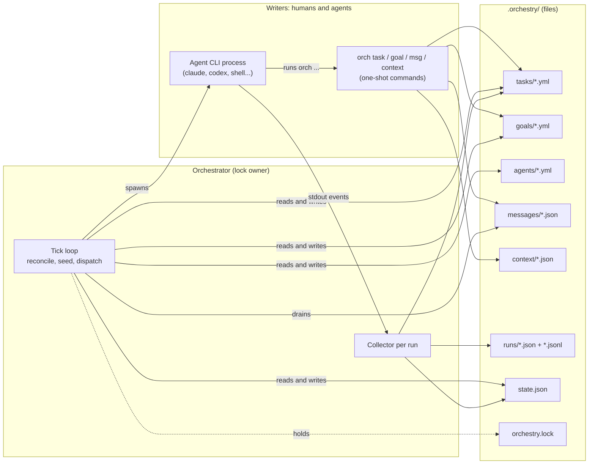

| Entity | File | Id | Written by |
|---|---|---|---|
| Goal | `goals/<id>.yml` | `goal_…` | `orch goal …`, agents, the dashboard |
| Task | `tasks/<id>.yml` (+ `_index.json`) | `tsk_…` | `orch task …`, agents, the orchestrator |
| Agent | `agents/<id>.yml` | `agt_…` | `orch agent …`; the orchestrator writes `status`, `current_task`, `last_error`, `stats` |
| Run | `runs/<id>.json` + `runs/<id>.jsonl` | `run_…` | the orchestrator only |
| Message | `messages/<id>.json` | `msg_…` | `orch msg …`; the orchestrator marks it delivered |
| Context entry | `context/<key>.json` | the key | `orch context set` |
| Orchestrator state | `state.json` | — | the orchestrator only |
| Owner lock | `orchestry.lock` | — | the orchestrator (PID inside) |

Ids are a prefix plus a nanoid (`infra/ids.rs:18-20`). Path builders are in `infra/storage/paths.rs:32-154`.

**The event bus is in-process.** `task:created`, `task:status_changed` and the rest go to subscribers in the
same process only. A task created by another process (an agent's `orch task add`, your terminal) is not
seen until the orchestrator's next tick reloads its caches and the files (`orchestrator/tick.rs:48-49`). A task
created inside the orchestrator's own process triggers a reactive dispatch instead (`orchestrator.rs:607-615`). That is why
cross-process changes take effect within `scheduling.poll_interval_ms` (default 10 s, `domain/config.rs:239`)
and in-process ones within about 0.5 s.

### Who runs the orchestrator

| Command | Owner lock | Reconcile | Creates `[auto]` tasks | Starts | Ends |
|---|---|---|---|---|---|
| `orch run <task-id>` | temporary (`orchestrator.rs:379-393`, `484-490`) | no | no | that task only; every other ready task is claimed so it cannot start (`orchestrator/dispatch.rs:264-293`), which also means it starts nothing and exits 0 when the assignee has another `todo`/`retrying` task ([§8](#8-known-gaps-pending-fixes) row 9) | when its collectors finish (`orchestrator.rs:681-688`) |
| `orch run --all` | temporary (`orchestrator.rs:493-498`) | no | no | one pass over everything ready (`orchestrator/dispatch.rs:25-34`) | when its collectors finish |
| `orch run --watch`, `orch serve`, the dashboard (`orch`, `orch tui`, `orch web`) | held while running (`orchestrator.rs:563-567`) | every tick | yes | every tick, plus reactive dispatch | on a signal, `/pause`, or the tick circuit breaker |
| `orch serve --once` | held | every tick | **no** (`orchestrator.rs:165-172`) | every tick | when every task is terminal |
| `orch tui --observe` | none | — | — | nothing on its own (one-shot actions from the dashboard still work) | — |

Only one process can hold the lock. Another watch-mode start fails with `LockConflict`
(`orchestrator.rs:563-566`). The lock file holds a PID; it is stale when that PID is dead or the file has not
been touched for 60 s (`infra/storage/lock.rs:27`, `41-60`), and every tick touches it
(`orchestrator/tick.rs:36-38`). One-shot commands such as `orch task add` never take the lock; the
consequences are in [ARCHITECTURE §2.1](../ARCHITECTURE.md#21-a2-in-detail--the-concurrency-story-is-weaker-than-single-writer).

---

## 2. Q1: Orchestration logic

> *"Orchestration logic: focus on the types of orchestration logic that it can do. Explain how orchestration
> works when setting up goals / tasks / agents. How to make sure tasks are handled, evidence persisted, and
> work handed off to another task or agent."*

**Answer.** r-orch has eight kinds of orchestration logic, all **[mechanism]**:

| # | Logic | What it decides | Section |
|---|---|---|---|
| 1 | Tick loop | When the orchestrator looks at the world | [§2.1](#21-the-tick-loop) |
| 2 | Reconcile | What happened to work already running | [§2.2](#22-reconcile-what-happened-to-running-work) |
| 3 | Scheduling | Which ready task starts next, on which agent | [§2.3](#23-scheduling-which-task-starts-next-on-which-agent) |
| 4 | Dispatch and collect | How a task becomes a process and a run record | [§2.4](#24-dispatch-and-collect) |
| 5 | Completion | Review, auto-approve, retry, cascade failure | [§2.5](#25-completion-success-review-retry-cascade) |
| 6 | Workspaces | Where an agent works and how its changes come back | [§2.7](#27-workspace-modes) |
| 7 | Recovery | What a restart does with half-finished work | [§2.8](#28-shutdown-and-restart-recovery) |
| 8 | Remote peers | Work run on another machine | [§2.9](#29-remote-peers) |

Goal-driven seeding is a ninth, covered with goals in [§5](#5-q4-how-does-a-goal-driven-system-work).
Setup is in [§2.10](#210-setting-up-goals-tasks-and-agents), evidence in
[§2.11](#211-evidence-what-is-written-where), and a checklist for "is my task going to be handled?" in
[§2.12](#212-checklist-will-this-task-be-handled).

### 2.1 The tick loop

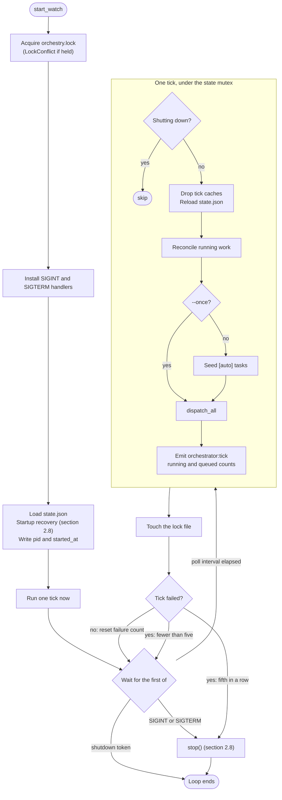

- Startup and the loop: `orchestrator.rs:504-666`, `1084-1143`. The loop is a `tokio::select!` over the
  shutdown token, the interval timer and the signal handlers (`orchestrator.rs:1117-1137`). The interval
  does not burst to catch up after a slow tick (`MissedTickBehavior::Delay`, `orchestrator.rs:1104-1108`).
  [ARCHITECTURE §6.2](../ARCHITECTURE.md#62-tick-loop) shows an earlier design sketch of this loop; the code
  above is what ships.
- One tick: `orchestrator/tick.rs:27-67`. The whole tick holds the state mutex, so ticks, completions and
  cancels never interleave ([ARCHITECTURE §6.1](../ARCHITECTURE.md#61-state-mutex)).
- Circuit breaker: five consecutive failed ticks call `stop()` (`orchestrator.rs:76`, `1148-1168`).
- `queued` in `orchestrator:tick` counts every `todo` and `retrying` task, including ones blocked by a
  dependency (`orchestrator/tick.rs:58-65`).

**Reactive dispatch.** Two events do not wait for the timer: a `task:created` in this process
(`orchestrator.rs:609-615`) and the end of any run (`orchestrator/collect.rs:835-840`). Each schedules a
mini-tick 500 ms later that dispatches but does **not** reconcile or seed (`orchestrator/tick.rs:552-595`).
If a tick is in progress it retries up to 10 times (`orchestrator.rs:83-86`). A `run <task-id>` in flight
suppresses it, so a one-shot command never starts other work (`orchestrator/tick.rs:591-593`).

### 2.2 Reconcile: what happened to running work

`state.json` keeps one **running entry** per started task: run id, agent id, PID, `started_at`,
`last_event_at` (`orchestrator/dispatch.rs:870-882`). Every tick checks each entry, in this order
(`orchestrator/tick.rs:80-299`):

| Step | Condition | Action | Source |
|---|---|---|---|
| 1 | The task is deleted or already terminal (for example cancelled by another process) | Cancel the run's token (the adapter kills the child), drop the entry, set the agent idle | `orchestrator/tick.rs:133-162` |
| 2 | A remote entry | Remote deadlines only; see [§2.9](#29-remote-peers) | `orchestrator/tick.rs:164-199` |
| 3 | This process has a live collector for the task | **Skip steps 4 and 5** | `orchestrator/tick.rs:201-206` |
| 4 | The PID is dead | Fail the run: `Process crashed unexpectedly` | `orchestrator/tick.rs:208-242` |
| 5 | No event for `stall_timeout_ms` (agent setting, default 600 000) | Kill with a 5 s grace, fail the run: `Agent stalled (no events)` | `orchestrator/tick.rs:244-291` |

Step 3 exists so that a child that exited cleanly, whose success handler is still waiting for the state
mutex, is not misread as a crash (`orchestrator.rs:197-200`). Its side effect is that steps 4 and 5 apply only
to entries **without** a collector in this process, which in practice means runs adopted after a restart.
For runs this process started, stall detection never fires: see [§8](#8-known-gaps-pending-fixes), row 2.

After the per-entry checks, reconcile also:

- sets agents that say `running` but have no running entry back to `idle` (`orchestrator/tick.rs:303-335`);
- fails tasks that are `in_progress` with no running entry and emits `task:orphaned`, force-writing when the
  state machine refuses (`orchestrator/tick.rs:340-392`);
- dispatches retry-queue entries whose `due_at` has passed, if the task is still `todo` or `retrying`
  (`orchestrator/tick.rs:396-420`);
- saves `state.json`.

### 2.3 Scheduling: which task starts next, on which agent

`dispatch_all` (`orchestrator/dispatch.rs:55-148`) builds the candidate list, sorts it, and walks it.

| Rule | Behaviour | Source |
|---|---|---|
| **Ready** | Status `todo` or `retrying`, not blocked, not already running, not claimed | `orchestrator/dispatch.rs:71-80`, `domain/transitions.rs:52-54` |
| **Dependencies** | Blocked while any `depends_on` task exists and is not `done`. A dependency id that no longer exists counts as done. Ids are checked when the task is created. | `domain/transitions.rs:94-109`, `engine/task_service.rs:90-105` |
| **Approval hold** | A task labelled `awaiting-approval` is skipped until `orch task approve` removes the label | `orchestrator/dispatch.rs:335-339`, `engine/task_service.rs:206-215` |
| **Order** | Priority ascending (1 runs first; 1–4, default 3), then goal-linked before unlinked, then most recently updated first. The sort is stable. | `orchestrator/dispatch.rs:82-90`, `engine/task_service.rs:83-88` |
| **Concurrency cap** | At most `scheduling.max_concurrent_agents` (default 6) local runs. Remote runs do not count. | `orchestrator/dispatch.rs:46-63`, `112-115`, `1158-1164` |
| **Scope** | A candidate whose `scope` overlaps a scoped `in_progress` task, or a candidate already started in this pass, is skipped and `task:scope_overlap` is emitted. Later candidates are still tried. | `orchestrator/dispatch.rs:92-145` |
| **One task per agent** | An agent with a running entry, or with another claimed task assigned, is not eligible | `orchestrator/dispatch.rs:386-401` |
| **Agent choice** | A task with an `assignee` waits for **that** agent to be idle; it is never given to someone else. An unassigned task goes to the highest-scoring idle agent: +50 per label that matches a skill, +30 if a label is a substring of the role, +20 for idle, plus up to +10 for its success rate. | `engine/agent_service.rs:601-630`, `693-724` |
| **Eligibility** | Agent status `idle`, so a `running` agent never qualifies. A `disabled` agent does not qualify either, but only while it stays disabled: the end of a run it was executing writes `idle` over `disabled` ([§6.1](#61-pause-and-resume-table), [§8](#8-known-gaps-pending-fixes) row 6). Also: remote agents online, and every `cap:<name>` label on the task present in the agent's capabilities | `engine/agent_service.rs:681-689` |
| **No agent** | No eligible agent: the claim is released and the task keeps its place. No agents at all: a `NoAgents` error. | `orchestrator/dispatch.rs:402-411` |

**Scope overlap is string-prefix logic, not glob matching** (`domain/scope.rs:1-6`): two patterns overlap
when one's text before the first `*` is a prefix of the other's, or both name files in the same directory
(`domain/scope.rs:23-45`). A task with no scope never overlaps anything. Only tasks in `in_progress` hold their
scope (`orchestrator/dispatch.rs:96-102`), so a task waiting in `review` no longer blocks overlapping work.

Teams do not affect scheduling. A team's task pool is stored but not read by the orchestrator
([manual: What a team changes](../manual/05-teams-and-goals.md#what-a-team-changes)).

### 2.4 Dispatch and collect

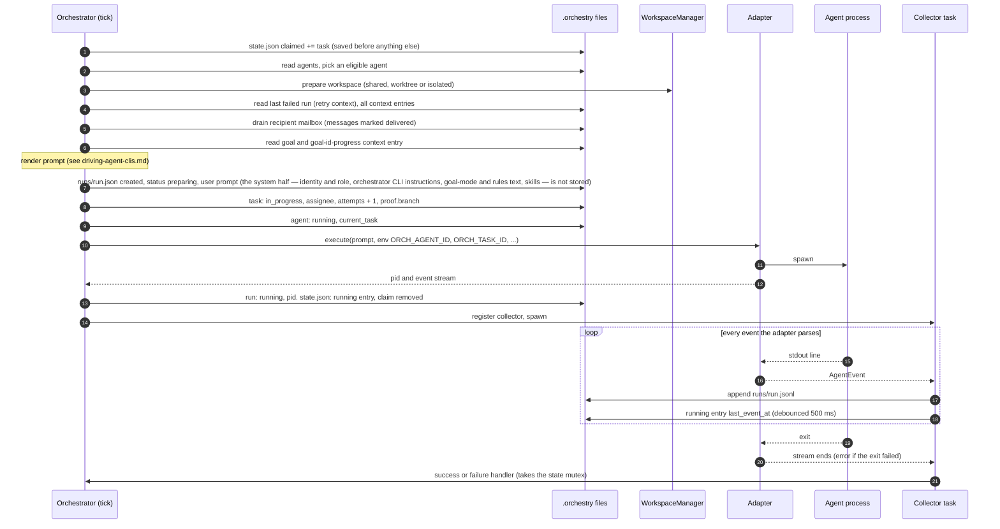

| Step | What | Source |
|---|---|---|
| Claim | `state.claimed` is written to disk before any other work, so a crash leaves a visible claim, which startup clears | `orchestrator/dispatch.rs:295-299`, `356-357`; `orchestrator/recovery.rs:327-330` |
| Rollback | Any error before the spawn drops the claim and the cancel token | `orchestrator/dispatch.rs:359-369` |
| Workspace | `prepare` returns a path (and a branch for worktrees) | `orchestrator/dispatch.rs:413-422` |
| Retry context | Attempt 2+ gets the previous run's error and last output | `orchestrator/dispatch.rs:424-450` |
| Inputs | Shared context, mailbox drain and goal are read together | `orchestrator/dispatch.rs:452-518` |
| Run record | Created `preparing`, with the rendered prompt | `orchestrator/dispatch.rs:622-632` |
| Task updates | `failed`/`cancelled` tasks are reset first; then `in_progress`, assign, attempts + 1 | `orchestrator/dispatch.rs:634-647` |
| Branch | Saved into `proof.branch` at once, so a later failure cannot lose it | `orchestrator/dispatch.rs:663-674` |
| Environment | `ORCH_AGENT_ID`, `ORCH_AGENT_NAME`, `ORCH_TASK_ID` plus the agent's `config.env` | `orchestrator/dispatch.rs:744-756` |
| Pre-spawn failure | An effort-preparation or spawn error fails the run through the normal failure path | `orchestrator/dispatch.rs:782-864`, `935-982` |
| Running entry | Written after the spawn; the collector is registered before it is spawned | `orchestrator/dispatch.rs:866-909` |
| Collector | Appends each event to the run log, refreshes `last_event_at`, forwards it to the event bus | `orchestrator/collect.rs:81-157`, `159-300` |

Prompt assembly, adapter argv, stdout parsing and the meaning of each event kind are covered in
[driving-agent-clis.md](driving-agent-clis.md): spawning in
[Q6](driving-agent-clis.md#q6-how-does-an-agent-drive-the-agent-cli), events in
[Q7](driving-agent-clis.md#q7-how-does-the-agent-send-request-response-tool-call).

### 2.5 Completion: success, review, retry, cascade

The collector decides success by one rule: **the event stream ended without an error** (`orchestrator/collect.rs:91-157`).
For most adapters that means the CLI exited 0. What the agent wrote does not matter; a run that prints
"BLOCKED" and exits 0 is a success.

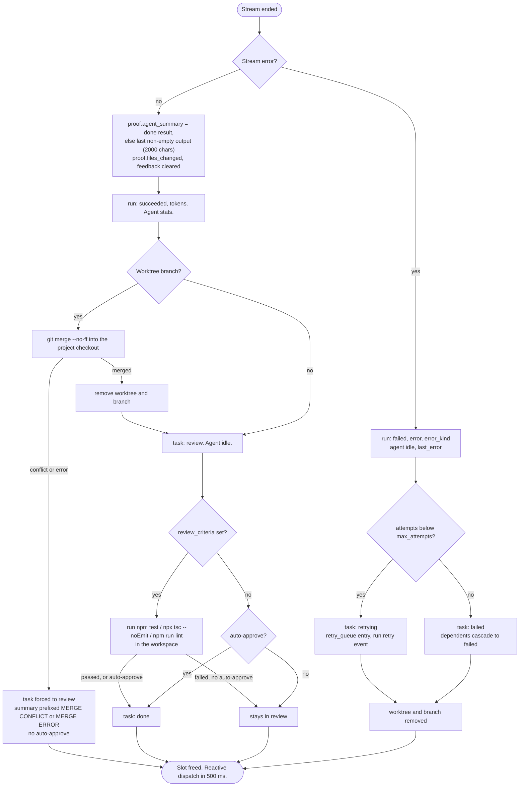

**Success** (`orchestrator/collect.rs:333-543`):

- The result text is `proof.agent_summary`: the `done` event's result, or else the last non-empty output
  event, cut to 2000 characters (`orchestrator/collect.rs:141-146`, `364-368`; `orchestrator.rs:91-92`).
  The shell adapter's output never reaches this field ([§8](#8-known-gaps-pending-fixes), row 4).
- `proof.files_changed` comes from the adapter's events or, if empty, from the worktree branch's diff
  (`orchestrator/collect.rs:354-375`).
- Success always passes through `review` (`domain/transitions.rs:121-132`).
- **Auto-approve** is on when the task has the `autonomous` label, is a remote mirror, or its agent has
  `approval_policy: auto` (`orchestrator/collect.rs:381-389`). `auto` is the project default
  (`domain/config.rs:226`) and `orch agent add` copies it into the agent, so **by default a successful run
  goes straight to `done`**. Use `--approval-policy manual` or `suggest` to make a human gate.
- Merge-back happens **before** review: in the [worked example](#7-worked-example-one-goal-end-to-end) the
  worker's branch was merged into `main` while its task still waited in `review`
  (`orchestrator/collect.rs:445-486` runs before `488-538`).
- Review criteria commands are hard-coded to the npm toolchain: `npm test`, `npx tsc --noEmit` and
  `npm run lint` (`engine/review_runner.rs:38-40`). If they fail and
  auto-approve is on, the task is still forced to `done` with a non-fatal error event
  (`orchestrator/collect.rs:747-765`).

**Failure** (`orchestrator/collect.rs:560-712`):

- Next status: `retrying` while `attempts < max_attempts` (default 3), else `failed`
  (`domain/transitions.rs:111-119`).
- A retry is queued with `delay = min(retry_base_delay_ms × 2^(attempts−1), retry_max_delay_ms)`
  (10 s, 20 s, 40 s … capped at 300 s; `domain/transitions.rs:134-143`, `orchestrator/collect.rs:667-680`).
  **The delay is announced but not enforced**: a `retrying` task is also an ordinary ready candidate, so the
  reactive dispatch 500 ms later restarts it. Measured: three attempts in 1.5 s with `run:retry` events
  announcing 10 s and 20 s ([§8](#8-known-gaps-pending-fixes), row 1). Fixed on `main` after `40a6dc7`
  by PR #54 (not in 0.10.0): dispatch now skips a `retrying` task until its retry-queue entry is due, and
  `process_retry_queue` starts it after that.
- A permanent failure walks the reverse dependency graph breadth-first and writes every non-terminal
  dependent, direct or transitive, as `failed`, emitting `task:status_changed` and `task:cascade_failed` for
  each (`orchestrator/dispatch.rs:1035-1116`). These writes bypass the state machine because `todo → failed` is
  not a legal transition.
- A worktree attempt's worktree **and branch are deleted** on failure (`orchestrator/collect.rs:692-697`,
  `infra/workspace/manager.rs:189-201`). Only the run log keeps what the agent did.
- The next attempt's prompt quotes the previous error and output (`infra/template/user.liquid:6-16`).

### 2.6 Task state machine

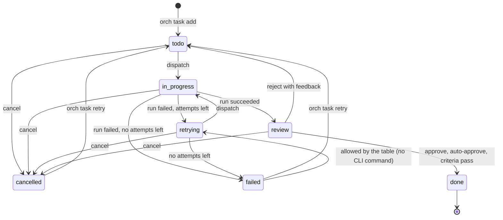

The table is `domain/transitions.rs:23-34`; user commands go through `engine/task_service.rs:178-201`, which
refuses anything else. `done`, `failed` and `cancelled` are terminal for the scheduler
(`domain/transitions.rs:41-49`). These paths **write the status directly** and skip the table:

| Path | Writes | Source |
|---|---|---|
| Cascade from a failed dependency | `todo`/`retrying`/… → `failed` | `orchestrator/dispatch.rs:1079-1096` |
| Orphaned `in_progress` task during a tick | → `failed` | `orchestrator/tick.rs:372-390` |
| Startup recovery | → `cancelled` | `orchestrator/recovery.rs:490-522` |
| Merge conflict | → `review` | `orchestrator/collect.rs:791-831` |
| `orch task retry` / `reject` | → `todo`, attempts reset to 0 | `engine/task_service.rs:253-306` |

### 2.7 Workspace modes

The mode is the task's `--workspace-mode`, else the agent's `workspace_mode`, else the project default
`defaults.agent.workspace_mode` (`worktree`) (`infra/workspace/manager.rs:43-47`, `domain/config.rs:230`).
`worktree` and `isolated` need a git repository (`infra/workspace/manager.rs:165-167`).

| Mode | Agent works in | Branch | After success | After failure |
|---|---|---|---|---|
| `shared` | the project root | none | nothing to merge | nothing to clean |
| `worktree` | `.orchestry/workspaces/<task-id>` (`git worktree add`) | `orchestry/<task-id>/<slug>` | `git merge --no-ff` into the project checkout, then worktree and branch removed; a conflict aborts the merge and forces `review` | worktree and branch removed |
| `isolated` | `.orchestry/workspaces/<task-id>` (`git clone --local`, `rsync` fallback) | none | not merged back; not cleaned up | not cleaned up |

Sources: `infra/workspace/manager.rs:81-183`, `infra/workspace/merge.rs:9-80`, `orchestrator/collect.rs:445-486`, `692-697`.
Two worktree tasks that touch the same file will conflict at merge time unless their scopes keep them apart
(see [§2.3](#23-scheduling-which-task-starts-next-on-which-agent)).

### 2.8 Shutdown and restart recovery

**Graceful stop** — `stop()` (`orchestrator.rs:751-831`, `orchestrator/recovery.rs:580-660`). Called by the
signal handlers, the circuit breaker and the dashboard's `/pause`.

1. Stop future ticks (the in-flight tick finishes), cancel the reactive-dispatch timer and the debounced save.
2. For each **local** running entry: kill the process group with a 10 s grace
   (`crates/orch-core/src/process.rs:328`), finish the run `cancelled`, move the task to `retrying` (or
   `failed` with no attempts left), set the agent idle.
3. **Remote** entries are detached, not cancelled: the worker keeps running them and the next start
   re-attaches (`orchestrator/recovery.rs:593-612`).
4. Clear `claimed`, `pid`, `started_at`; save `state.json`; release the lock. A failed save still releases
   the lock (`orchestrator.rs:795-830`).

`stop()` does not enqueue retries. After a restart the `retrying` tasks are simply ready and start on the
first tick (observed in the pause experiments, [§6.3](#63-what-we-measured)).

**Startup recovery** — before the first tick (`orchestrator.rs:645-666`):

| Found | Action | Source |
|---|---|---|
| Running entry whose PID is dead | Drop it, agent idle, task **cancelled**, run `cancelled` "Orchestrator restarted" | `orchestrator/recovery.rs:280-325` |
| Running entry whose PID is alive (a child that outlived a crashed orchestrator) | **Kept.** No collector exists for it, so reconcile's PID and stall checks now apply. When it exits, the run fails with `Process crashed unexpectedly` and the task retries. | `orchestrator/recovery.rs:280-288`; `orchestrator/tick.rs:208-242` |
| Any claim | Cleared | `orchestrator/recovery.rs:327-330` |
| `in_progress` task with no entry, when at least one dead entry was found | Cancelled; its retries removed | `orchestrator/recovery.rs:332-360` |
| Run `preparing` with no entry | Finished `cancelled` | `orchestrator/recovery.rs:366-413` |
| Run `running` with no entry (crash between spawn and save) | Process killed, run `cancelled` | `orchestrator/recovery.rs:415-485` |
| Remote entry whose peer is still registered | Kept as `unknown`, re-attached by the peer runtime | `orchestrator/recovery.rs:252-279` |

Recovery **cancels rather than fails**, on purpose: a failed task would retry, and an agent redoing work it
may already have committed is worse than stopping (`orchestrator/recovery.rs:240-244`). Restart a cancelled
task by hand with `orch task retry <id>`.

### 2.9 Remote peers

A remote agent's id contains `@` (`<agent>@<alias>`). Dispatch to it differs from local dispatch only in the
places below; the user view is in [manual chapter 11](../manual/11-remote-agents.md).

| Aspect | Remote behaviour | Source |
|---|---|---|
| Workspace | `remote:<alias>`; nothing is prepared locally | `orchestrator/dispatch.rs:413-415` |
| Running entry | PID 0, a remote reference; the run stays `preparing` until the worker says it started | `orchestrator/dispatch.rs:676-697` |
| Submission | Queued on the remote bridge with the prompt, title, priority, review criteria, goal id | `orchestrator/dispatch.rs:698-727` |
| Concurrency | Not counted against `max_concurrent_agents`; each remote agent runs one task | `orchestrator/dispatch.rs:46-54` |
| Mailbox | Not drained locally | `engine/message_service.rs:273-275`, `orchestrator/dispatch.rs:460-463` |
| Deadlines | An unacknowledged submit fails after 5 min of online time; a mirror queued for 1 h warns hourly | `orchestrator.rs:95-106`, `orchestrator/remote.rs:88-145` |
| Outcome | Only `Failed` goes through the shared failure handler (`handle_run_failure_locked`). `Succeeded` and `Cancelled` are handled inline in `handle_remote_outcome`: success sets `proof`, moves the task to `review` and on to `done` under the same auto-approve or criteria-passed rule; cancel cancels the run and the task. No merge-back runs, and `handle_run_success_locked` is not called, so a change to the local success handler does not reach remote runs | `orchestrator/remote.rs:690-693` (failure), `695-709` (cancel), `710-775` (success) |
| On the worker | A submitted task for an agent whose policy is not `auto` is held with `awaiting-approval` | `domain/task.rs:67-71` |

### 2.10 Setting up goals, tasks and agents

What each setup command writes, verified in a fresh project:

| Command | Writes | Side effects | Source |
|---|---|---|---|
| `orch init` | `.orchestry/` with `config.yml`, `agents/agt_creator.yml` (a **claude** agent), `tasks/`, `goals/`, `runs/`, `logs/`, `templates/default.md`, `.gitignore`, `workspace-exclude` | none | observed |
| `orch agent add` | `agents/<id>.yml` and `agents/_index.json`; unset settings are copied from `defaults.agent` (for example `approval_policy: auto`) | none | observed |
| `orch task add` | `tasks/<id>.yml` and `tasks/_index.json`; `status: todo`, `attempts: 0` | Unknown `--depends-on` ids and priorities outside 1–4 are refused; `task:created` reaches only this process's subscribers | `engine/task_service.rs:78-162` |
| `orch goal add [--assignee A]` | `goals/<id>.yml`, `status: active` | The assignee gets `autonomous: true` | `engine/goal_service.rs:85-115` |
| `orch agent autonomous <id>` | the agent's `autonomous` flag | — | CLI |
| `orch msg send` | `messages/<id>.json`, `status: pending`, `expires_at` 24 h later (at most 7 days) | none until the recipient is next dispatched | `engine/message_service.rs:118-174`, `domain/message.rs:130-133` |
| `orch context set [--ttl <ms>]` | `context/<key>.json` | Offered to every later prompt, which shows **at most 15** entries ranked by relevance to the task and agent (goal id, agent name, scope, role); with 15 or fewer entries every agent sees all. Expires after `--ttl` | `infra/template/context.rs:75-149`, `crates/orch-core/src/template.rs:214`, `infra/storage/context.rs:49-57`, `84-110` |

`init` creates `agt_creator`, an AI agent. In a test project disable it (`orch agent disable agt_creator`), or
an unassigned task may start a real AI CLI.

**"Autonomous" means two different things:**

| | Agent flag `autonomous: true` | Task label `autonomous` |
|---|---|---|
| Set by | `goal add --assignee`, `goal update --assignee`, resuming a goal, `orch agent autonomous` | the seeder, or anyone with `-l autonomous` |
| Effect | The tick seeds `[auto]` tasks for the agent ([§5.2](#52-the-seeding-loop)) | (a) auto-approve on success (`orchestrator/collect.rs:381`); (b) ignored by the goal's achieved guard (`engine/goal_service.rs:257-271`); (c) cancelled, if `todo`/`retrying`, when a goal assigned to the task's agent pauses (`engine/goal_service.rs:336-356`); (d) adds the "Autonomous Goal Mode" section to the system prompt (`infra/template/system.liquid:19-35`) |
| Cleared by | pausing, achieving, abandoning or deleting the agent's last `active` goal (`engine/goal_service.rs:312-319`) | nothing |

**Prompt composition (pointer only).** Each dispatch renders a system and a user prompt from Liquid templates
(`infra/template/system.liquid`, `infra/template/user.liquid`; eco variants in `eco_*.liquid`). The user prompt
contains, in order: the task, attempt and retry error; project and working directory; the **Team** list;
review feedback; **Shared Context** (at most 15 entries, ranked by relevance; see [§3](#3-q2-how-does-one-agent-connect-to-another-agent));
**Inbox** (drained messages); **Goal** (status, linked tasks with status, latest progress)
(`infra/template/user.liquid:1-70`). The full treatment, including what the agent's CLI actually receives, is
in [driving-agent-clis.md](driving-agent-clis.md#q6-how-does-an-agent-drive-the-agent-cli).

### 2.11 Evidence: what is written where

```text
.orchestry/
├── config.yml                project settings
├── state.json                running entries, claims, retry queue, totals      gitignored
├── orchestry.lock            owner PID                                         gitignored
├── agents/<id>.yml           definition + status, current_task, last_error, stats
├── tasks/<id>.yml            status, attempts, proof (result), feedback, goalId
├── goals/<id>.yml            status, assignee
├── messages/<id>.json        body, status pending/delivered, delivered_at
├── context/<key>.json        value, created_at, updated_at
├── runs/<run>.json           one record per attempt                            gitignored
├── runs/<run>.jsonl          every event of that attempt                       gitignored
├── attachments/<task-id>/    files from --attach
├── workspaces/<task-id>/     worktree or clone                                 gitignored
└── logs/                     created by init; nothing writes here in 0.10.0    gitignored
```

The `gitignored` column is from the `.gitignore` that `orch init` writes (observed). Tasks, goals, agents,
messages and context are **not** ignored, so in a git project they can be committed. The only reference to
`logs/` is in `init` (`cli/commands/init.rs:108`, `444`); `orch serve --log-file <path>` writes wherever you
point it.

| Evidence | Lives in | Written when | Source |
|---|---|---|---|
| The user half of the prompt an attempt got (the system half is not persisted; see [driving-agent-clis.md "What gets persisted?"](driving-agent-clis.md#what-gets-persisted)) | `runs/<run>.json` → `prompt` | at dispatch, before the spawn | `orchestrator/dispatch.rs:586-620` (render), `622-632` (store) |
| Attempt outcome | `runs/<run>.json` → `status`, `finished_at`, `error`, `error_kind`, `tokens`, `pid` | at start and at finish | `domain/run.rs:58-78` |
| Everything the agent emitted | `runs/<run>.jsonl`, one `{timestamp, type, data}` per event; `type` is `agent_output`, `file_changed`, `command_run`, `tool_call`, `error` or `done`; `data` capped at 8 KB | as each event arrives | `orchestrator/collect.rs:235-248`, `domain/run.rs:122-131`, `orchestrator.rs:71-72` |
| The task's result | `tasks/<id>.yml` → `proof.branch` | at dispatch | `orchestrator/dispatch.rs:663-674` |
| | `proof.agent_summary` (≤ 2000 chars), `proof.files_changed`, `proof.test_results`, `review_results` | at completion | `orchestrator/collect.rs:363-378`, `733-739` |
| Why it failed or is retrying | agent `last_error`; then task `status`, `attempts`; `state.json` `retry_queue` | at a failed run's end | `orchestrator/collect.rs:618-634` (`last_error`), `655-680` (status, retry queue) |
| Why it was sent back | task `feedback` | at `orch task reject` | `engine/task_service.rs:292-296` |
| What was delivered to whom | `messages/<id>.json` → `status: delivered`, `delivered_at` | at the recipient's dispatch | `engine/message_service.rs:272-293` |
| Goal progress | `context/<goal-id>-progress.json` | whenever an agent sets it | [§5.4](#54-goal-progress-mechanism-reads-convention-writes) |
| Totals | `state.json` → `stats` | at each completion | `orchestrator/collect.rs:399-443` |

To read it: `orch task show <id>`, `orch logs <run-id>`, `orch logs --task <id>`, `orch goal show <id>`,
`orch status` ([manual: View logs](../manual/07-running-and-monitoring.md#view-logs)).

Concurrent writers can lose an index entry (a task file exists but `_index.json` does not list it, so dispatch
does not see it). This is a known hazard with a recovery procedure:
[ARCHITECTURE §2.1](../ARCHITECTURE.md#21-a2-in-detail--the-concurrency-story-is-weaker-than-single-writer).

### 2.12 Checklist: will this task be handled?

**What the code guarantees** [mechanism]:

- A dispatched task leaves `in_progress` through its collector, through reconcile (dead PID, task made
  terminal elsewhere, orphan), or through startup recovery.
- Retries are bounded by `max_attempts` (default 3, `domain/config.rs:234`).
- A permanently failed dependency fails its dependents instead of leaving them blocked forever.
- A claim never survives a restart.

**Where a task can wait with no end** — check these when a task "does nothing":

| Symptom | Cause | Fix |
|---|---|---|
| `todo`, never starts | its `assignee` is busy, disabled or does not exist (it is never reassigned) | `orch task assign`, `orch agent enable`. (The reverse also happens: a disabled agent that was busy starts queued work again once its run ends, [§8](#8-known-gaps-pending-fixes) row 6.) |
| `todo`, never starts | a dependency is not `done` (in `review` counts as not done) | finish or approve the dependency |
| `todo`, never starts | a scope overlap with a long-running task | narrow the scopes |
| `todo`, never starts | no orchestrator is running | start `orch serve` or `orch run --watch` |
| `review` forever | the agent's policy is `manual`/`suggest` and nobody approves | `orch task approve` / `reject` |
| `in_progress` for hours | an agent that hangs is not stopped: stall detection does not fire for live runs ([§8](#8-known-gaps-pending-fixes) row 2) and `timeout_ms` is not enforced ([manual](../manual/07-running-and-monitoring.md#stop-a-stalled-run)) | `orch task cancel` fails while a daemon owns the project ([§8](#8-known-gaps-pending-fixes) row 3). Stop the daemon (its run is killed and the task goes to `retrying`), then `orch task cancel <id>`, which needs no lock for a task that is not `in_progress` (`cli/commands/task.rs:486-490`) |
| A message was "lost" | the mailbox is drained before the prompt renders; a failure after the drain loses it (`engine/message_service.rs:267-271`) | resend |

---

## 3. Q2: How does one agent connect to another agent?

> *"How does one agent connect to another agent?"*

**Answer.** It does not connect. Agents share no socket, pipe or session. They leave files for each other
with the `orch` CLI, and the orchestrator hands those files to the next run of the recipient. There are three
channels:

| Channel | Command | Reaches | When | Kind |
|---|---|---|---|---|
| Direct message | `orch msg send <agent-id> "<body>" -s <subject> --from <my-id>` | one agent | the recipient's **next dispatch** | [mechanism] |
| Broadcast / team lead | `orch msg broadcast …`, `--team` | every non-disabled agent but the sender (or a team), or a team's lead | each recipient's next dispatch | [mechanism] |
| Shared context | `orch context set <key> "<value>" [--ttl <ms>]` | each prompt shows **at most 15** entries, ranked by relevance to the task and agent; with 15 or fewer entries every agent sees all | every later prompt, until deleted or expired (`--ttl`) | [mechanism] |
| A task | `orch task add --assignee <agent-id>` | one agent | when the task is dispatched | [mechanism], see [§4](#4-q3-how-does-one-agent-connect-to-another-task) |

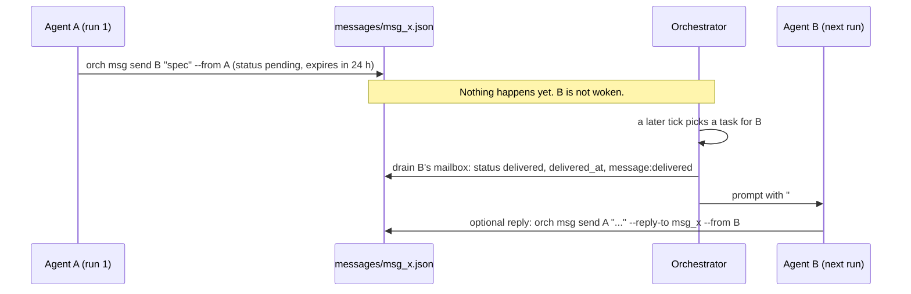

**Rules** [mechanism]:

- `--from` defaults to `cli` (`cli/commands/msg.rs:43`, `79`); an unknown sender is refused
  (`engine/message_service.rs:130-139`). Agents must pass `--from $ORCH_AGENT_ID` to be identifiable.
- A message is delivered **once**: draining marks it delivered at dispatch (`engine/message_service.rs:267-293`,
  `orchestrator/dispatch.rs:460-471`). It appears in exactly one prompt.
- A message does **not** create a task or wake anyone: no code path does either. The only reader of a mailbox
  is the drain at dispatch (`orchestrator/dispatch.rs:460-471`). If the recipient has no task and is not
  autonomous, the message waits until it expires (default 24 h, max 7 days; `domain/message.rs:130-133`).
- A broadcast with a `--team` that names no team goes to **all** agents (`engine/message_service.rs:176-182`).
- A `lead` message to a team whose lead was deleted is stored for nobody (`engine/message_service.rs:241-243`).
- A remote recipient is addressed as `<agent>@<alias>` (`engine/message_service.rs:252-262`).
- Shared context is last-writer-wins: `set` overwrites the whole entry (`infra/storage/context.rs:84-110`).
  An entry set with `--ttl <ms>` expires and is purged on the next read (`infra/storage/context.rs:49-57`,
  `127-147`).
- Shared context is **not** a guaranteed broadcast. Each prompt shows at most 15 entries
  (`MAX_CONTEXT_ENTRIES`, `crates/orch-core/src/template.rs:214`), chosen by `filter_relevant_context`
  (`infra/template/context.rs:75-149`, called from `192-202`). Each entry is scored against the task and agent:
  +10 if the key starts with the task's goal id, +8 if the agent's name is in the key or value, +6 if a task
  scope path is in the key or value, +4 if the key starts with a role keyword and `-` or `_`, +1 for a generic
  prefix (`bug-`, `perf-`, `stability-`, `docs-`, `arch-`, `spec-`). Scored entries come first, best first;
  the remaining slots go to unscored entries in key order. The rest are left out silently. Measured: 20 keys
  set, the prompt listed 15 (`k01`…`k15`); see [§8](#8-known-gaps-pending-fixes) row 8. With 15 or fewer entries
  every agent sees all of them (`infra/template/user.liquid:36-41`), and they cost tokens on every run.

**Conventions** [convention], from the `a-team` organisation template roles
(`domain/org_templates/a-team/agents/*.yml`): ask with your best guess and proceed without waiting; reply with
`--reply-to`; keep context to short pointers; put artifacts in files and send paths. None is enforced.

In the [worked example](#7-worked-example-one-goal-end-to-end) the message was created at `20:09:37.361Z` and
delivered at `20:09:37.579Z`, because the worker happened to be dispatched straight away.

---

## 4. Q3: How does one agent connect to another task?

> *"How does one agent connect to another task?"*

**Answer.** An agent is a process with the `orch` CLI on hand and three environment variables:
`ORCH_AGENT_ID`, `ORCH_AGENT_NAME`, `ORCH_TASK_ID` (`orchestrator/dispatch.rs:754-756`). With those it creates,
links, inspects and gates tasks. The `orch` binary finds the project by walking up from the working
directory, so this works from a worktree under `.orchestry/workspaces/` too (observed).

| Pattern | Command | What enforces it |
|---|---|---|
| **Delegate** | `orch task add "<verb> <object>" -d "<inputs, acceptance, output path>" --assignee <agent> --goal-id <goal>` | [mechanism] the task waits for that agent ([§2.3](#23-scheduling-which-task-starts-next-on-which-agent)) |
| **Sequence** | `--depends-on <id>[,<id>]` | [mechanism] starts only when every dependency is `done`; a failed dependency cascades ([§2.5](#25-completion-success-review-retry-cascade)) |
| **Continue myself later** | `orch task add … --assignee "$ORCH_AGENT_ID" --depends-on <ids>` | [mechanism] for the wait; [convention] that the agent ends its run after scheduling it |
| **Serialise file changes** | `--scope "<globs>"` | [mechanism] overlapping scoped tasks never run at the same time |
| **Human gate** | agent `--approval-policy manual`; then `orch task approve` or `orch task reject <id> --reason …` | [mechanism] the task stops in `review`; `reject` returns it to `todo` with feedback in the next prompt and attempts reset (`engine/task_service.rs:279-306`) |
| **Pick the right agent** | `cap:<name>` labels, skill labels | [mechanism] eligibility and scoring ([§2.3](#23-scheduling-which-task-starts-next-on-which-agent)) |
| **Inspect** | `orch task show <id> --json`, `orch task list --goal-id <goal>` | reads the files |

**Hand-back is pull, not push.** When a task finishes:

- its result is in `proof.agent_summary` and the run log ([§2.11](#211-evidence-what-is-written-where));
- dependents become ready, but **their prompt does not contain the dependency's result**: the default
  templates do not render `depends_on` (`infra/template/user.liquid`; the field is passed in
  `infra/template/context.rs:218` but unused);
- the task's creator is not notified. If the creator is a goal's agent, it sees the new status in the Goal
  section's linked-task list the next time it runs (`orchestrator/dispatch.rs:481-518`).

So results move between tasks by **[convention]**: the producer writes a file and the consumer's task
description names its absolute path, or the consumer runs `orch task show <dependency>`.

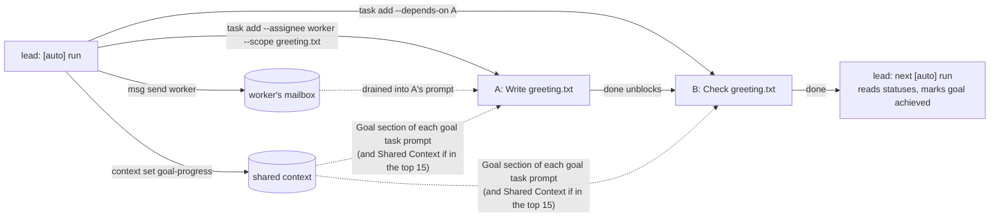

**Decision and blocking patterns are conventions.** The `a-team` roles define them; the engine has no code for
them (no `Decide:` or `BLOCKED` string appears in any Rust source):

| Pattern | Defined in | What the engine actually sees |
|---|---|---|
| `Decide: <question>` task assigned to the lead, with the continuation `--depends-on` it | `domain/org_templates/a-team/agents/senior-eng.yml:28`, `orchestrator.yml:20` | two ordinary tasks and a dependency |
| A result starting `BLOCKED — continued in <id>` or `AWAITING DECISION — <id>` | `senior-eng.yml:31`, `orchestrator.yml:21` | a successful run (exit 0) → `done` |
| `[ateam] checkpoint` tasks with `-l autonomous` as the lead's next wake-up | `orchestrator.yml:17-19` | an autonomous-labelled task: auto-approved, ignored by the achieved guard, **cancelled if any goal assigned to the lead is paused** ([§5.5](#55-what-pausing-a-goal-does-to-its-tasks)), and **still dispatched after its goal is abandoned or achieved** ([§5.6](#56-what-abandoning-or-achieving-a-goal-does-to-its-tasks)) |
| "Do NOT finish the `[auto]` task until the goal is achieved" | `infra/template/system.liquid:28` | nothing; the run ends when the CLI exits |

---

## 5. Q4: How does a goal-driven system work?

> *"How does a goal driven system work?"*

**Answer.** A goal is a stored objective with a status. It does nothing alone
([manual: What a goal changes](../manual/05-teams-and-goals.md#what-a-goal-changes)). It drives work through
**autonomous agents**: while a goal is `active`, the tick keeps giving its agent an `[auto]` task that carries
the goal text, and the agent turns the goal into ordinary tasks. The loop ends when the goal leaves `active`
or the agent stops being autonomous.

### 5.1 Goal state machine

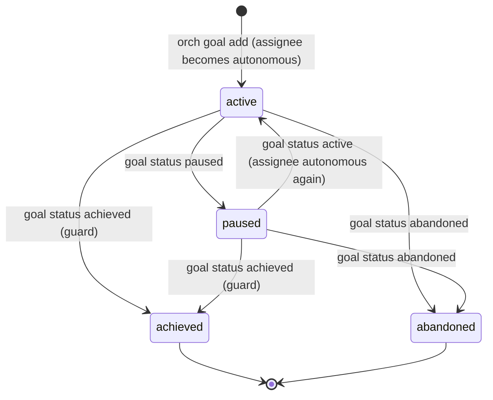

`domain/goal.rs:38-53`; side effects in `engine/goal_service.rs:133-176`. `achieved` and `abandoned` are
final for the goal, but not for its work: neither cancels the goal's queued tasks
([§5.6](#56-what-abandoning-or-achieving-a-goal-does-to-its-tasks)). The TUI keys `P` (pause/resume), `C` (achieve with force) and `X` (abandon) call the same service
(`tui/keys.rs:475-497`).

### 5.2 The seeding loop

Every watch-mode tick, after reconcile (`orchestrator/tick.rs:426-541`):

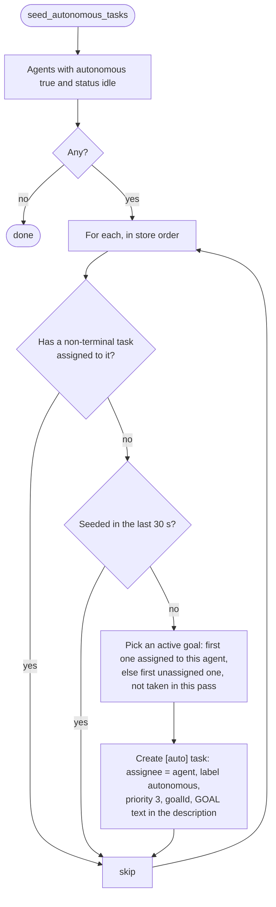

| Detail | Behaviour | Source |
|---|---|---|
| Who | `autonomous == true` and `status == idle` | `orchestrator/tick.rs:434-437` |
| Busy guard | Any non-terminal task assigned to the agent (including `review`) suppresses seeding | `orchestrator/tick.rs:465-469` |
| Cooldown | 30 s per agent, in memory (a restart resets it) | `orchestrator.rs:80-81`, `206-207`; `orchestrator/tick.rs:470-477` |
| Goal choice | assigned to this agent first, then unassigned; one agent per goal per pass; only `active` goals | `orchestrator/tick.rs:449-493` |
| No goal | still seeds: `[auto] <agent>: <role>`, "Autonomous work cycle", no goal id | `orchestrator/tick.rs:508-511` |
| Task shape | title `[auto] <agent>: <goal title, 60 chars>`; description `## GOAL (highest priority)` + goal description + role | `orchestrator/tick.rs:495-522` |
| Failure | per agent, reported as `orchestrator:error`, other agents still seeded | `orchestrator/tick.rs:523-535` |
| Off | `serve --once` does not seed | `orchestrator.rs:147`, `orchestrator/tick.rs:53-55` |

The resulting cycle, with nothing else assigned to the agent:

1. The `[auto]` task runs. Its system prompt includes **Autonomous Goal Mode**: decompose into
   `orch task add --goal-id …`, track progress in `<goal-id>-progress`, mark the goal achieved when done
   (`infra/template/system.liquid:19-35`) [convention].
2. It succeeds and is auto-approved, because it carries the `autonomous` label.
3. The agent is idle with no open task. After the cooldown, the next tick seeds a new `[auto]` task.

In the worked example the lead was re-seeded every 30 s (four `[auto]` tasks in 90 s) until it closed the goal.
An agent that creates a task **assigned to itself** (for example a checkpoint) is not re-seeded until that
task is terminal.

### 5.3 What "achieved" does

`orch goal status <id> achieved` (`engine/goal_service.rs:148-150`, `257-299`):

1. **Guard:** every task linked to the goal that is **not** labelled `autonomous` must be terminal. Otherwise
   the command fails and lists them. Autonomous tasks are excluded because they are the mechanism, and the
   running `[auto]` task would otherwise block every goal from inside.
2. `--force` cancels the pending linked tasks that are not `in_progress`, then still refuses if any is
   `in_progress` (only the orchestrator can kill a process).
3. The goal is saved `achieved`; `goal:status_changed` is emitted.
4. The assignee's `autonomous` flag is cleared if it has no other `active` goal. No more `[auto]` tasks.

Queued tasks labelled `autonomous` are **not** cancelled. The guard's code comment says "the side effects
below cancel them afterwards" (`engine/goal_service.rs:259-261`), but the only side effect for `achieved` is
step 4 (`engine/goal_service.rs:170-171`). See [§5.6](#56-what-abandoning-or-achieving-a-goal-does-to-its-tasks).

In the worked example the lead's own `[auto]` run executed `orch goal status … achieved` and the guard passed
while that run was still `in_progress`.

### 5.4 Goal progress: mechanism reads, convention writes

The key `<goal-id>-progress` in shared context is **read** by code: it is added to the Goal section of every
prompt for a goal-linked task (`orchestrator/dispatch.rs:484-492`, `infra/template/user.liquid:66-69`) and
shown by `orch goal show` (`engine/goal_service.rs:245-255`). It is **written** only by agents following the
template instruction (`infra/template/system.liquid:26`) [convention]. Being shared context, it also appears
in the Shared Context section of other agents' prompts, but only if it ranks in that prompt's top 15
([§3](#3-q2-how-does-one-agent-connect-to-another-agent)). Its key starts with the goal id, so it scores +10 in
the prompts of that goal's own tasks.

### 5.5 What pausing a goal does to its tasks

`orch goal status <id> paused` (`engine/goal_service.rs:162-167`), verified in a throwaway project:

| Thing | Effect |
|---|---|
| The goal | `status: paused`; seeding ignores it (only `active` goals are offered, `orchestrator/tick.rs:449-457`) |
| Assignee's `autonomous` flag | cleared, unless it has another `active` goal (`engine/goal_service.rs:312-319`) |
| Assignee's `todo`/`retrying` tasks labelled `autonomous` | **cancelled, whatever goal they belong to** (`engine/goal_service.rs:336-356`) — see below |
| Running tasks, including the `[auto]` task | keep running to completion |
| Non-autonomous tasks linked to the goal | **still dispatched**; dispatch does not check goal status |
| Prompts | the Goal section shows `**Status:** paused` |
| A goal with no assignee | none of the above side effects; only seeding stops |

**Observed, intent unconfirmed:** pausing goal A cancelled a `todo` autonomous task linked to goal B, because
the cancel filters on assignee and label, not on goal id. No test covers the multi-goal case.

The same-goal case matters more in practice. The `a-team` lead schedules its next wake-up as an
`[ateam] checkpoint` task labelled `autonomous`, then pauses its goal at the approval gate. The pause cancels
that checkpoint, and the checkpoints the lead has queued for its other goals.

**Resume:** `orch goal status <id> active` re-enables the assignee's autonomous flag
(`engine/goal_service.rs:168-169`). Cancelled tasks are **not** restored. The next tick seeds a fresh `[auto]`
task (cooldown permitting).

### 5.6 What abandoning or achieving a goal does to its tasks

`orch goal status <id> abandoned` (or `achieved`) runs one side effect: it clears the assignee's
`autonomous` flag if the agent has no other `active` goal (`engine/goal_service.rs:170-171`, `312-319`).
Nothing else changes. Dispatch never reads goal status (the only goal-status check in the orchestrator is
the seeder's, `orchestrator/tick.rs:449-457`).

| Thing | Pause | Abandon or achieve |
|---|---|---|
| Seeding of new `[auto]` tasks for the goal | stops | stops |
| Assignee's `autonomous` flag | cleared (unless another goal is `active`) | cleared (unless another goal is `active`) |
| Assignee's queued tasks labelled `autonomous` | **cancelled**, any goal | **left queued, and they run** |
| Queued tasks without the label, linked to the goal | left queued, and they run | left queued, and they run |
| Running tasks | finish | finish |

So **abandon is weaker than pause**: it stops new `[auto]` work, but every task already queued, including
the lead's own `[ateam] checkpoint`, is still dispatched and, if labelled `autonomous`, auto-approved. To stop
a goal's queued work, cancel each task: `orch task list --goal-id <id>`, then `orch task cancel <task-id>`.
Whether abandon should cancel like pause does is unconfirmed; see [§8](#8-known-gaps-pending-fixes) row 7.

Measured on 0.10.0 (shell stub agent, no daemon running while the goal changed status, then `orch serve`):

```text
$ orch goal status goal_bQBNoiK abandoned
  ✓ Goal "Goal C" → abandoned
$ grep '^autonomous' .orchestry/agents/agt_3bM6TN3.yml
autonomous: false
$ orch task show <id> --json | jq -r '"\(.id) \(.status) \(.labels)"'    # for both tasks
tsk_4ib1UHe todo ["autonomous"]        # "[ateam] checkpoint C", linked to the goal
tsk_aXagEfz todo []                    # "plain C", linked to the goal
$ orch serve --log-file serve.log      # task:status_changed lines, abridged
21:02:14.647Z tsk_aXagEfz todo -> in_progress
21:02:14.868Z tsk_aXagEfz review -> done
21:02:15.402Z tsk_4ib1UHe todo -> in_progress
21:02:15.557Z tsk_4ib1UHe review -> done
```

Achieving a goal (with `achieved`, no `--force`) left its queued `[ateam] checkpoint D` task in `todo`, and
`orch serve` then ran it to `done` in the same way. `--force` cancels only tasks that are **not** labelled
`autonomous`, because the guard ignores those (`engine/goal_service.rs:267-290`).

---

## 6. Q5: How does a pause happen?

> *"How does a pause happen? When a pause happen? What signal drives it to continue?"*

**Answer.** r-orch has no single "pause" switch. Seven things stop or hold work, at three levels:

- a **goal** stops generating work (pause, abandon);
- an **agent** stops taking work (disable);
- the **orchestrator** stops running work (watch stop, standalone interrupt, circuit breaker, crash).

Separately, one **task** can wait on its own conditions ("Waits that look like pauses", below). A goal pause
cancels queued autonomous work, and the orchestrator-level stops kill running work. Abandoning the goal and
disabling the agent, the two levers an operator is likely to try first, do neither: queued work still runs.
None of them is resumed by a message: the inbox is read only when a task is dispatched, so a message cannot restart anything. What
resumes each one is a command or a change of state, picked up at the next tick (within
`poll_interval_ms`) because the orchestrator re-reads the files each tick (`orchestrator/tick.rs:48-50`).

### 6.1 Pause and resume table

| Trigger | When it happens | What stops | What keeps going | What is persisted | What resumes it |
|---|---|---|---|---|---|
| **Goal pause**: `orch goal status <id> paused`, dashboard `P`, `/goal status <id> paused` | A human or an agent decides. The `a-team` lead pauses its goal at the approval gate [convention] (`domain/org_templates/a-team/agents/orchestrator.yml:78`). | Seeding for that goal; the assignee's autonomous flag; the assignee's queued autonomous tasks (cancelled) | Running tasks; non-autonomous linked tasks | `goals/<id>.yml` `status: paused`; agent `autonomous: false`; cancelled tasks | `orch goal status <id> active` (or `P`). The a-team convention: the owner sends `orch msg send <lead> …` **and** runs `goal status active`; the message alone does nothing. |
| **Goal abandon** (or achieve): `orch goal status <id> abandoned`, dashboard `X` | A human or an agent gives up on (or closes) the goal | Seeding for that goal; the assignee's autonomous flag | **Every queued task**, autonomous-labelled ones included; running tasks ([§5.6](#56-what-abandoning-or-achieving-a-goal-does-to-its-tasks)) | `goals/<id>.yml` `status: abandoned`; agent `autonomous: false` | Nothing: the status is final. To stop the queued work, `orch task cancel` each task. |
| **Agent disable**: `orch agent disable <id>` | A human wants one agent to stop taking work | New dispatch to the agent and `[auto]` seeding for it, **only while it is idle** | Its current run. When that run ends (success, failure or merge), the agent is written back to `idle` and takes its next queued task ([§8](#8-known-gaps-pending-fixes) row 6, pending fix) | `agents/<id>.yml` `status: disabled`, until a run ends | `orch agent enable <id>`, **or the end of any run it was executing** |
| **Watch stop**: dashboard `/pause`, `Ctrl+C` or `SIGTERM` to `run --watch` / `serve` / the dashboard | An operator stops the daemon or the dashboard pauses | All ticks; **every local run is killed** (10 s grace). The dashboard's `/pause` also drops this node's peer listener, so controllers that use this node as a remote lose it until `/watch` (`cli/tui/backend.rs:868-877`; test at `cli/serve/peer.rs:228-246`) | Remote runs this node submitted (detached) | runs `cancelled`; tasks `retrying` (or `failed`); `state.json` `pid: null`, `running` emptied; lock released | Start a watch process again (`orch serve`, `orch run --watch`, dashboard `/watch`). `retrying` tasks start on the first tick. |
| **Standalone interrupt**: `Ctrl+C`/`SIGTERM` to `orch run <id>` or `run --all` | An operator interrupts a one-shot run | New dispatches; the runs this command started | Runs started by other processes | Same as watch stop, for its own runs; exit code 130 or 143 | Run the command again |
| **Circuit breaker** | Five consecutive failing ticks, for example an unreadable store | Same as watch stop | — | Same as watch stop; each failure is an `orchestrator:error` with context `tick`, and the fifth has `fatal: true` | Fix the cause, start again |
| **Crash or `kill -9`** | The orchestrator dies without `stop()` | The tick and all collectors; child processes **may keep running** | Orphaned children | `state.json` still lists the runs and the old PID; the lock goes stale | Start again. Dead entries: their tasks are **cancelled** (`orch task retry` to restart). Live children: adopted, retried when they exit ([§2.8](#28-shutdown-and-restart-recovery)). |

Sources: goal `engine/goal_service.rs:133-176`; agent disable `engine/agent_service.rs:527-529`, `546-556`, and
the run-end resets `orchestrator/collect.rs:508-511` (success), `589-593` (failure), `811-815` (merge); `/pause` `tui/commands.rs:174-187` → `cli/tui/backend.rs:868-877` →
`orchestrator.rs:751-831`; signals `orchestrator.rs:583-600`, `725-734`, `1132-1135`; standalone interrupt
`orchestrator.rs:833-922`, exit codes `cli/commands/run.rs:361-362`; breaker `orchestrator.rs:1148-1168`; crash recovery `orchestrator/recovery.rs:245-485`.

**Waits that look like pauses** — the task is fine, it is waiting for a condition [mechanism]:

| Task waits in | Because | Continues when |
|---|---|---|
| `review` | its agent's policy is `manual` or `suggest`, or review criteria failed, or a merge conflicted | `orch task approve <id>` (→ `done`) or `orch task reject <id>` (→ `todo`) |
| `todo` + `awaiting-approval` label | a remote peer submitted it for a non-`auto` agent | `orch task approve <id>` on the worker removes the label |
| `todo` | a dependency is not `done` | the dependency becomes `done` (or is deleted) |
| `todo` | its scope overlaps running work | the overlapping task leaves `in_progress` |
| `todo` | its assignee is busy, disabled or absent; or all slots are full | the agent is idle and enabled; a slot frees |
| `retrying` | a failed attempt; the backoff is announced but not enforced at `40a6dc7` ([§8](#8-known-gaps-pending-fixes) row 1; fixed on `main` by PR #54) | next dispatch, about 0.5 s later |

### 6.2 State diagrams

The orchestrator process, as the dashboard sees it:

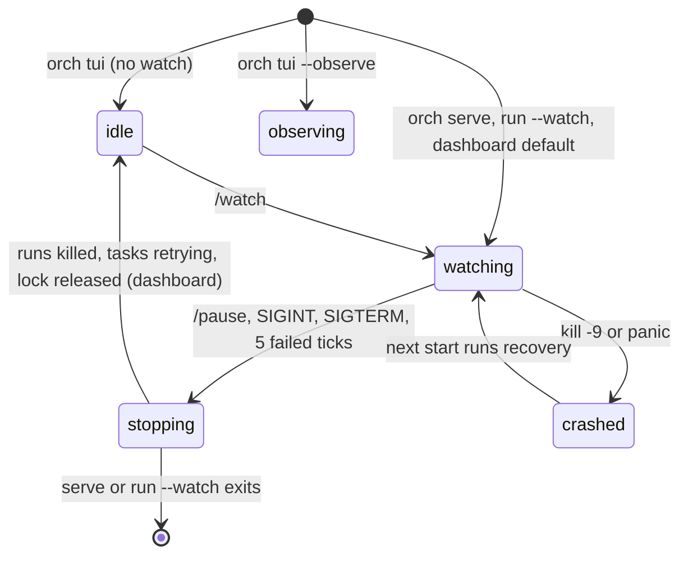

The dashboard's labels are `watching`, `observing` and `idle` (`tui/state.rs:3712-3720`). `stopping` and
`crashed` are not shown states; they are drawn to show what happens.

A goal and what each status does to its queued work (the goal's own state machine is in [§5.1](#51-goal-state-machine)):

```mermaid
stateDiagram-v2
    state "active: [auto] tasks seeded" as active
    state "paused: no seeding; assignee's queued autonomous tasks cancelled; the rest still runs" as paused
    state "achieved or abandoned: no seeding; nothing cancelled, every queued task still runs" as closed
    [*] --> active
    active --> paused : goal status paused
    paused --> active : goal status active (cancelled tasks stay cancelled)
    active --> closed : achieved (guard passes) or abandoned
    paused --> closed : achieved (guard passes) or abandoned
```

### 6.3 What we measured

Throwaway project, shell agents (`sleep 15`), `poll_interval_ms: 1000`, shared workspaces:

| Experiment | Result |
|---|---|
| Pause goal one while its `[auto]` task runs | The `[auto]` task ran to completion (`20:12:33` → `20:12:48`, `done`). A non-autonomous task linked to the paused goal was dispatched at `20:12:49`. The agent's flag became `autonomous: false`; resuming set it back to `true`. |
| Pause goal one while the agent has a queued autonomous task for goal two | The goal-two task went to `cancelled`. |
| Abandon a goal with an `autonomous`-labelled and a plain task queued, then `orch serve`; separately, achieve a goal with an `autonomous`-labelled task queued | Both abandoned-goal tasks ran to `done` (`21:02:14`–`21:02:15`); the achieved goal's task ran to `done` too ([§5.6](#56-what-abandoning-or-achieving-a-goal-does-to-its-tasks)). |
| `orch agent disable` while the agent runs the first of two queued tasks (stub `sleep 6`) | Agent `status: running` → `disabled` at about `21:02:34`. When the run ended the agent was `idle`, and the second task went `todo → in_progress` at `21:02:40.502` and finished `done`. |
| `SIGTERM` to `orch serve` during a run | `orchestrator:shutdown "Received SIGTERM"`; run `cancelled`; task `retrying` (attempts 1); `state.json` `pid: null`, `running: {}`; lock file removed. |
| Start `orch serve` again | The `retrying` task was dispatched in the first tick (`20:13:11.194`). |
| `kill -9` the daemon during a run, then start again | The child survived. The new daemon took over the stale lock and kept the running entry. When the child exited (`20:13:27`), reconcile failed the run with `Process crashed unexpectedly`, the task went to `retrying` with a 20 s retry announced, and it was re-dispatched 54 ms later. |
| `orch task cancel <running-task>` while `orch serve` runs | `✕ Orchestrator already running (PID: …)`, exit 4; the task stayed `in_progress` ([§8](#8-known-gaps-pending-fixes) row 3). |

---

## 7. Worked example: one goal end to end

A lead agent turns a goal into two tasks for a worker, the worker does them, a human approves, and the lead
closes the goal. Both agents are `shell` scripts, so the run needs no AI CLI.

### 7.1 Setup

```sh
export HOME=<tmp>/home ORCHESTRY_GLOBAL_CONFIG_PATH=<tmp>/home/global.yml
mkdir <tmp>/proj && cd <tmp>/proj && git init -q -b main && git commit -q --allow-empty -m init
orch init
orch agent disable agt_creator                    # the default agent is a real AI CLI
orch config set scheduling.poll_interval_ms 1000  # faster ticks for the demo
orch agent add lead   --adapter shell --command "<tmp>/bin/lead.sh"   --role "team lead"
orch agent add worker --adapter shell --command "<tmp>/bin/worker.sh" --role "engineer" --approval-policy manual
orch goal add "Ship a greeting file" --description "greeting.txt exists on main and says hello" --assignee <lead-id>
```

```text
  ✓ Disabled agent agt_creator
  ✓ scheduling.poll_interval_ms = 1000
  ✓ Created goal "Ship a greeting file" (goal_dM7wWns)
```

The goal file, and the side effect on the lead:

```yaml
# .orchestry/goals/goal_dM7wWns.yml
id: goal_dM7wWns
title: Ship a greeting file
description: greeting.txt exists on main and says hello
status: active
assignee: agt_Exz8Um9
created_at: '2026-10-23T20:09:31.541Z'
updated_at: '2026-10-23T20:09:31.541Z'
```

```text
$ grep autonomous .orchestry/agents/agt_Exz8Um9.yml
autonomous: true
```

The two stub agents (paths shortened; `$O` is the `orch` binary, `$T` a scratch directory):

```bash
# lead.sh: plans on its first [auto] run, checks and closes the goal on later ones
G=$(cat $T/goal_id); W=$(cat $T/worker_id)
if [ ! -f $T/lead.planned ]; then
  touch $T/lead.planned
  A=$($O task add "Write greeting.txt" -d "Create greeting.txt containing hello" --assignee "$W" \
        --goal-id "$G" --scope "greeting.txt" --workspace-mode worktree --quiet)
  B=$($O task add "Check greeting.txt" -d "Confirm greeting.txt says hello" --assignee "$W" \
        --goal-id "$G" --depends-on "$A" --workspace-mode shared --quiet)
  echo "$A" > $T/task_a; echo "$B" > $T/task_b
  $O msg send "$W" "greeting.txt must contain exactly: hello" -s "Spec" --from "$ORCH_AGENT_ID" --quiet
  $O context set "$G-progress" "planned $A -> $B; waiting" >/dev/null
  echo "planned $A then $B"
else
  A=$(cat $T/task_a); B=$(cat $T/task_b)
  SA=$($O task show "$A" --json | jq -r .status); SB=$($O task show "$B" --json | jq -r .status)
  if [ "$SA" = done ] && [ "$SB" = done ]; then
    $O context set "$G-progress" "done: $A and $B" >/dev/null
    $O goal status "$G" achieved >/dev/null
    echo "goal achieved"
  else
    echo "still waiting: $A=$SA $B=$SB"
  fi
fi
```

```bash
# worker.sh: the task prompt arrives in ORCHESTRY_TASK_PROMPT
echo "$ORCHESTRY_TASK_PROMPT" > "$T/prompt-$ORCH_TASK_ID.txt"
if grep -q "^## Task: Write greeting.txt" <<<"$ORCHESTRY_TASK_PROMPT"; then
  echo hello > greeting.txt
  git add greeting.txt && git -c user.email=w@x -c user.name=worker commit -qm "add greeting" \
    && echo "wrote greeting.txt in $(pwd)"
else
  grep -qx hello greeting.txt && echo "greeting.txt verified"
fi
```

### 7.2 Run

```sh
orch serve --log-file <tmp>/serve.log
```

The `serve` log, with ticks removed and fields shortened:

| Time (UTC) | Event | Mechanism |
|---|---|---|
| 20:09:36.991 | `serve:started` mode watch | lock taken, recovery, first tick |
| 20:09:37.040 | `task:created` `tsk_YScMkwA` "[auto] lead: Ship a greeting file" | seeding ([§5.2](#52-the-seeding-loop)) |
| 20:09:37.120–.216 | `todo → in_progress`, `agent:started` lead, `run_Fgyre0A` | dispatch ([§2.4](#24-dispatch-and-collect)) |
| (inside the run) | lead creates `tsk_9LTxwVi` (A) and `tsk_gsWirYB` (B), sends `msg_zE6BERw`, sets progress | [§4](#4-q3-how-does-one-agent-connect-to-another-task) |
| 20:09:37.443–.536 | lead `agent:completed`; worktree merged; `in_progress → review → done` | auto-approve: autonomous label |
| 20:09:37.617–.695 | A `todo → in_progress`; worker started, `run_apQKDcP` | reactive dispatch after the lead's run; mailbox drained |
| 20:09:37.983–38.054 | worker completed; `workspace:merge_succeeded` `orchestry/tsk_9LTxwVi/write-greeting-txt`; A `in_progress → review` | merge before review; `manual` policy stops at review |
| 20:09:38 → 20:10:37 | B stays `todo`: blocked on A. The lead is re-seeded every 30 s and prints `still waiting` | dependency; seeding cooldown |
| (human) | `orch task approve tsk_9LTxwVi` → `✓ Approved tsk_9LTxwVi` | human gate |
| 20:10:43.274–.415 | B `todo → in_progress`, worker run, B `→ review` | next tick saw A `done` (cross-process change, so not reactive) |
| (human) | `orch task approve tsk_gsWirYB` | |
| 20:11:07.249–.626 | new `[auto]` lead task; the lead runs `orch goal status … achieved`; its task `→ done` | achieved guard passes: A and B terminal, `[auto]` tasks excluded |

```text
$ orch goal show goal_dM7wWns
  ID           goal_dM7wWns
  Title        Ship a greeting file
  Status       achieved
  Assignee     agt_Exz8Um9
  Description  greeting.txt exists on main and says hello
  Created      2026-10-23T20:09:31.541Z
  Updated      2026-10-23T20:11:07.464Z

  Tasks (6)
  ──────────────────────────────────────────
  STATUS  ID           TITLE                              AGENT
  ✓ done  tsk_96_kaso  [auto] lead: Ship a greeting file  agt_Exz8Um9
  ✓ done  tsk_gsWirYB  Check greeting.txt                 agt_th7D9rF
  ✓ done  tsk_9LTxwVi  Write greeting.txt                 agt_th7D9rF
  ✓ done  tsk_T7pUWvM  [auto] lead: Ship a greeting file  agt_Exz8Um9
  ✓ done  tsk_tjSSbhR  [auto] lead: Ship a greeting file  agt_Exz8Um9
  ✓ done  tsk_YScMkwA  [auto] lead: Ship a greeting file  agt_Exz8Um9

  Progress Report
  ──────────────────────────────────────────
  done: tsk_9LTxwVi and tsk_gsWirYB
```

Afterwards the lead's `autonomous` flag is `false` and no more `[auto]` tasks appear. `SIGTERM` then stopped the
daemon: `orchestrator:shutdown "Received SIGTERM"`, `state.json` `pid: null`, the lock file removed.

### 7.3 The on-disk trail

Files after task A ran (before approval), excluding templates and workspaces:

```text
.orchestry/agents/{_index.json, agt_creator.yml, agt_Exz8Um9.yml, agt_th7D9rF.yml}
.orchestry/context/{_index.json, goal_dM7wWns-progress.json}
.orchestry/goals/{_index.json, goal_dM7wWns.yml}
.orchestry/messages/{_index.json, msg_zE6BERw.json}
.orchestry/runs/{run_Fgyre0A.json, run_Fgyre0A.jsonl, run_apQKDcP.json, run_apQKDcP.jsonl}
.orchestry/tasks/{_index.json, tsk_9LTxwVi.yml, tsk_gsWirYB.yml, tsk_YScMkwA.yml}
.orchestry/{config.yml, state.json, orchestry.lock, peer-id, .gitignore, workspace-exclude}
```

(plus `.index.lock`, `.mutation.lock` and `.definition.lock` helper files.)

Task A waiting for approval. `proof.branch` was saved at dispatch, `files_changed` came from the branch diff:

```yaml
id: tsk_9LTxwVi
title: Write greeting.txt
description: Create greeting.txt containing hello
status: review
priority: 3
assignee: agt_th7D9rF
labels: []
depends_on: []
created_at: '2026-10-23T20:09:37.302Z'
updated_at: '2026-10-23T20:09:38.040Z'
attempts: 1
max_attempts: 3
workspace_mode: worktree
workspace: <tmp>/proj/.orchestry/workspaces/tsk_9LTxwVi
proof:
  branch: orchestry/tsk_9LTxwVi/write-greeting-txt
  files_changed:
  - greeting.txt
scope:
- greeting.txt
goalId: goal_dM7wWns
```

There is no `proof.agent_summary`, although the worker printed a line: the shell adapter gap ([§8](#8-known-gaps-pending-fixes) row 4).

Task B, blocked on A:

```yaml
id: tsk_gsWirYB
title: Check greeting.txt
description: Confirm greeting.txt says hello
status: todo
priority: 3
assignee: agt_th7D9rF
labels: []
depends_on:
- tsk_9LTxwVi
created_at: '2026-10-23T20:09:37.328Z'
updated_at: '2026-10-23T20:09:37.328Z'
attempts: 0
max_attempts: 3
workspace_mode: shared
goalId: goal_dM7wWns
```

The worker's run record and its event log. The stored `prompt` is the 4746-character **user** prompt, shown
here replaced by its length; the system half (identity and role, orchestrator CLI instructions, goal-mode
and rules text, skills; in eco mode the team roster too) is not stored, so the CLI received more than this
(see [driving-agent-clis.md "What gets persisted?"](driving-agent-clis.md#what-gets-persisted)):

```json
{
  "id": "run_apQKDcP",
  "task_id": "tsk_9LTxwVi",
  "agent_id": "agt_th7D9rF",
  "attempt": 1,
  "status": "succeeded",
  "started_at": "2026-10-23T20:09:37.597Z",
  "finished_at": "2026-10-23T20:09:37.977Z",
  "workspace_path": "<tmp>/proj/.orchestry/workspaces/tsk_9LTxwVi",
  "pid": 87903,
  "prompt_chars": 4746
}
```

```text
$ cat .orchestry/runs/run_apQKDcP.jsonl
{"timestamp":"2026-10-23T20:09:37.942Z","type":"agent_output","data":"wrote greeting.txt in <tmp>/proj/.orchestry/workspaces/tsk_9LTxwVi"}
```

The message, delivered when the worker was dispatched:

```json
{
  "id": "msg_zE6BERw",
  "channel": "direct",
  "from_agent_id": "agt_Exz8Um9",
  "to_agent_id": "agt_th7D9rF",
  "subject": "Spec",
  "body": "greeting.txt must contain exactly: hello",
  "created_at": "2026-10-23T20:09:37.361Z",
  "expires_at": "2026-10-24T20:09:37.361Z",
  "status": "delivered",
  "delivered_at": "2026-10-23T20:09:37.579Z"
}
```

The progress entry:

```json
{
  "key": "goal_dM7wWns-progress",
  "value": "planned tsk_9LTxwVi -> tsk_gsWirYB; waiting",
  "created_at": "2026-10-23T20:09:37.386Z",
  "updated_at": "2026-10-23T20:09:37.386Z"
}
```

Where those reached the worker's prompt for task A (section headings, from the `ORCHESTRY_TASK_PROMPT` it saved):

```text
29:## Task: Write greeting.txt
36:## Context
40:## Team
114:## Shared Context
116:- **goal_dM7wWns-progress**: planned tsk_9LTxwVi -> tsk_gsWirYB; waiting
121:## Inbox (1 message)
132:## Goal: Ship a greeting file
147:planned tsk_9LTxwVi -> tsk_gsWirYB; waiting
```

```text
## Inbox (1 message)

---
**From:** lead · **Subject:** Spec
greeting.txt must contain exactly: hello

---
```

`state.json` between runs, while the daemon owned the project:

```json
{
  "version": 1,
  "pid": 87542,
  "started_at": "2026-10-23T20:09:37.001Z",
  "onboardingCompleted": false,
  "running": {},
  "claimed": [],
  "retry_queue": [],
  "stats": {
    "total_runs": 2,
    "total_tasks_completed": 2,
    "total_tasks_failed": 0,
    "total_tokens": { "input": 0, "output": 0, "reasoning": 0, "total": 0, "cache_read": 0, "cache_write": 0 },
    "total_runtime_ms": 529
  }
}
```

And the project history, showing the merge-back of A's worktree branch:

```text
$ git log --oneline --all
d4ac54f Merge orchestry/tsk_9LTxwVi/write-greeting-txt
c13f223 add greeting
f21f62b init
```

---

## 8. Known gaps (pending fixes)

Behaviour this document describes that differs from what the manual or code comments promise, or that an
operator would not expect. Each row was reproduced on `40a6dc7` (0.10.0); the "Reproduction" column points to
the measurement in this document. None is tracked in a public issue yet. When a fix lands, update the row and
every section that links to it.

| # | Actual behaviour at `40a6dc7` | Contradicts | Reproduction · status |
|---|---|---|---|
| 1 | Retry backoff is announced (`run:retry delay_ms`) but not enforced; `retrying` tasks restart in about 0.5 s | manual [02-concepts](../manual/02-concepts.md) line 138, [04-tasks](../manual/04-tasks.md) line 414 | stub agent that exits 1: three attempts in 1.5 s ([§2.5](#25-completion-success-review-retry-cascade)) · **fixed on `main` by PR #54**, after 0.10.0 |
| 2 | Stall detection never fires for a run whose collector is live in this process, which is every run the process started (`orchestrator/tick.rs:201-206`) | manual [07](../manual/07-running-and-monitoring.md#stop-a-stalled-run), [02-concepts](../manual/02-concepts.md) lines 137 and 299, [RUNBOOK](../RUNBOOK.md) line 304 | code path in [§2.2](#22-reconcile-what-happened-to-running-work) · open |
| 3 | `orch task cancel` of an `in_progress` task fails with exit 4 while another process owns the lock (`cli/commands/task.rs:486-488` → `orchestrator.rs:384-386`; `LockConflict` maps to 4 at `domain/error.rs:104`) | manual [04-tasks](../manual/04-tasks.md#cancel-a-task) line 370; the reconcile comment at `orchestrator/tick.rs:135-139` | [§6.3](#63-what-we-measured), last row · open |
| 4 | Shell-adapter output never becomes `proof.agent_summary`: shell events carry a bare string and the collector reads only `text`/`message` (`orchestrator/collect.rs:193-204`, `infra/adapters/shell.rs:119`) | the fallback comment at `orchestrator/collect.rs:141-142` | worked example, task A's `proof` ([§7.3](#73-the-on-disk-trail)) · open |
| 5 | Pausing a goal cancels the assignee's queued autonomous tasks of **every** goal (`engine/goal_service.rs:336-356`) | nothing explicit | [§6.3](#63-what-we-measured), second row · intent unconfirmed |
| 6 | `orch agent disable` on a running agent is undone when its run ends: success, failure and merge all write `idle` without checking (`orchestrator/collect.rs:508-511`, `589-593`, `811-815`), and the agent takes its next queued task | manual [03-agents](../manual/03-agents.md) line 288: "A disabled agent gets no new tasks" | [§6.3](#63-what-we-measured), agent-disable row · open |
| 7 | Abandoning or achieving a goal cancels none of its queued tasks, autonomous-labelled ones included; they still run and auto-approve (`engine/goal_service.rs:170-171`) | the achieved guard's comment, "the side effects below cancel them afterwards" (`engine/goal_service.rs:259-261`) | [§5.6](#56-what-abandoning-or-achieving-a-goal-does-to-its-tasks) · intent unconfirmed |
| 8 | Each prompt shows at most 15 shared-context entries, ranked by relevance to the task and agent; the rest are left out silently (`infra/template/context.rs:75-149`, `crates/orch-core/src/template.rs:214`) | manual [06-messages-and-context](../manual/06-messages-and-context.md#how-agents-see-the-context) lines 244 and 253: every entry is in every prompt | set 20 keys, dispatch one shell task: the prompt lists 15 ([§3](#3-q2-how-does-one-agent-connect-to-another-agent)) · open; not filed, reported to the owner |
| 9 | `orch run <task-id>` exits 0 and runs nothing when the assignee has any other dispatchable (`todo`/`retrying`) task: `dispatch_only_task` claims every other such task (`orchestrator/dispatch.rs:264-293`), the eligibility filter then excludes any agent with another claimed task (`orchestrator/dispatch.rs:386-401`), and the claim is dropped with `Ok(())` (`orchestrator/dispatch.rs:402-411`). Unchanged on `main` after PR #54 | the run-one-task contract of `orch run <task-id>` ([§1](#who-runs-the-orchestrator)) | two `todo` tasks on one shell agent; `orch run A` prints `orch · running <id> "A"`, exits 0, writes no run record, and both stay `todo`. With B cancelled, the same command runs A to `done` · open; not filed, reported to the owner |

Also documented as current limits in the manual: `timeout_ms` is stored but not enforced
([manual 07](../manual/07-running-and-monitoring.md#stop-a-stalled-run)).

## 9. Constants

| Constant | Value | Source |
|---|---|---|
| `scheduling.poll_interval_ms` | 10 000 ms | `domain/config.rs:239` |
| `scheduling.max_concurrent_agents` | 6 local runs | `domain/config.rs:240` |
| `scheduling.retry_base_delay_ms` / `retry_max_delay_ms` | 10 000 / 300 000 ms | `domain/config.rs:241-242` |
| `defaults.task.max_attempts` / `priority` | 3 / 3 | `domain/config.rs:234-235` |
| `defaults.agent.stall_timeout_ms` | 600 000 ms | `domain/config.rs:229` |
| `defaults.agent.approval_policy` | `auto` | `domain/config.rs:226` |
| `defaults.agent.workspace_mode` | `worktree` | `domain/config.rs:230` |
| Reactive dispatch debounce, lazy-save debounce | 500 ms | `orchestrator.rs:82-83` |
| Reactive dispatch retries while a tick runs | 10 | `orchestrator.rs:84-86` |
| Autonomous seeding cooldown | 30 000 ms per agent | `orchestrator.rs:80-81` |
| Tick circuit breaker | 5 consecutive failures | `orchestrator.rs:75-76` |
| Retry queue size | 100, oldest dropped | `orchestrator.rs:77-79` |
| Kill grace: cancel / stall / stop | 3 s / 5 s / 10 s | `orchestrator.rs:87-90`, `crates/orch-core/src/process.rs:328` |
| `proof.agent_summary` cap | 2000 chars | `orchestrator.rs:91-92` |
| Run event data cap (file / bus) | 8 KB / 4 KB | `orchestrator.rs:71-74` |
| Lock staleness | 60 s untouched, or dead PID | `infra/storage/lock.rs:27` |
| Message TTL default / max | 24 h / 7 days | `domain/message.rs:130-133` |
| Remote submit deadline / queued warning | 5 min online / 1 h | `orchestrator.rs:95-106` |
