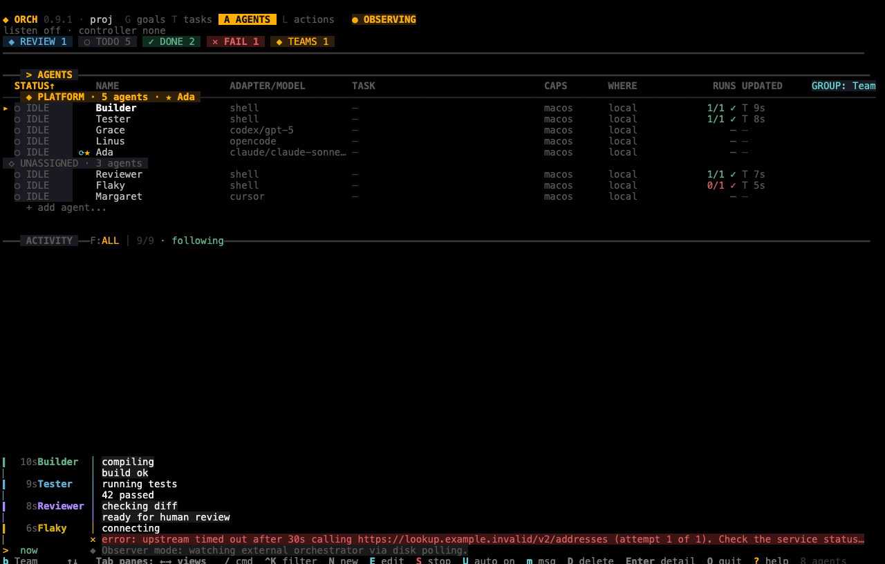
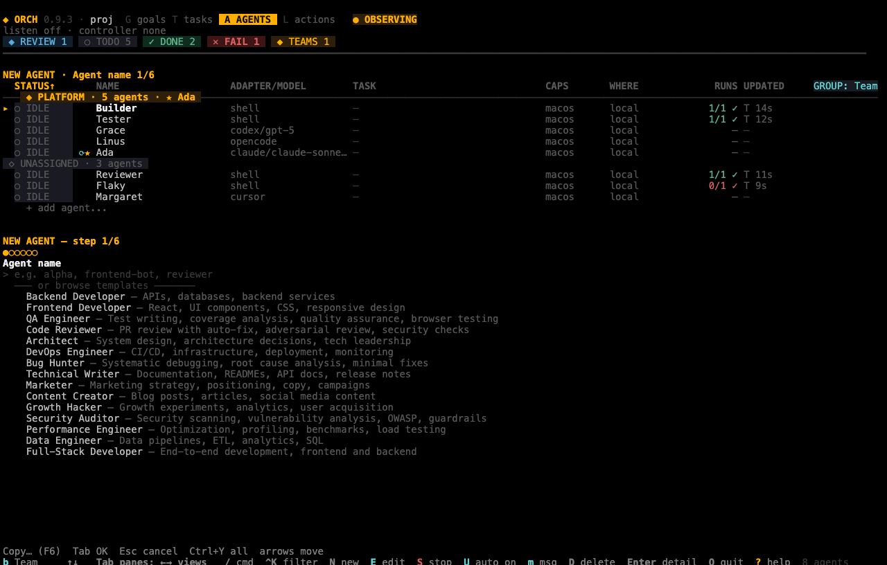

# Agents

An agent is a named worker that runs one AI command-line tool, or one shell command, on your tasks. Read this chapter to add agents, change them, stop them taking work, and remove them. For what an agent is, see [Agents and adapters](02-concepts.md#agents-and-adapters).

## In this chapter

- [Add an agent](#add-an-agent)
- [Choose an adapter and its options](#choose-an-adapter-and-its-options)
- [Add a ready-made agent from the shop](#add-a-ready-made-agent-from-the-shop)
- [List agents and see one in detail](#list-agents-and-see-one-in-detail)
- [Change an agent](#change-an-agent)
- [Change an agent's model](#change-an-agents-model)
- [Stop an agent from taking work](#stop-an-agent-from-taking-work)
- [Autonomous agents](#autonomous-agents)
- [Remove an agent](#remove-an-agent)
- [Use the dashboard instead](#use-the-dashboard-instead)

The examples in this chapter use the `shell` adapter, which runs a command you write. It needs nothing but `bash`, so you can try every step without an AI tool installed.

## Add an agent

Before you start: run `orch init` in your project. See [Getting started](01-getting-started.md).

1. Run `orch agent add` with a name, an adapter and, for a `shell` agent, the command to run:

```sh
orch agent add builder --adapter shell \
  --command 'echo "working on: $ORCH_TASK_ID"; echo done > built.txt' \
  --workspace-mode shared
```

```text
  ✓ Added agent builder (shell) → agt_3cU5sQA
```

2. Read the ID at the end of the line. Commands that take an agent accept this ID. Some commands also accept the exact name; see [Names and IDs](#names-and-ids).

The general form is `orch agent add <name> --adapter <adapter> [options]`.

In the default `worktree` workspace mode, orch merges back only the work an agent has committed. Uncommitted files are discarded when the run ends. This example uses `--workspace-mode shared` so that it works in any folder. See [Workspaces](02-concepts.md#workspaces) before you rely on `worktree`.

A name must be unique in the project:

```text
  ✕ Agent "builder" already exists
```

A `shell` agent without a command is refused:

```text
  ✕ Shell agents require a command
```

To add an AI agent, name the adapter and, if you want, a model, a role and skills:

```sh
orch agent add reviewer --adapter claude --model claude-sonnet-4-6 \
  --effort high --role "Reviews pull requests" --skills review,qa \
  --approval-policy suggest
```

### Options for `orch agent add`

| Option | What it does | Default |
|---|---|---|
| `<name>` | The agent's name. Required. | |
| `--adapter <adapter>` | The tool the agent runs: `claude`, `opencode`, `codex`, `cursor`, `pi`, `grok`, `antigravity` or `shell`. Required. | |
| `--command <cmd>` | The command a `shell` agent runs. Required for `shell`. | |
| `--model <model>` | The model name, for AI adapters. Ignored for `shell`. | The tool's own default |
| `--effort <level>` | Reasoning effort: `low`, `medium` or `high`. Ignored for `shell`. | The tool's own default |
| `--role <role>` | A description of the agent's job. orch puts it in the agent's prompt and uses it when it matches tasks to agents. | None |
| `--skills <skills>` | A comma-separated list of skills. | None |
| `--max-turns <n>` | The maximum number of turns per run. | 50 |
| `--timeout <ms>` | A timeout in milliseconds. See the warning below. | 3600000 |
| `--approval-policy <policy>` | `auto`, `suggest` or `manual`. See [Review and approval](02-concepts.md#review-and-approval). | `auto` (the project default) |
| `--workspace-mode <mode>` | `shared`, `worktree` or `isolated`. See [Workspaces](02-concepts.md#workspaces). | The project default, `worktree` |
| `-e`, `--edit` | Opens `$EDITOR` so you can write the role. | |

> **Note:** `--timeout` is stored in the agent's file, but orch does not enforce it in this version. A different limit, `stall_timeout_ms`, stops a run that produces no output for 10 minutes by default. See [Stop a stalled run](07-running-and-monitoring.md#stop-a-stalled-run).

Three details about the defaults:

- A `shell` agent ignores `--model` and `--effort`, and its approval policy is `auto` unless you pass `--approval-policy`.
- Other adapters take the approval policy from the project setting `defaults.agent.approval_policy`, which is `auto` after `orch init`.
- `orch init` also creates one agent, Agent Creator, with the policy `suggest`. It uses the project's default adapter, which is `claude` unless you ran `orch init --adapter <adapter>`.

> **Note:** `orch agent add` accepts any adapter name without checking it. A name that is not in the list above is saved, but orch cannot run that agent. Run `orch doctor` to see which adapters are installed.

### Names and IDs

`orch agent edit`, `update`, `patch`, `disable`, `enable`, `autonomous` and `remove` need the agent's ID (`agt_…`) and refuse a name with `Agent not found`. `orch agent status` (and `show`), `orch task assign` and `orch task add --assignee` accept an ID or an exact name. `orch team create --lead` needs an ID. To print only IDs, use `--quiet`:

```sh
orch agent list --quiet
```

## Choose an adapter and its options

An **adapter** is the AI tool an agent runs. orch starts the tool as a child process, so you must install and sign in to the tool yourself. Run `orch doctor` to see what orch can find ([Check your setup](07-running-and-monitoring.md#check-your-setup)).

The table shows which of your options orch passes to each tool.

| Adapter | Tool | `--model` | `--effort` | `--max-turns` |
|---|---|---|---|---|
| `claude` | Claude Code (`claude`) | Yes | Yes | Yes |
| `codex` | Codex (`codex`) | Yes | No | No |
| `cursor` | Cursor agent CLI (`cursor-agent` or `agent`) | Yes | No | No |
| `opencode` | OpenCode (`opencode`) | Yes | No | No |
| `pi` | Pi (`pi`) | Yes | Yes, as its thinking level | No |
| `grok` | Grok (`grok`) | Yes | Yes | Yes |
| `antigravity` | Google Antigravity (`agy`) | Yes | No | No |
| `shell` | `bash -lc <your command>` | No | No | No |

"No" means orch stores the value but does not pass it to the tool. Model names differ between tools; use the names that tool accepts.

A `shell` agent runs your command with `bash -lc`. orch gives it the task text in the environment variable `ORCHESTRY_TASK_PROMPT`, and the variables `ORCH_AGENT_ID`, `ORCH_AGENT_NAME` and `ORCH_TASK_ID`. An exit code of 0 means success; any other code fails the run. Everything the command prints becomes the run's log. Always quote the task text in your command (`"$ORCHESTRY_TASK_PROMPT"`) and treat it as untrusted input: on a worker that listens for remote peers, any host that can reach the port supplies it. See [Restrict who can connect](11-remote-agents.md#restrict-who-can-connect).

> **Warning:** A `shell` agent runs whatever command you give it, with your permissions. Keep API keys in your environment, not in an agent's `env` setting. Agent files can be read only by you, and `orch init` adds `.orchestry` to `.gitignore`. A copy, a backup or a forced `git add` still carries any key stored there.

Agents are stored as one file each in `.orchestry/agents/`.

## Add a ready-made agent from the shop

The agent shop is a catalogue of 15 agent roles, each with a model tier, a role text and skills.

```sh
orch agent shop --list
```

```text
  Key                   Name                  Tier      Skills
  backend-dev           Backend Developer     balanced  review, careful
  frontend-dev          Frontend Developer    balanced  design-review, review
  qa-engineer           QA Engineer           balanced  qa, testing-suite:generate-tests
  …
```

Run `orch agent shop` in a terminal to pick one from a list. Press `Enter` to install the highlighted template and `q` or `Esc` to cancel. If the output is redirected to a file or pipe, the command prints the table instead.

`--template <name>` and `--template-dir <path>` install one member of an organization template. The templates, the picker and these options are in [Templates and the agent shop](10-templates-and-shop.md#add-one-agent-from-the-agent-shop).

## List agents and see one in detail

List all agents:

```sh
orch agent list
```

```text
  STATUS  AGENT          ADAPTER  CAPS   WHERE  TASK  TIME
  ○ idle  Agent Creator  claude   macos  local  —     —
  ○ idle  noter          shell    macos  local  —     —
  ○ idle  builder        shell    macos  local  —     —

  3 agents · 0 running · 0 tokens total
```

| Column | Meaning |
|---|---|
| STATUS | `idle`, `running`, `disabled`, or `offline` for a remote agent whose machine is not connected. |
| AGENT | The agent's name. |
| ADAPTER | The adapter. |
| CAPS | The host capabilities, such as `macos` or `linux`. Tasks can require one with a `cap:` label ([Labels and capabilities](04-tasks.md#labels-and-capabilities)). |
| WHERE | `local`, or `remote <alias> online` or `offline`. See [Remote agents](11-remote-agents.md). |
| TASK | The task the agent is running now. |
| TIME | Always `—` in this version. |

Show one agent. `orch agent show` is a short form of the same command.

```sh
orch agent status agt_3cU5sQA
```

```text
  builder
  ══════════════════════════════════════════

  Adapter  shell
  Command  echo "working on: $ORCH_TASK_ID"; echo done > built.txt
  Status   ○ idle
  CAPS     macos
  WHERE    local
  Policy   auto

  Stats
  ──────────────────────────────────────────
  Tasks completed  0
  Tasks failed     0
  Total runs       0
  Tokens used      0
```

An AI agent also shows its model, effort, role and skills. `orch agent list --json` and `--yaml` print every field; see [Choose the output format](12-configuration-and-output.md#choose-the-output-format).

## Change an agent

You have three ways to change an agent. You cannot change a remote agent (one whose ID contains `@`). `update` and `patch` also refuse to change an agent that is running.

| Command | Use it to |
|---|---|
| `orch agent edit <id>` | Change the name, command, model and role in your editor. |
| `orch agent patch <id> -f <file>` | Change some settings from a JSON or YAML file or from standard input. Settings you leave out stay as they are. |
| `orch agent update <id> -f <file>` | Replace the whole definition from a file. Optional settings you leave out are cleared. |

### Change an agent in your editor

1. Run `orch agent edit <id>`. orch opens the file in `$EDITOR` (then `$VISUAL`, then `vi`).
2. Change the lines `name:`, `command:` and `model:` between the two `---` lines. Write the role below the second `---`.
3. Save and close the editor.

```text
  ✓ Updated agent reviewer (agt_tXijNDc)
```

An empty value clears the setting. `edit` cannot change the adapter, approval policy or skills; use `patch` for those.

### Change settings from a file

Use `patch` for a small change, such as a new command. This example changes the command of a `shell` agent:

```sh
echo '{"config": {"command": "echo hello"}}' | orch agent patch agt_3cU5sQA -f -
```

```text
  ✓ Updated agent builder (agt_3cU5sQA)
```

A patch follows the rules of RFC 7396: objects merge, arrays replace, and `null` removes a setting. Use `update` when you keep the whole definition in version control:

```yaml
# agent.yaml
name: builder
adapter: shell
role: Builds artifacts
config:
  command: echo "building $ORCH_TASK_ID"; echo done > built.txt
  approval_policy: auto
  workspace_mode: shared
```

```sh
orch agent update agt_3cU5sQA -f agent.yaml
```

| Option | What it does |
|---|---|
| `-f`, `--file <file>` | The file to read. Use `-` for standard input. Required. At most 1 MiB. |
| `--input-format json` or `yaml` | Overrides the format orch detects from the file name or first character. |

The writable settings are `name`, `adapter` and `role`, and under `config` the keys `command`, `model`, `effort`, `approval_policy`, `max_turns`, `timeout_ms`, `stall_timeout_ms`, `env`, `system_prompt`, `workspace_mode` and `skills`. A change that is not valid is refused and nothing is saved:

```sh
echo '{"config":{"typo":1}}' | orch agent patch agt_3cU5sQA -f -
```

```text
  ✕ <stdin>: config.typo: unknown field
```

Examples to copy are in `examples/file-mutations/` in the repository. The input rules, every error and the locking limits are in [docs/file-mutations.md](../file-mutations.md).

## Change an agent's model

1. Find the agent's ID with `orch agent list --quiet`.
2. Patch the model:

   ```sh
   echo '{"config": {"model": "claude-opus-4-6"}}' | orch agent patch agt_IfMMT6C -f -
   ```

3. Check the result with `orch agent status agt_IfMMT6C`. The `Adapter` line shows the model in parentheses.

To go back to the tool's default model, remove the setting:

```sh
echo '{"config": {"model": null}}' | orch agent patch agt_IfMMT6C -f -
```

Run `orch agent edit <id>` if you prefer an editor; change the `model:` line.

## Stop an agent from taking work

Disable the agent. A disabled agent gets no new tasks, and a broadcast message skips it.

```sh
orch agent disable agt_4EBuHFv
```

```text
  ✓ Disabled agent agt_4EBuHFv
```

`orch agent list` then shows `disabled` in the STATUS column.

A task assigned to a disabled agent stays in `todo`. orch does not give it to another agent. Assign it to a different agent with `orch task assign` ([Assign a task](04-tasks.md#assign-a-task)).

To let the agent work again:

```sh
orch agent enable agt_4EBuHFv
```

```text
  ✓ Enabled agent agt_4EBuHFv
```

> **Note:** Disabling does not stop a run that has already started. To stop it, cancel its task with `orch task cancel <task-id>`.

## Autonomous agents

An autonomous agent finds its own work: while the orchestrator runs, orch creates a task for the agent whenever it is idle and has no open task. See [Autonomy](02-concepts.md#autonomy) for how orch chooses the work.

```sh
orch agent autonomous agt_NnBifRi --on
```

```text
  ✓ Autonomous mode enabled for agent noter (agt_NnBifRi)
```

| Option | What it does |
|---|---|
| `--on` | Turns autonomous mode on. |
| `--off` | Turns it off. |
| (neither) | Switches it to the opposite of its current state. |

If you pass both, `--on` wins.

When the orchestrator runs, the new task has a title that starts with `[auto]`. This is what `orch serve --log-format text` logged within a second of starting, with a goal assigned to the agent:

```text
23:09:14.906 INFO  task:created  taskId=tsk_cf6OMmd title=[auto] noter: Keep notes fresh
```

orch approves these tasks when they finish, whatever the agent's approval policy is. It waits at least 30 seconds before it creates another task for the same agent.

A goal that has an assignee turns autonomous mode on for that agent by itself ([Goals](05-teams-and-goals.md#goals)).

An autonomous agent keeps creating work and uses AI provider quota. See [Autonomy](02-concepts.md#autonomy) before you turn it on.

## Remove an agent

```sh
orch agent remove agt_4EBuHFv
```

```text
  ✓ Removed agent agt_4EBuHFv
```

You cannot remove an agent that is running; cancel its task first. You cannot remove a remote agent. orch does not change tasks that were assigned to the removed agent. They keep the old ID and stay in `todo`, so reassign them ([Assign a task](04-tasks.md#assign-a-task)).

An unknown ID is an error:

```text
  ✕ Agent not found: agt_nope
```

## Use the dashboard instead

The dashboard shows agents as a table, with their status, task and model, and has a wizard for adding one. Press the agent action keys from the main list.



*The Agents view, grouped by team. Click a column header to sort; the `GROUP: Team` chip at the end of the header row names the grouping. The team lead is marked with a star.*



*The New Agent wizard. You can type a name or start from a template.*

See [Dashboard](08-dashboard.md) for the keys, and for the shop picker that opens from the wizard with `Ctrl+S`.
