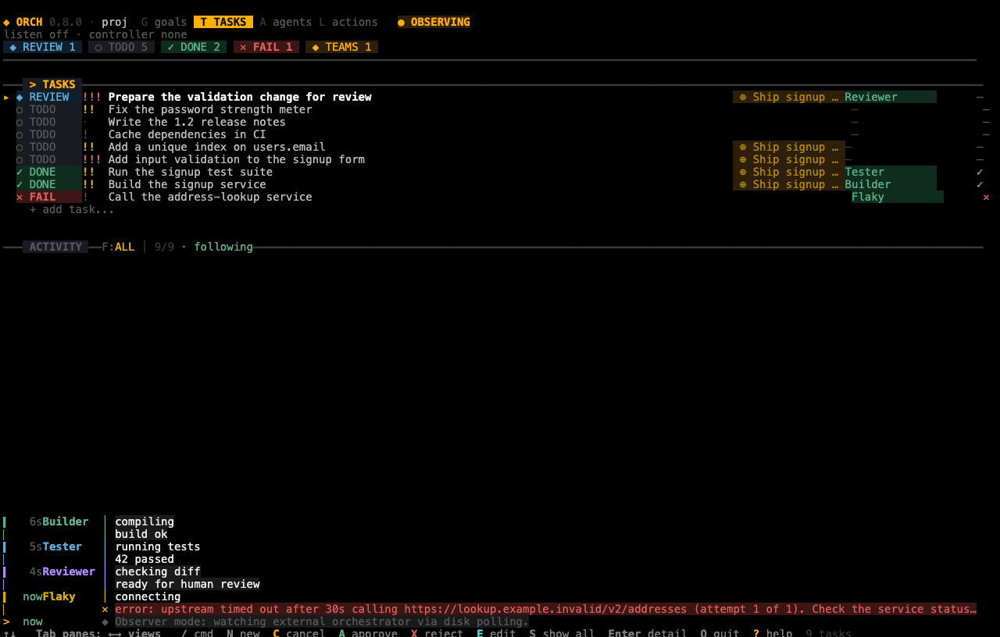
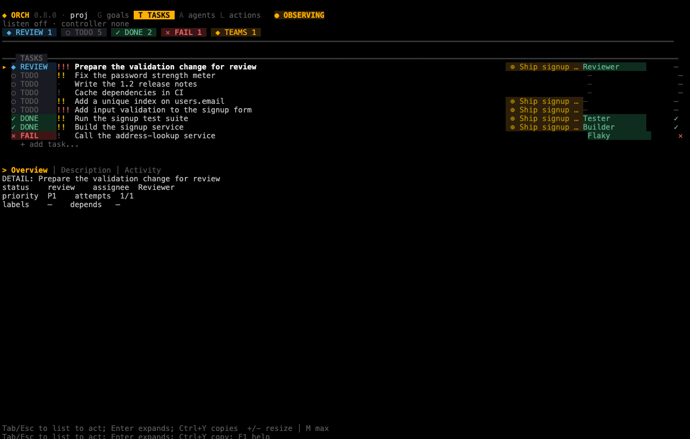
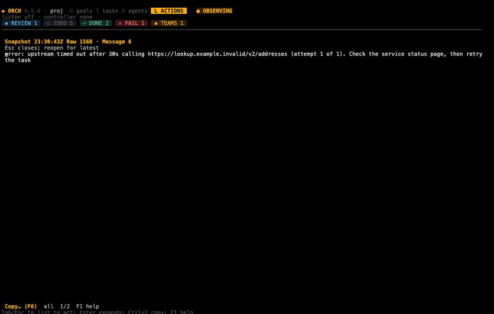
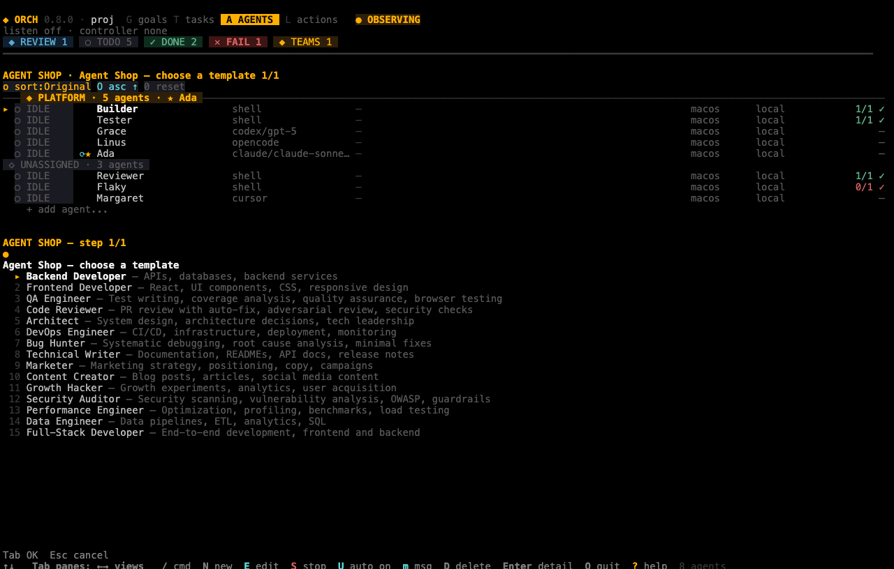
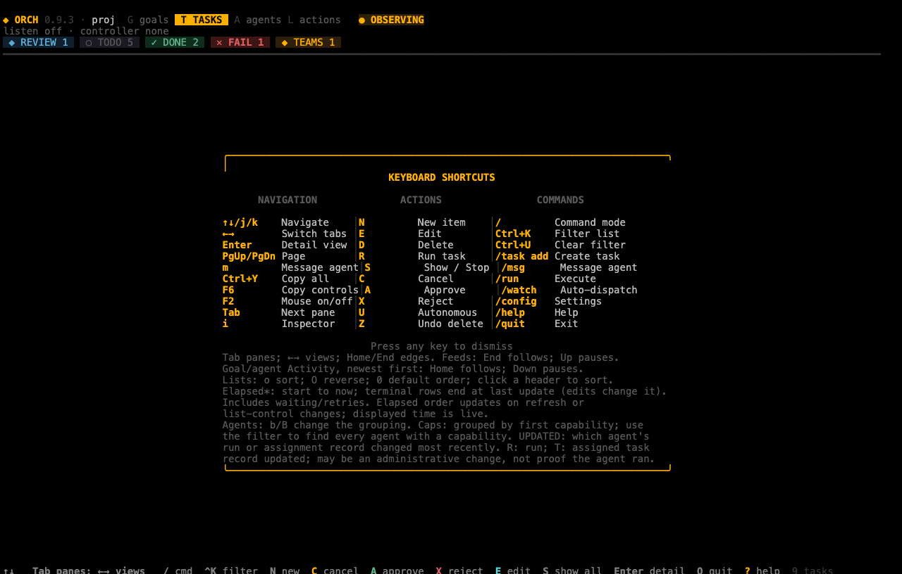

# The dashboard

The dashboard (`orch tui`) is the terminal screen where you watch agents work and manage goals, tasks and agents without typing CLI commands. Read this chapter when you want to run orch interactively. The [web dashboard](09-web-dashboard.md) shows the same screen in a browser.

## In this chapter

- [Start the dashboard](#start-the-dashboard)
- [Read the screen](#read-the-screen)
- [Switch views and move around](#switch-views-and-move-around)
- [Open and resize details](#open-and-resize-details)
- [Sort the lists](#sort-the-lists)
- [Sort and group agents](#sort-and-group-agents)
- [Filter a list by keyword](#filter-a-list-by-keyword)
- [Follow activity feeds](#follow-activity-feeds)
- [Read long text in the viewer](#read-long-text-in-the-viewer)
- [Create and edit with wizards](#create-and-edit-with-wizards)
- [Keep drafts and avoid losing edits](#keep-drafts-and-avoid-losing-edits)
- [Use the command bar](#use-the-command-bar)
- [Message an agent](#message-an-agent)
- [Copy text](#copy-text)
- [Use the mouse](#use-the-mouse)
- [Get help and quit](#get-help-and-quit)
- [Key bindings](#key-bindings)

## Start the dashboard

Before you start: run the command inside a project (a directory with `.orchestry/`). See [Getting started](01-getting-started.md).

```sh
orch tui
```

Bare `orch` also starts the dashboard. In a directory with no `.orchestry/`, bare `orch` creates one first. `orch tui` does not; it stops with `Not initialized`.

> **Warning:** By default the dashboard also starts the orchestrator for the project (watch mode). It dispatches `todo` tasks to idle agents straight away, and real agents cost money. The header shows `WATCHING` while this is on. To look without dispatching from this process, use `--observe`. To stop dispatching, type `/pause`.

| Option | What it does | Default |
|---|---|---|
| `--observe` | Does not start the orchestrator. The header shows `OBSERVING`. You can still create, change and run things from the dashboard. | off |
| `--listen [ADDR]` | Accepts connections from other orch machines. See [Remote agents](11-remote-agents.md). Only the orch process that runs the orchestrator for the project can listen. | off; a bare `--listen` binds `127.0.0.1:7690` |
| `--peer-name NAME` | Sets the name other machines see for this one. | the short host name |

`--observe` is not read-only. It only means this process does not start the orchestrator's watch loop. If you press `R` on a task, or click run, the dashboard still dispatches that task from this process, so it can start a real, paid agent run while the header says `OBSERVING`.

If another process already runs the orchestrator for the project (for example `orch serve`), the dashboard becomes an observer on its own. `--listen` then fails. The message says "engine owner", which means the orch process that runs the orchestrator:

```text
  ✕ --listen requires the engine owner; another orchestrator holds the lock
```

`orch tui --observe --listen` is refused at once with exit code 2 and the message `--listen requires the engine owner; --observe cannot listen`.



*The Tasks view, which the dashboard opens on. The header counts tasks by status.*

The screenshots in this chapter were taken in observe mode, so the header shows `OBSERVING` and the second header line reads `listen off · controller none`. When you run `orch tui` yourself, the header shows `WATCHING` instead. The second line tells you about peer connections: whether this machine listens for other orch machines (`listen off` or an address), which machine controls it (`controller none`), and the state of each remote you registered. See [Remote agents](11-remote-agents.md).

## Read the screen

From top to bottom the screen has these parts. This is the real layout of a small project in a 120-column terminal:

```text
◆ ORCH 0.8.0 · proj  G goals  T TASKS  A agents L actions   ● OBSERVING
listen off · controller none
 ○ TODO 2
━━━━━━━━━━━━━━━━━━━━━━━━━━━━━━━━━━━━━━━━━━━━━━━━━━━━━━━━━━━━━━━━━━━━━━━
━━━ > TASKS ━━━━━━━━━━━━━━━━━━━━━━━━━━━━━━━━━━━━━━━━━━━━━━━━━━━━━━━━━━━
▸ ○ TODO    !   Second task                           —            —
  ○ TODO    !   Write the docs                        worker       —
    + add task...
━━━ ACTIVITY ━━F:ALL │ 1/1 · following━━━━━━━━━━━━━━━━━━━━━━━━━━━━━━━━
…
↑↓   Tab panes; ←→ views   / cmd  N new  R run  C cancel  E edit  …  ? help
```

| Part | What it shows |
|---|---|
| Header | The version, the project name, the four view tabs, and a status chip: `WATCHING` (this process dispatches work), `OBSERVING` (another process does, or you used `--observe`) or `IDLE`. |
| Second header line | The peer listen address, the connected controller and each remote's online state. See [Remote agents](11-remote-agents.md). |
| Status counts | Task counts by status. |
| Main list | The list for the current view, with a `+ add …` row at the end. |
| Detail panel | Opens under the list when you press `Enter`. |
| Activity feed | Recent events. A label shows the filter and whether the feed is `following` or `paused`. |
| Command bar | Appears at the bottom when you press `/`. |
| Footer | Key hints for what you can do now. Click a hint to use it. |

Colours follow a palette. Change it with `/config palette` (see [Change dashboard settings](#change-dashboard-settings)). `--no-color` and `--ascii` also work with `orch tui`; see [Configuration and output](12-configuration-and-output.md).

## Switch views and move around

The dashboard has four views. The tab for the current view is upper case in the header.

| View | Key | Shows |
|---|---|---|
| Goals | `G` | [Goals](02-concepts.md#goals) and their progress. |
| Tasks | `T` | [Tasks](02-concepts.md#tasks). This is the default view. |
| Agents | `A` | [Agents](02-concepts.md#agents-and-adapters) as a table, grouped by team by default. |
| Actions | `L` | The log of everything agents and the orchestrator did, with filters. |


*The Agents view, grouped by team. Click a column header to sort; the `GROUP: Team` chip at the end of the header row names the grouping. The team lead is marked with a star.*

To switch views:

1. Press `G`, `T`, `A` or `L`, or press `Left` and `Right` to go to the previous or next view.
2. Check that the header shows the new view in upper case.

View keys do nothing while a detail panel is open. Press `Esc` first.

Some letters mean different things in different views. In Tasks, `A` approves the selected task when it is in `review`; otherwise it switches to Agents. In Tasks, `G` groups tasks by goal instead of switching to Goals. Use the arrow keys to switch views if a letter is taken.

### Move between panes

The screen has several panes: the main list, the activity feed and, when a detail is open, its sections.

- `Tab` and `Shift+Tab` move focus between panes.
- `Up`, `Down`, `j`, `k`, `PageUp`, `PageDown`, `Home`, `End` and the mouse wheel move inside the focused pane.
- A click or a wheel turn focuses the pane under the pointer.

Letters that act on an item (`E`, `D`, `R`, `C` and so on) work only while the main list has focus. Press `Tab` or `Esc` to return to the list.

## Open and resize details

1. Select an item in the list.
2. Press `Enter`. The detail panel opens and its Overview section has focus.
3. Press `Tab` to move through sections such as Description, Activity and Files.
4. Press `Esc` to close the panel.



*A task's detail, opened with Enter.*

| Key | What it does |
|---|---|
| `+` or `=` | Gives the detail panel more room. |
| `-` | Gives the list more room. |
| `M` | Maximizes the detail panel, or restores the split. Upper case only. |

### A goal's Tasks section

A goal's detail has a Tasks section between Description and Activity. It is the Tasks list's table, filtered to that goal's tasks. This is a goal's Tasks section with its first task selected, in a 120-column terminal:

```text
Overview │ Description │ > Tasks │ Activity
━━━ GOAL: Ship signup ━━━━━━━━━━━━━━━━━━━━━━━━━━━━━━━━━━━━━━━━━━━━━━━━━━━━━━━━━━━━━━━━━━━━━━━━━━━━━━━━━━━━━━━━━━━━━━━━━━
status    ACTIVE         assignee  —
  STATUS↑   PRI TITLE                                                                  ASSIGNEE        STARTED  ELAPSED*
▸ ○ TODO    !!! Add email validation                                                   —
  ○ TODO    !!  Write signup form                                                      —
  ─ OFF     ·   Review signup copy                                                     —
```

- **Columns.** The same header and rows as the Tasks list: status, priority, title, assignee, Started and Elapsed*. The Goal column is left out, because every row has the same goal, and its width goes to the title.
- **Rows.** Every task of this goal and nothing else. The Tasks list's keyword filter and its ten-task limit do not apply here, so a goal with 13 tasks lists all 13.
- **Order.** The section uses the Tasks list's sort, so both always show the goal's tasks in the same order. With the section focused, `o`, `O` and `0` change that sort for both (see [Sort the lists](#sort-the-lists)). Clicking a header in the section sorts the same way and also focuses the section, even when the goal list had focus.
- **Selection.** The selected task stays selected when a sort moves it to another row.
- **Actions.** `Enter` opens the selected task's description in the [viewer](#read-long-text-in-the-viewer), and `Ctrl+Y` copies that description (see [Copy text](#copy-text)). The section does not open the task itself; to edit or run a task, use the Tasks view.

A goal with no tasks still has a Tasks section. It shows the header and `No entries.`, and `Enter` and `Ctrl+Y` do nothing there.

## Sort the lists

The Goals, Tasks and Agents lists have a column header row. Each list keeps its own sort for this session, and none of these controls change grouping. A goal's [Tasks section](#a-goals-tasks-section) has no sort of its own: it uses the Tasks list's sort, and these controls change that sort while the section has focus.

| Key | What it does |
|---|---|
| `o` | Moves the sort to the next column, keeping the direction. |
| `O` | Reverses the direction, keeping the column. |
| `0` | Restores that list's default order. In Agents that is STATUS ascending. |
| Click a header | An inactive column sorts by it ascending; the active column flips its direction. |

The active column is marked `↑` or `↓`. When a column is too narrow for its whole label, the label is cut and the arrow stays, for example `ADAPTER/…↑`. For what each Agents column sorts by, see [Sort and group agents](#sort-and-group-agents).

Goals and Tasks also have a Started and an Elapsed* column, both blank for an entity that never started.

Elapsed*: start to now; terminal rows end at last update (edits change it). Includes waiting/retries.

A task's Started is its earliest retained run record, which is written while the run is still `preparing` — not the moment an agent process launched. A goal's Started is its creation time. Ordering by Elapsed re-sorts on a refresh or a list-control change; the time the column shows stays live between those.

## Sort and group agents

The Agents list is a table with one header row, like Goals and Tasks. You sort it with the keys in [Sort the lists](#sort-the-lists) and cut it into sections with `b`. The sort and the grouping are separate: the sort orders the agents inside each section, and neither one resets the other. Both keep the selected agent selected, and both last only until you close the dashboard.

This is the Agents view of a small project in a 120-column terminal, grouped by team and in the default order:

```text
━━━ > AGENTS ━━━━━━━━━━━━━━━━━━━━━━━━━━━━━━━━━━━━━━━━━━━━━━━━━━━━━━━━━━━━━━━━━━━━━━━━━━━━━━━━━━━━━━━━━━━━━━━━━━━━━━━━━━
  STATUS↑       NAME           ADAPTER/M… TASK                 CAPS       WHERE             RUNS UPDATED     GROUP: Team
─── ◈ PLATFORM · 5 agents · ★ Ada ──────────────────────────────────────────────────────────────────────────────────────
▸ ○ IDLE        Builder        shell      —                    macos      local            1/1 ✓ T 1m
  ○ IDLE        Tester         shell      —                    macos      local            1/1 ✓ T 1m
  ○ IDLE        Grace          codex/gpt… —                    macos      local                — —
  ○ IDLE        Linus          opencode   —                    macos      local                — —
  ○ IDLE     ⟳★ Ada            claude/cl… —                    macos      local                — —
 ◇ UNASSIGNED · 3 agents
  ○ IDLE        Reviewer       shell      —                    macos      local            1/1 ✓ T 19s
  ○ IDLE        Flaky          shell      —                    macos      local            0/1 ✓ T 1m
  ○ IDLE        Margaret       cursor     —                    macos      local                — —
    + add agent...
…
b Team     ↑↓   Tab panes; ←→ views   / cmd  ^K filter  N new  E edit  S stop  U auto on  m msg  D delete  Enter detail
```

### The columns

| Column | What it shows | Ascending order |
|---|---|---|
| STATUS | `ACTIVE` (with a spinner), `IDLE`, `ERROR`, `OFFLINE`, or `OFF` for a disabled agent. After it, `⟳` marks an agent in autonomous mode and `★` the lead of its team. | ACTIVE, IDLE, ERROR, OFFLINE, disabled. This is the default sort. |
| NAME | The agent's name. | Alphabetical, ignoring case. |
| ADAPTER/MODEL | The adapter, then `/` and the model if one is set. | By adapter, then by model. |
| TASK | The title of the task an active agent is running. For an agent in `ERROR` it shows the error instead. | By task title. Rows with no running task count as blank. |
| CAPS | Every capability of the agent, comma-separated. | Alphabetical by the cell's text. An agent with no capability counts as blank. |
| WHERE | `local`, or the remote alias with its online or offline state. | `local` and the remote aliases, alphabetically. |
| RUNS | Lifetime runs as completed/total, for example `1/1 ✓`. An agent that has never run shows `—`. | By total runs. |
| UPDATED | Which agent's run or assignment record changed most recently (see below). | Oldest first. |

Rules that hold for every column:

- Agents with equal values keep their configured order, in both directions.
- Blank values (`—`) sort last, in both directions.
- RUNS shows lifetime statistics for an active agent too. The elapsed time of its live run is in the agent's detail: press `Enter` and read the `live` row of the Overview.

### What UPDATED means

UPDATED answers "which agent's run or assignment record changed most recently". It does not tell you when the agent last did anything. Each cell starts with a letter that says where the time comes from:

| Cell | Source |
|---|---|
| `R <age>` | The newest start or event of the agent's live run. Only an agent with a run in progress has one. |
| `T <age>` | The newest update of a task currently assigned to the agent. The assigned task record was updated; that may be an administrative change, such as an edit, an approval or a new assignment, and is not proof that the agent ran. |
| `—` | Neither: no live run and no assigned task. |

`R` wins over `T`, even when the task changed later. While UPDATED is the sort column, the footer spells out the letters as `R run · T task`. The agent's Overview has an `updated` row that gives the same value in words, for example:

```text
updated  T 2m · assigned task record updated; may be an administrative change, not proof the agent ran
```

### Group the table

Press `b` to move to the next grouping and `B` to move back. The modes come in this order and then start again:

| Mode | Sections |
|---|---|
| Team (the default) | One section per active team, with its lead after `★`, then `◇ UNASSIGNED` for agents in no team. |
| Node | `LOCAL` for this instance's agents, then one section per remote alias in alias order, marked `● online` or `○ offline`. |
| Status | ACTIVE, IDLE, ERROR, OFFLINE, DISABLED, in that order. |
| Adapter | One section per adapter, alphabetical. |
| Caps | Grouped by first capability: each agent appears once, under its alphabetically first capability, and `◇ no caps` comes last. To find every agent with a capability, use the [keyword filter](#filter-a-list-by-keyword), which matches every capability. |
| None | One table with no section rows. |

A section with no agents is not drawn. Each section row counts its agents, for example `─── ◈ PLATFORM · 5 agents · ★ Ada ───`.

The mode is always on screen:

- **Footer.** The first hint in the footer names the mode, for example `b Team`. (While mouse capture is off, `⌨ mouse off · F2` comes before it.) Click it to move to the next mode, like `b`. This hint is there at every width.
- **Header chip.** When the table is at least 108 columns wide, the header row ends with a `GROUP: <Mode>` chip, for example `GROUP: Team`. Click it to move to the next mode. Below 108 columns there is no chip.

### Narrow terminals

As the terminal gets narrower, UPDATED is the first column to go, then CAPS:

- From 108 columns: every column and the `GROUP:` chip.
- From 93 to 107 columns: every column, no chip.
- From 84 to 92 columns: every column but UPDATED.
- At 80 columns: STATUS, NAME, ADAPTER/MODEL, TASK, WHERE and RUNS.

A sort by a column that is not shown still applies. The footer then names it after the mode, and a click on it moves the sort to the next column, like `o`. This is the footer at 80 columns while the list is sorted by CAPS:

```text
b Team     o Caps↑  ↑↓   Tab panes; ←→ views   / cmd  ^K filter  N new  E edit
```

## Filter a list by keyword

On the Goals, Tasks or Agents list, press `Ctrl+K` (or click `^K filter` in the footer) to filter it by a keyword. The list narrows as you type; the prompt shows how many rows match, such as `2/5`.

| Key | What it does |
|---|---|
| `Ctrl+K` | Open the keyword prompt of this list, on its current keyword. |
| Typing, `Backspace`, `Left`, `Right` | Edit the keyword. The list follows at once. |
| `Up`, `Down` | Move the list's selection without leaving the prompt. |
| `Enter` | Keep the keyword and close the prompt. |
| `Esc` | Clear the keyword and close the prompt. |
| `Ctrl+U` | On the list: clear the keyword. |

Matching ignores case and looks at each field on its own: the ID, the title or name, the status (both `in_progress` and the `RUN` the row shows), the assignee's or agent's name and ID, a task's goal, and an agent's team, adapter, model, node (`local` or the remote alias) and every capability. Descriptions and the Started and Elapsed times are not searched.

A kept keyword shows as a `filter: … · matches/total` chip on the list's title rule; click the chip to clear it. The filter applies before sorting, grouping and the ten-task limit, so the ten tasks listed are all matches and a match past the first ten unfiltered tasks is not lost; with more than ten matches, `show all` lists the rest (`▼ Show all (2 more) — press S`). Empty sections disappear, and a goal section counts its listed tasks as `1/2 tasks`. The selected row stays selected while it still matches. Each list has its own keyword, up to 256 characters, kept until you close the dashboard. The Tasks keyword does not narrow a goal's [Tasks section](#a-goals-tasks-section). `/` still opens the command bar.

## Follow activity feeds

The Activity panel, the Actions view and a task's Activity section follow new entries at the bottom.

- Scroll up to pause following. The feed label then says `paused`.
- To resume, press `End`, scroll to the bottom with the wheel or `PageDown`, or click the last entry.
- A goal's or an agent's Activity section lists entries newest first, so it follows new entries at the top instead. Move down to pause; the title then says `paused · Home follows`. To resume, press `Home`, scroll to the top with the wheel or `PageUp`, or click the first entry. The footer hint says the same.
- In the Actions view, press `i` on an entry to open the inspector. It pins that entry, so new arrivals do not move it.
- Press `f` or `F` in Tasks, Goals or Agents (with no detail open) to cycle the Activity filter between All, Text, Tools, Errors and Events. The choice is saved.
- In the Actions view, `a` opens the agent picker, `f` opens the type picker, and `F` cycles the type presets. These work only while no detail is open.

## Read long text in the viewer

Long messages, log entries and descriptions do not fit in a list row. Open the full-text viewer:

1. Focus the text, or select a message in the Actions view.
2. Press `Enter` (or double-click), or press `i` on supported text.
3. Scroll with `Up`, `Down`, `PageUp`, `PageDown`, `Home` and `End`.
4. Press `Esc` or `q` to close it.



*The full-text viewer shows a snapshot of the whole text. Close and reopen it to see newer content.*

The viewer shows a snapshot. It does not change while it is open. Close it and open it again to see new content.

Known message formats open as readable text (Human). Press `r` to switch to Raw, which keeps the bytes as received. The footer shows the switch.

Limits: a body over 1 MiB shows an "unavailable" notice. The dashboard keeps at most 500 records and 32 MiB of message text, so older records can disappear.

To select text, use `Shift+Arrow` keys or drag with the mouse. Copy it as described in [Copy text](#copy-text).

## Create and edit with wizards

Wizards are step-by-step forms. Each one shows its title and a step counter, for example `NEW TASK — step 1/4`.

| Wizard | Open it with | Steps |
|---|---|---|
| New Task | `N` in Tasks, `/task add`, or the `+ add task...` row | Title, priority, assignee, description |
| New Agent | `N` in Agents, `/agent add`, or the `+ add agent...` row | Name, provider (adapter), command (shell only), model, reasoning effort, role, skills, team |
| New Goal | `N` in Goals, `/goal add` | Title, assignee, description |
| New Team | `/team create` | Name, lead, members, description |
| Edit Task, Agent or Goal | `E` on the selected item | The same steps, filled in |
| Settings | `/config <setting>` | One step |


*The New Agent wizard. You can type a name or start from a template.*

To fill in a wizard:

1. Type a value, or choose an option with `Up` and `Down` (or `j` and `k`).
2. Press `Enter` or `Tab` to accept the step.
3. Press `Esc`, or `Backspace` on an empty text field, to go back one step. `Esc` on the first step leaves the wizard.
4. Accept the last step to create the item. If creation fails, the form stays open so you can fix it.

On select steps the number keys `1` to `9` choose and accept an option at once. Steps that pick an agent (assignee, team lead, team members) filter as you type instead: letters, including `j` and `k`, narrow the list to agents whose name, adapter or role contains them (move with the arrow keys), `Backspace` edits the filter, `Esc` clears it, and `Ctrl+O` cycles the order through Original, Name, Adapter and Status. The numbers follow the filtered list, and typed text alone never assigns anyone: choose a listed agent, or Auto-assign/None. On multi-select steps `Space` toggles the option. In description fields, `Enter` adds a new line; press `Tab` or `Ctrl+Enter` to accept the field. The model step offers suggestions: press `Down` to browse them.

### Install from the agent shop

The agent name step suggests the 15 built-in templates. You can also open the shop explicitly: press `Ctrl+S` (or `Alt+S`) in the New Agent wizard, or type `/agent shop`. Choose a template and the wizard fills in a name, model, role and skills for you to review.



*The Agent Shop, opened with Ctrl+S in the New Agent wizard.*

For the command-line shop, your own templates and organizations, see [Templates and the agent shop](10-templates-and-shop.md).

### Paste text

Bracketed paste keeps newlines in the wizard and the command bar. A single paste is limited to 64 KiB; a note appears if orch cuts it. In normal mode (no input open) a paste is ignored, so a pasted `q` cannot quit.

## Keep drafts and avoid losing edits

If you leave a changed wizard, orch asks what to do:

- **Continue** goes back to editing.
- **Keep draft** saves the edits in memory so you can recover them later.
- **Discard** drops them.

Choose with the arrow keys or `Tab`, then press `Enter`. `Esc` means Continue.

Drafts live only in the running dashboard. Limits: 20 drafts, 256 KiB each, 2 MiB in total. A full store refuses a new draft rather than deleting an old one. Closing the dashboard discards all drafts. When you press `q` with unsaved edits or saved drafts, the dashboard asks you to confirm.

If creating something fails after the item was made, the message names the created item. Fix that item rather than creating a second one.

Vim-style editing is not included.

## Use the command bar

Press `/` to open the command bar. It starts with `/` already typed and shows suggestions.

| Key | What it does |
|---|---|
| `Up`, `Down`, `PageUp`, `PageDown` | Move through suggestions. With no suggestions, `Up` and `Down` walk your command history. |
| `Tab` | Fill in the selected suggestion, or complete the ghost text. |
| `Enter` | Run the command, or fill in a suggestion that needs more input. |
| `Esc` | Close the bar. |

Type `/help` to print every command into the feed. Verbs and sub-commands are not case sensitive.

### Commands

| Command | What it does |
|---|---|
| `/task add [title]` | Creates a task with that title, or opens the New Task wizard when you give no title. |
| `/task list` | Lists tasks in the feed. |
| `/task show [id]` | Shows one task (the selected one if you give no id). |
| `/task cancel [id]` | Cancels a task. |
| `/task retry [id]` | Retries a task. |
| `/task assign [id] <agent>` | Assigns a task to an agent. |
| `/task approve [id]` | Approves a task in review. |
| `/task reject [id] [feedback]` | Rejects a task in review, with optional feedback. |
| `/task delete [id]` | Deletes a task. |
| `/agent add [name] [adapter] [command]` | Without a name, opens the New Agent wizard. With a name and no adapter, creates the agent at once with the default adapter. For `shell` agents the rest of the line is the command; a `shell` agent without a command opens the wizard pre-filled. |
| `/agent list`, `/agent disable [id]`, `/agent enable [id]` | List, disable or enable agents. The id can also be an exact name. |
| `/agent delete [id]` | Deletes an agent that is not running. |
| `/agent autonomous [id]` | Turns autonomous mode on or off. |
| `/agent shop` | Opens the Agent Shop. |
| `/team create` | Opens the New Team wizard. |
| `/team list` | Lists teams. |
| `/team join <teamId> [agentId]`, `/team leave <teamId> [agentId]` | Adds or removes an agent. |
| `/team set-lead <teamId> <agentId>` | Changes the lead. |
| `/team disband <teamId>` | Disbands a team. |
| `/goal add [title]` | Creates a goal, or opens the wizard without a title. |
| `/goal list`, `/goal show [id]`, `/goal delete [id]` | List, show or delete goals. |
| `/goal status [id] <active\|paused\|achieved\|abandoned>` | Changes a goal's status. |
| `/run [id]` | Runs a task now (the selected one if you give no id). |
| `/run-all` | Runs all `todo` tasks. |
| `/watch` | Starts watch mode, so the dashboard dispatches work. |
| `/pause` | Stops watch mode. |
| `/status` | Prints a one-line summary. |
| `/msg <agent\|all> <text>` | Queues a message. See [Message an agent](#message-an-agent). |
| `/config <setting>` | Opens a settings wizard. |
| `/mouse on\|off\|status` | Turns mouse capture on or off. |
| `/help` | Lists commands. |
| `/quit` | Exits the dashboard. |

Short forms also work: `/cancel`, `/retry`, `/assign <agent>`, `/disable` and `/enable` act on the selected item. `/agent remove` and `/agent auto` are aliases of `delete` and `autonomous`, and `/team add` and `/goal create` are aliases of `create` and `add`.

The commands do the same as their CLI counterparts: see [Tasks](04-tasks.md), [Agents](03-agents.md) and [Teams and goals](05-teams-and-goals.md).

### Change dashboard settings

| Command | What it changes |
|---|---|
| `/config palette [name]` | The colour palette: `amber`, `ocean`, `forest`, `violet` or `light`. With a name it applies directly. |
| `/config activity-filter` | The default Activity filter. |
| `/config max-concurrent` | How many agents may run at the same time (choose from 1, 2, 3, 4, 6, 8 or 10). |
| `/config notifications-toast` | Turns toast notifications on or off. |
| `/config notifications-bell` | Turns the completion bell on or off. |

## Message an agent

You can send a message to one agent or to all agents from the dashboard. The message is queued exactly as `orch msg send` queues it. The agent reads it on its next run, so start `/watch` if nothing is dispatching. See [Messages and context](06-messages-and-context.md).

1. Go to the Agents view and select an agent.
2. Press `m`. The command bar opens with the command and the agent's name filled in, for example `/msg worker `. orch adds quotes only when the name needs them, for example `/msg "Code Reviewer" `.
3. Type the message and press `Enter`.
4. Check the feed for `✓ Queued for <name>`.

You can also type the command yourself. The command bar offers a list of agents as you type; `Tab` or a double-click fills in the name.

```text
/msg reviewer the signup test is flaky on CI
/msg "Code Reviewer" please look at #12
/msg agt_7fK2mQ1 ping
/msg all standup in five
```

Rules:

- A name with spaces needs double quotes. Inside quotes, escape `"` and `\` with a backslash. You can always use the agent id instead.
- The text after the name is sent as it is. `/msg reviewer /quit now` sends that text; it does not quit.
- The dashboard never guesses. A prefix, an ambiguous name or a name that could be read two ways is refused, and the message tells you the exact form to use.
- `all` sends to every enabled agent. Type it in lower case, bare. The dashboard asks you to press `Enter` a second time straight away. Any edit or other key cancels the confirmation. `ALL`, `All` and `@all` are treated as agent names.
- A queued message expires after 24 hours if the agent never runs, and nothing reports it. Check that `WATCHING` or `OBSERVING` is in the header.
- The orchestrator cuts a body at 4000 characters; the dashboard tells you when this happens.
- Without bracketed paste (the legacy Windows console, or tmux with the mode off) a pasted newline sends the message early. Paste one line, or use `orch msg send`.

## Copy text

Pick the way that matches where you are. This section owns the copy rules; the [web dashboard](09-web-dashboard.md#copy-text-in-the-browser) and [Troubleshooting](13-troubleshooting.md#copying-text-from-the-dashboard-does-nothing) link here.

| You want to copy | Do this |
|---|---|
| A whole field or document | Focus a read-only text section, or open the viewer or an editor field, and press `Ctrl+Y`. |
| Only what you selected, in the viewer | Press `y`. In an editor, use **Copy selection** on the copy rail. |
| To a chosen destination | Open the viewer (`Enter` on the text) or an editor field, then press `F6` to open the copy rail. Choose with the arrows or `Tab` and press `Enter`. `Esc`, `F6` or `x` closes the rail. |
| To the clipboard of the machine running orch | In the viewer or an editor field, press `F6`, then `End`, then `Enter`. This is **Copy on this host**. |
| To your terminal's clipboard | Press `Ctrl+Alt+C`. This is **Copy via terminal**. |

The copy rail (`F6`) exists only in the viewer and in editor fields. It is not available on the main screen. There, use `Ctrl+Y` on a focused read-only section.

There are two routes.

- **Terminal (OSC 52).** OSC 52 is a terminal code that asks your terminal to copy text. The status says "requested" because a terminal cannot confirm delivery. Your terminal must support and allow OSC 52. The request is limited to 64 KiB.
- **Host clipboard.** orch writes to the clipboard of the machine where orch runs. Under SSH that is the server, not your laptop. The limit is 1 MiB.

A request over its limit is refused whole. Select less text. With `Ctrl+Y`, the dashboard uses the terminal route when you are in SSH, tmux, screen or the web dashboard, and the host clipboard otherwise. A failed host copy never falls back silently to the other route. A "Busy" status means the host copy helper is occupied. Wait a moment and try again.

> **Note:** Under tmux, OSC 52 needs `set-clipboard on` and a terminal that supports it. Under GNU screen it is not supported: choose **Copy on this host**.

In the browser there is one more step: click **Copy to clipboard**. See [The web dashboard](09-web-dashboard.md#copy-text-in-the-browser).

Press `F1` while text is focused to see the copy status and route guidance for that text. If copying fails, see [Troubleshooting](13-troubleshooting.md#copying-text-from-the-dashboard-does-nothing).

## Use the mouse

Mouse support is on by default. You can click tabs, list rows, `+ add …` rows, filter chips and footer hints. Double-click a row to open its detail. The wheel moves the selection. Everything is also a key.

Mouse capture takes click-drag text selection away from the terminal. To get it back:

- Press `F2`, or type `/mouse off`. Press `F2` again (or `/mouse on`) to turn capture back on. `/mouse status` says which it is.
- In most terminals you can hold `Shift` while dragging. **This does not work under tmux.** Use `F2` there.
- Start with the mouse off: `ORCH_TUI_MOUSE=0 orch`.

Under tmux, clicks reach the dashboard only if you set `set -g mouse on`. While capture is off the footer starts with `⌨ mouse off · F2`.

## Get help and quit

Press `F1` or `?` for help. The overlay lists the main shortcuts and commands. When text, a viewer or an editor field has focus, `F1` shows help for copying that text instead. Press `Esc`, `F1` or `?` to close it; any other key closes it and also does what the key normally does.



*The help overlay, opened with F1.*

To quit, press `q`, or type `/quit`. `Esc` never quits. If you have unsaved edits or saved drafts, orch asks you to confirm and then discards the drafts.

If the dashboard stops abnormally and the terminal prints odd characters when you click, see [Troubleshooting](13-troubleshooting.md#the-terminal-prints-odd-characters-after-the-dashboard-exits).

## Key bindings

Keys are not case sensitive for letters unless the table says so. Letter actions work only with no modifier (or `Shift`) and, where noted, while the main list has focus.

### Anywhere

You can use these keys in every state. `F6` is not here: it works only in the viewer and in editor fields (see the tables below).

| Key | What it does |
|---|---|
| `F1` | Opens help (contextual when text has focus). |
| `F2` | Turns mouse capture on or off. Works in every state. |

### Main screen

| Key | What it does |
|---|---|
| `G`, `T`, `A`, `L` | Switch to Goals, Tasks, Agents or Actions (see the exceptions below). |
| `Left`, `Right` | Previous or next view. |
| `Tab`, `Shift+Tab` | Next or previous pane. |
| `Up`, `Down`, `k`, `j` | Move. |
| `PageUp`, `PageDown`, `Home`, `End` | Page or jump in the focused pane. |
| `Enter` | Open or close the detail of the selected item; run a `+ add …` row; open the viewer when a detail section has focus. |
| `Esc` | Close the detail panel; in Actions, return to the live tail. |
| `+`, `=` / `-` | Bigger detail panel / bigger list (not in Actions). |
| `M` | Maximize or restore the detail panel. |
| `N` | New item for this view (main list focus). |
| `E` | Edit the selected item. |
| `D` | Delete the selected item. Deletion waits 5 seconds. |
| `Z` | Undo the last pending deletion. |
| `f`, `F` | Cycle the Activity filter (not in Actions). |
| `/` | Open the command bar (no detail open). |
| `Ctrl+K` | Filter the Goals, Tasks or Agents list by keyword (main list focus). |
| `Ctrl+U` | Clear that list's keyword (main list focus). |
| `?` | Open help. |
| `q` | Quit. |
| `Ctrl+Y` | Copy the focused text. |
| `Ctrl+Alt+C` | Copy the focused text through the terminal route. |

### Tasks view (main list focus)

| Key | What it does |
|---|---|
| `R` | Run the selected task. |
| `C` | Cancel the selected task. |
| `A` | Approve a task in `review`. |
| `X` | Reject a task in `review`. |
| `E` | Edit the task. |
| `D` | Delete the task (not while it is running). |
| `S` | Show all tasks, or collapse the list. The selected task stays selected while it is still listed. |
| `G` | Group tasks by goal, or ungroup. The selected task stays selected while it is still listed. |
| `o`, `O`, `0` | Move the sort to the next column, reverse the direction, reset. |

### Agents view (main list focus)

| Key | What it does |
|---|---|
| `E` | Edit the agent. |
| `S` | Force-stop the agent if it is running. |
| `D` | Delete the agent. |
| `U` | Turn autonomous mode on or off. |
| `m` | Message the agent (lower case only). |
| `o`, `O`, `0` | Move the sort to the next column, reverse the direction, reset to STATUS ascending. |
| Click a header | Sort by that column ascending, or flip the direction of the active column. |
| `b`, `B` | Next or previous grouping: Team, Node, Status, Adapter, Caps, None. Upper case `B` goes back. |
| Click `b <Mode>` in the footer, or the `GROUP:` chip | Next grouping, like `b`. |

### Goals view (main list focus)

| Key | What it does |
|---|---|
| `E` | Edit the goal. |
| `D` | Delete the goal. |
| `P` | Pause an active goal, or resume a paused one. |
| `C` | Mark an active or paused goal achieved, cancelling its tasks that can be cancelled. |
| `X` | Abandon an active or paused goal. |
| `o`, `O`, `0` | Move the sort to the next column, reverse the direction, reset. |

### Goal Tasks section (section focus)

| Key | What it does |
|---|---|
| `o`, `O`, `0` | Move the Tasks list's sort to the next column, reverse the direction, reset. The section and the Tasks list both follow. |
| `Enter` | Open the selected task's description in the viewer. |
| `Ctrl+Y` | Copy the selected task's description. |

### Actions view

| Key | What it does |
|---|---|
| `i` | Open the inspector for the selected entry. |
| `a` | Choose which agents to show. |
| `f` | Choose which message types to show. |
| `F` | Cycle the message-type presets. |
| `End` | Resume following new entries. |
| `Esc` | Leave the selection and return to the tail. |

### Filter pickers (agent and type)

| Key | What it does |
|---|---|
| `Up`, `Down` | Move (wraps around). |
| `PageUp`, `PageDown`, `Home`, `End` | Page or jump. |
| `Space` | Toggle the entry. |
| `a` | Agent picker: show all agents. Type picker: select all, or none if all are already on. |
| `1` to `5` | Type picker: presets all, text, tools, errors, events. |
| `Enter` | Apply. |
| `Esc` | Discard. |

### Command bar

| Key | What it does |
|---|---|
| `Enter` | Run the command, or fill in the selected suggestion. |
| `Tab` | Fill in the suggestion or ghost text. |
| `Up`, `Down` | Move through suggestions, or through history. |
| `PageUp`, `PageDown`, `Home`, `End` | Move through a long suggestion list. |
| `Esc` | Close the bar. |

### Wizards

| Key | What it does |
|---|---|
| `Enter`, `Tab` | Accept the step. In description fields `Enter` adds a line, and `Tab` or `Ctrl+Enter` accepts. |
| `Esc` | Go back one step; on the first step, leave the wizard (with a draft prompt if you changed something). |
| `Backspace` | On an empty text field or a select step, go back one step. |
| `Up`, `Down`, `j`, `k` | Choose an option (select steps). |
| `Down` | In a text step with suggestions, start browsing them. |
| `1` to `9` | Choose the numbered option and accept it. |
| `Space` | Toggle an option (multi-select steps). |
| `PageUp`, `PageDown`, `Home`, `End` | Page through options. |
| `Ctrl+S`, `Alt+S` | New Agent wizard: open the Agent Shop. |
| `Ctrl+V`, `Ctrl+I` (or `Alt`) | Paste an image on text steps of wizards that allow it (for example New Task). |
| `Ctrl+Y` | Copy the whole field. `Ctrl+Alt+Y` copies the selection. |
| `F6` | Open or close the copy rail. |
| `Ctrl+Z`, `Ctrl+R` | Description fields: undo, redo. |
| `Ctrl+A`, `Ctrl+E` | Description fields: start, end of line. |
| `Ctrl+K`, `Ctrl+U`, `Ctrl+W` | Description fields: delete to end of line, to start of line, a word. |
| `Shift+Arrows`, `Shift+Home/End` | Description fields: extend the selection. |

### Leave-wizard prompt

| Key | What it does |
|---|---|
| `Up`, `Down`, `Left`, `Right`, `Tab` | Choose Continue, Keep draft or Discard. |
| `Enter` | Apply the choice. |
| `Esc` | Continue editing. |

### Text viewer

| Key | What it does |
|---|---|
| `Up`, `Down`, `PageUp`, `PageDown`, `Home`, `End` | Scroll. |
| `Left`, `Right` | Move the caret by one character. |
| `Shift+Arrows`, `Shift+Home/End` | Extend the selection. |
| `Ctrl+Home`, `Ctrl+End` | Jump to the start or end of the text (add `Shift` to select). |
| `r` | Switch between Human and Raw. |
| `y` | Copy the selection. |
| `Ctrl+Y` | Copy everything. |
| `Ctrl+Alt+C` | Copy through the terminal route. |
| `F6` | Open the copy rail. |
| `Esc`, `q` | Close the viewer. |

### Copy rail

| Key | What it does |
|---|---|
| `Left`, `Right`, `Tab`, `Shift+Tab` | Choose Copy all, Copy selection, Copy via terminal or Copy on this host. |
| `Home` / `End` | Choose Copy all / Copy on this host. |
| `Enter` | Run the chosen action. |
| `Esc`, `F6` | Close the rail without copying. |

### Help overlay

| Key | What it does |
|---|---|
| `Esc`, `F1`, `?` | Close. |
| `Up`, `Down`, `PageUp`, `PageDown`, `Home`, `End` | Scroll the copy help. |
| Any other key | Close the overview, then act as normal. |
