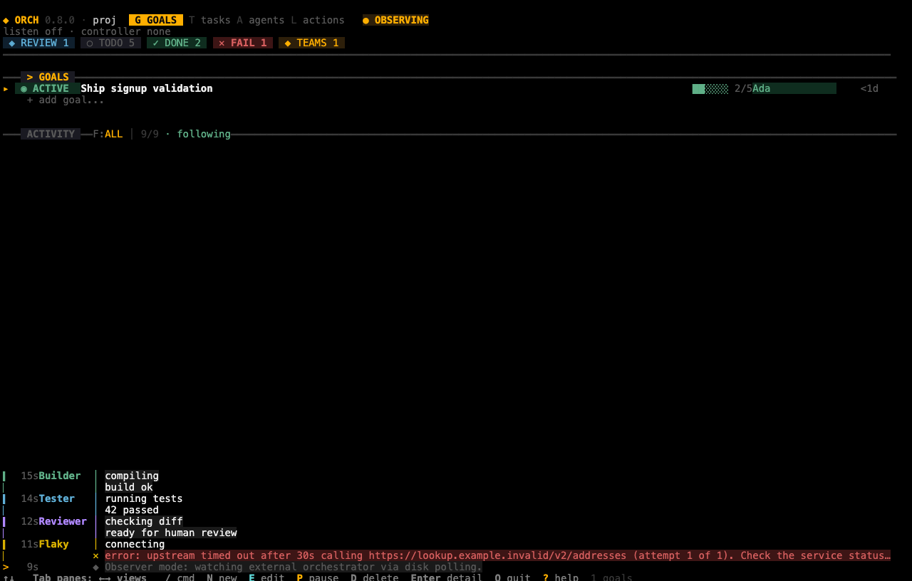

# The web dashboard

The web dashboard (`orch web`) shows the [dashboard](08-dashboard.md) in a browser tab. Read this chapter when you want to watch or steer a project from a browser, or from another machine, and you need to do it safely.

## In this chapter

- [Start it and open it](#start-it-and-open-it)
- [Log in](#log-in)
- [Reach it from another machine](#reach-it-from-another-machine)
- [Run it behind a proxy](#run-it-behind-a-proxy)
- [Observe without dispatching](#observe-without-dispatching)
- [Use tabs and sessions](#use-tabs-and-sessions)
- [Copy text in the browser](#copy-text-in-the-browser)
- [Stop it](#stop-it)
- [Options](#options)

> **Warning:** Anyone who can use the web dashboard can run code on your machine as you. Agents run commands, and some run with permission checks off. Treat the access token or password like an SSH key, and keep the server reachable only by you. A proxy or port forward that exposes `orch web` without its login does the same damage, so keep the token or password on.

## Start it and open it

Before you start: run the command inside a project (a directory with `.orchestry/`). Outside a project it stops with `Not initialized`.

1. Start the server:

   ```sh
   orch web
   ```

2. Read the address it prints. It includes your access token:

   ```text
   orch web listening on http://127.0.0.1:7681/?token=aaf3b179a3292228090d951a9c09b886
   ```

3. Open that whole address in your browser.
4. Check that the dashboard appears in the page.



*The web dashboard fills the browser page with the terminal dashboard.*

The server listens on `127.0.0.1:7681` by default. That address is reachable only from your own machine. Each browser tab runs its own `orch tui` on the server, so the page behaves exactly like the terminal dashboard, including all keys and the mouse.

The token is new every time you start `orch web`. Keep the terminal open; the server stops when you close it.

## Log in

`orch web` always asks for a credential unless you turn that off.

| Mode | How you start it | How you log in |
|---|---|---|
| Access token (default) | `orch web` | Open the printed address with `?token=…`, or enter the token as the password when the browser asks (any user name). |
| Password | `orch web --password SECRET` | Enter the password when the browser asks (any user name). |
| Password from the environment | `read -s ORCH_WEB_PASSWORD; export ORCH_WEB_PASSWORD`, then `orch web` | Same as above. |
| No login | `orch web --no-auth` | Nothing. |

Use `ORCH_WEB_PASSWORD` instead of `--password` so the password stays out of the process list (`ps`). Do not type the password on the command line either, because it lands in your shell history. Read it without echo:

```sh
read -s ORCH_WEB_PASSWORD; export ORCH_WEB_PASSWORD
orch web
```

You can also fill the variable from a password manager.

> **Note:** `orch web` passes its environment to every dashboard session and to every local agent process those sessions start. Local runs inherit the full environment, and the filter for secret-looking names applies only to remote runs. Agents can therefore see the password. If agents you do not trust run in this project, use token mode on loopback instead.

Rules for passwords:

- On any address that is not a loopback address (an address that reaches only your own machine, such as `127.0.0.1`), the password must have at least 16 characters. Shorter ones are refused:

  ```text
    ✕ The password must be at least 16 characters when listening on 0.0.0.0:17681
  ```

- An empty password counts as not set.
- You cannot combine `--no-auth` with a password.

If someone sends the wrong credential several times in a row, the server answers that address with `429` and makes it wait longer each time. A correct credential always works.

> **Warning:** In token mode, the `?token=` address ends up in your browser history and in the logs of any proxy on the way. On your own machine this is fine. Across a network, use `--password` instead.

### Why `--no-auth` is dangerous

> **Warning:** `--no-auth` turns the login off. Anyone who can reach the port can run any command as you, and the connection is not encrypted. Use it only on `127.0.0.1` on a machine where you are the only user, or behind a firewall, Tailscale access rules or an SSH tunnel that you control.

orch refuses `--no-auth` on a wildcard address (an address such as `0.0.0.0` that means every network interface of the machine):

```text
  ✕ Refusing --no-auth on the wildcard address 0.0.0.0:17681: bind a specific interface IP
```

It prints a warning on every start when you use it.

## Reach it from another machine

The connection is plain HTTP. Anything you type, the token and the password can be read by anyone on the network path.

> **Warning:** If you bind to an address that is not a loopback address, orch prints a warning that the connection is unencrypted (`::1` is loopback and does not warn). Do not do this on shared Wi-Fi or any network you do not control. Never bind to `0.0.0.0` unless a firewall limits who can connect, because it exposes the dashboard on every network interface. Use one of the two safe ways below.

### Use an SSH tunnel

An SSH tunnel keeps the server on loopback and encrypts the traffic. This is the safest way.

1. On the server, run `orch web` (default address).
2. On your own machine, open a tunnel:

   ```sh
   ssh -L 7681:127.0.0.1:7681 you@server
   ```

3. Open `http://127.0.0.1:7681/?token=…` in your local browser, with the token the server printed. If you started the server with a password, open `http://127.0.0.1:7681/` and log in with the password.

### Use Tailscale

Tailscale gives each machine a private address and encrypts traffic between them. Your set of connected machines is called a tailnet.

1. Find the server's Tailscale address, for example `100.64.0.5`.
2. Bind to that address and set a password of 16 or more characters:

   ```sh
   read -s ORCH_WEB_PASSWORD; export ORCH_WEB_PASSWORD
   orch web --bind 100.64.0.5:7681
   ```

   `read -s` asks for the password without showing it, so it stays out of your shell history.

3. From another machine on your tailnet, open `http://100.64.0.5:7681/` and log in.

Use Tailscale access rules to limit which machines can reach the port.

## Run it behind a proxy

The server only accepts requests whose `Host` header (the server name your browser puts in each request) matches the bind address. On loopback it accepts `localhost` and loopback IP addresses. On other addresses it accepts IP addresses. This protects you against hostile web pages that resolve a name to your machine.

If you reach the server by a name, or through a reverse proxy, tell it the names to accept:

```sh
orch web --allow-host dash.example.com --allow-host dash
```

| Rule | Detail |
|---|---|
| Repeat the option | One `--allow-host` per name. |
| Exact match | No wildcards, and no port. |
| Websocket origin | The browser's `Origin` must match the request's own host. Your proxy must pass the original `Host` header on. |

Use a proxy that provides TLS (encryption for the connection), and keep the access credential on. The server does not trust `X-Forwarded-For`, so all clients behind one proxy look like one address to the failure counter.

> **Warning:** Every name you allow is an exception to the protection against DNS rebinding (a hostile name that points at your machine). Add only names whose DNS you control.

## Observe without dispatching

```sh
orch web --observe
```

With `--observe`, each tab runs `orch tui --observe`: the dashboard does not start the orchestrator, so the watch loop does not start, so it does not dispatch tasks by itself. Use it to watch a project that `orch serve` runs.

> **Warning:** `--observe` is not read-only. Pressing `R` on a task, or clicking run, still dispatches that task from the page, so anyone with the login can start real, paid agent runs while the header says `OBSERVING`.

## Use tabs and sessions

- Each browser tab opens its own session with its own `orch tui` process on the server.
- Extra tabs are not shared views. A project has one orchestrator owner. The first dashboard becomes the owner (unless you used `--observe`); later tabs fall back to observers (`OBSERVING` in the header).
- The server allows at most 8 sessions at a time.
- Closing a tab ends that session. A browser that stops answering for 60 seconds is dropped.
- The page resizes the terminal to fit the window.

## Copy text in the browser

Copy in the browser takes two steps because the page cannot write to your clipboard without a click.

1. In the dashboard, copy as usual. See [Copy text](08-dashboard.md#copy-text) for the keys, the routes and the size limits.
2. A panel appears in the page with the text "Terminal copy requested". Click **Copy to clipboard**.
3. If the browser refuses, a text box shows the text. Select it and copy it with the browser's own copy command.

The browser needs a secure context (`https://` or `localhost`) and permission to write to the clipboard. Over plain HTTP from another address the page shows the text box instead. The page never reads your clipboard.

Click **Dismiss** to close the panel.

## Stop it

Press `Ctrl+C` in the terminal that runs `orch web`, or send it `SIGTERM` (the standard "please stop" signal, for example from `kill`).

1. The server stops accepting connections and tells each session to close. Each session's `orch tui` stops its own agents.
2. It waits up to about 17 seconds for sessions to finish.
3. Press `Ctrl+C` again to exit at once.

## Options

| Option | What it does | Default |
|---|---|---|
| `--bind ADDR:PORT` | Address to listen on. The port is required; names such as `localhost:7681` are not accepted. | `127.0.0.1:7681` |
| `--password PW` | Uses a password (HTTP Basic, any user name) instead of the generated token. 16 characters or more off loopback. | a generated token |
| `ORCH_WEB_PASSWORD` | The same, from the environment. | not set |
| `--no-auth` | No login. Refused on wildcard addresses. | off |
| `--allow-host NAME` | Accepts this `Host` name. Repeat for more. | none |
| `--observe` | Runs each tab as `orch tui --observe`. | off |

For the output flags (`--json`, `--quiet` and so on) see [Configuration and output](12-configuration-and-output.md).
